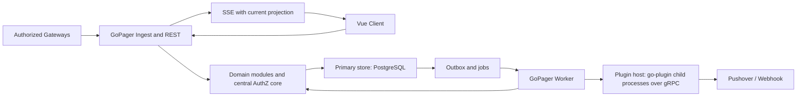
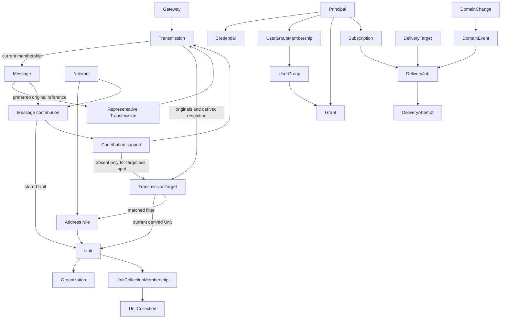

# GoPager Target Architecture and Responsibilities

Date: 2026-10-25. This file owns technology selections/rationale, topology, module/data ownership and dependency rules. Boundary behavior belongs to [owner contracts](domain-contracts.md); decision disposition/approval belongs to the [plan](authoritative-plan.md). Diagrams are relationship maps, never complete schemas. Implemented architecture is described in the permanent [architecture documentation](../docs/architecture.md); this file holds planning rationale and rules, not a second description of the code.

## Technology Decisions

'Selected' means a reasoned planning decision inherited from the original plan, not a successful spike or a fixed package version. Go and the modular monolith were also directly confirmed by the user. Exact foundation versions are now approved in the [AP-05 selection](#ap-05-foundation-version-selection); the plugin protocol is selected under TECH-08. SQLite drivers, UI component library and frontend build tools remain unselected.

| ID | Selection | Rationale / boundary | Evidence/gate owner |
| --- | --- | --- | --- |
| TECH-01 | Go, modular monolith, single backend entry point | One Operator start with all application runtime dependencies supplied; application-managed children are permitted under [D-63](authoritative-plan.md#operator-start-and-bundled-dependency-clarification). Standard library first (`net/http`, `database/sql`, `context`), few justified dependencies, no heavy application framework. Go remains selected independently of OS-process count. No claimed benchmark advantage. | [AP-03 T010/T014](work-packages/ap-03-technical-validation.md) |
| TECH-02 | Shared codebase and backend artifact for Lite and Full | Lite and Full are deployment profiles of one application and one engine (D-135): Lite is the single-host compose profile, Full may distribute roles. Topology is shown below. | [P-20/P-21](authoritative-plan.md#open-issues-and-risks) |
| TECH-03 | Vue 3 + TypeScript, statically built and embedded in the backend | Independent client/server development, deployment without a mandatory separate web server or frontend process. Build tools may be development dependencies. | [AP-15](work-packages/ap-15-frontend.md), [C-07](contracts/c-07-query-live.md) |
| TECH-04 | REST/JSON, versioned OpenAPI contract; SSE for live updates | Explicit query/command API; live communication is primarily server-to-browser. No WebSocket without a bidirectional product need. The implemented schema is [api/openapi/v1.yaml](../api/openapi/v1.yaml). | [P-10/P-15](authoritative-plan.md#open-issues-and-risks), [C-07](contracts/c-07-query-live.md) |
| TECH-05 | PostgreSQL for every profile | Relational transactions on one engine. Superseded in part: the former SQLite half (local file for Lite) was retired by [D-135](decisions/10-foundation-redesign.md#d-135). No mandatory universal ORM or separate domain data models. | [AP-03 T010](work-packages/ap-03-technical-validation.md), [P-01/P-03](authoritative-plan.md#open-issues-and-risks) |
| TECH-06 | PostgreSQL primary as Full write authority | Stateless API/worker roles; established external database HA rather than custom consensus. Authority/replica behavior is specified in C-12. | [P-04/P-20](authoritative-plan.md#open-issues-and-risks), [C-12](contracts/c-12-persistence-operations.md) |
| TECH-07 | Transactional outbox/job tables in the primary database; Watermill SQL for the approved PostgreSQL fact-publication subset | Avoids a mandatory separate broker; integrates with the shared database transaction boundary. [Current transport selection](#proposed-postgresql-integration-slice) is limited to publication, not a second job lifecycle or production consumer. Job/event behavior belongs to [C-08](contracts/c-08-events-jobs.md). | [D-94](authoritative-plan.md#watermill-postgresql-publication-integration-proposal), [P-04/P-11](authoritative-plan.md#open-issues-and-risks) |
| TECH-08 | Plugins are Operator-provisioned executables run as managed child processes through HashiCorp `go-plugin` v1.8.0 over gRPC, one process per configured instance; published protocol [api/plugin/v2/plugin.proto](../api/plugin/v2/plugin.proto) and Go SDK [pluginsdk](../pluginsdk/) ([D-131](authoritative-plan.md#managed-plugin-process-runtime)). Core regex runs in process ([D-129](authoritative-plan.md#in-process-core-regex)). | Selected 2026-11-05 after the [plugin re-evaluation](#native-plugin-alternative-review) under the D-130 trust clarification; replaces the earlier embedded Wazero/WASI selection (D-62/D-67), whose evidence remains historical. Any gRPC-capable language can implement the protocol; only the Go SDK is supplied. Plugin trust/capabilities remain in [C-10](contracts/c-10-plugin-host.md). | [D-130](authoritative-plan.md#plugin-trust-clarification), [D-131](authoritative-plan.md#managed-plugin-process-runtime), [P-05..P-07](authoritative-plan.md#open-issues-and-risks) |
| TECH-09 | Database-integrated search baseline | No search daemon. PostgreSQL `pg_trgm` is a candidate, not an already-correct search implementation (the SQLite FTS5 option was retired by D-135). | [P-15](authoritative-plan.md#open-issues-and-risks), [C-07 search representation](contracts/c-07-query-live.md) |
| TECH-10 | Central AuthZ core in Go | No baseline external policy service; one semantic owner for grants, field projection, and current Delivery authorization. | [P-10](authoritative-plan.md#open-issues-and-risks), [C-06](contracts/c-06-identity-authorization.md) |

A broker, cache, separate search index, or policy service may become a later Full optimization with demonstrated benefit, not a speculative baseline component. SQLite WAL permits only one concurrent writer; short transactions and local storage are prerequisites. No WAL on a shared network filesystem and no multi-host SQLite HA.

### Existing-code Library Reassessment

Under [D-98](authoritative-plan.md#coordinated-existing-code-library-reassessment), three disjoint review sessions assessed 153 handwritten Go files and inventoried 181 generated Ent files separately, plus eight migration SQL artifacts. Coverage, limitations and validation remain at [AP-06](execution/ap-06.md#e-05-consolidated-library-binding). The generated artifacts were not manually audited line by line. Public package documentation was used after package-discovery HTTP 503 responses.

**Central binding, 2026-11-03:** Retain the currently approved libraries and standard-library mechanisms below. No new dependency, upgrade, contract replacement or demonstrated library-replacement requirement emerged from these reports. These are coordinated reuse/exception decisions, not assertions that no alternative library exists.

| Shared capability | Binding and justified application code |
| --- | --- |
| HTTP, strict JSON, CLI/configuration, logging and process lifecycle | Reuse Go `net/http`, `encoding/json`, `flag`, `context`, `log/slog` and synchronization primitives. Bounded closed inputs, proof precedence, CSRF/Origin and startup validation remain narrow integration. No routing/configuration framework is justified by the reviewed surfaces. |
| Authentication, normalization, authorization and field classification | Retain pinned `x/crypto/argon2`, `x/text`, `x/net/idna` and standard crypto. Reuse central AuthZ; scoped action grants and global field permissions remain application semantics, not a second Casbin/OPA evaluator. Preserve persisted transactional login accounting rather than substitute the in-memory token bucket supplied by `x/time/rate`. |
| Predicates, schemas, protocol/domain matching and receipts | Retain restricted CEL-Go and standard JSON/time/collection operations. Closed types, hidden/absent distinctions, target correlation, protocol address distinctions and actor-bound atomic command receipts are application-specific validation/integration; a generic schema or idempotency package does not replace them. |
| Plugin processes and rooted artifacts | Use HashiCorp `go-plugin` for handshake, gRPC transport and process lifecycle (D-131); no Wazero. Core regex runs in process ([D-129](authoritative-plan.md#in-process-core-regex)). Pins, rooted executable verification, current authority, pure preview and resource/result checks remain integration code. |
| Durable Processing work and scheduling | Retain D-75's single candidate lifecycle and bounded dispatcher. River/Watermill alternatives retain their previously documented assessment; cron scheduling does not supply candidate revisions, current-source checks or fencing. No second queue/lifecycle is introduced. |
| Persistence, publication and test fixtures | Retain Ent, Goose, pgx through `database/sql`, D-94's Watermill reference-only transactional publication, Testcontainers and existing Go/Ginkgo/Gomega tooling. Caller-owned transaction adapters and owner migrations remain integration, not custom library replacements. |

Review sessions receive this same binding before implementation. Continue reuse as kernel surfaces are completed; concrete future evidence of unnecessary reinvention must be reported centrally and pass existing approval gates. The review does not permit earlier behavior changes or later AP implementation.

### AP-05 Foundation Version Selection

**TECH-01/05/06; D-35; status: approved 2026-10-26 for AP-05 only.** Exact initial implementation tuple: Go `1.26.2`, `github.com/jackc/pgx/v5 v5.11.0` through its `stdlib` adapter and Go `database/sql`, PostgreSQL `18.0`. The reproducible local test image is `postgres:18.0-alpine` at OCI index digest `sha256:48c8ad3a7284b82be4482a52076d47d879fd6fb084a1cbfccbd551f9331b0e40`; this pins the test fixture, not a requirement that Operators deploy Alpine containers. AP-03 characterized these exact candidates; the user separately approved their production selection under [D-35](authoritative-plan.md#ap-04-foundation-freeze-decision). No claim of latest versions, vulnerability certification or product runtime validation follows.

Use the standard library for startup/configuration, HTTP status handlers, structured logging and test harnesses. The original D-35 selection did not include an application framework, ORM or migration dependency; D-37 subsequently approved Goose as described below. [go.mod](../go.mod)/[go.sum](../go.sum) now own executable dependency pins, including Goose's resolved transitive minimums. New direct dependencies/version changes require their own rationale and affected compatibility checks; no silent switch to another tuple. SQLite driver, plugin runtime/SDK tuple, Unicode/search implementation and frontend tools remained unselected by this foundation approval; the plugin runtime was later selected under TECH-08.

The application consumes store-neutral transaction/repository interfaces under [C-12](contracts/c-12-persistence-operations.md#ap-05-foundation-boundary); pgx/SQL handles, dialects and migration SQL stay in infrastructure. AP-05 owns only platform schema objects. Domain owners later register their own migrations through integration, without copying AP-03 probe tables into production.

### AP-05 Library Assessment

Date: 2026-10-26; architecture/integration review for AP-05 T019..T021 under [D-36](authoritative-plan.md#repository-wide-library-policy-decision). The [repository-wide policy](README.md#library-reuse) applies; D-35's frozen boundaries remain unchanged. Executable dependency versions are owned by [go.mod](../go.mod) and [go.sum](../go.sum); the initial tuple above preserves the original selection history.

| Capability | Library assessment and bounded implementation |
| --- | --- |
| PostgreSQL connection, pooling, transactions, cancellation, TLS parsing | Reuse the approved pgx `stdlib` adapter and Go `database/sql`; do not build a driver, pool, SQL parser or TLS implementation. Repository adapters resolve the opaque transaction capability to the existing library transaction only inside infrastructure. |
| HTTP, process signals, configuration, logging, synchronization | Reuse `net/http`, `os/signal`, `flag`, `log/slog`, `context` and `sync`. This slice needs only explicit startup flags, two boolean health routes and bounded runners; an application/router/configuration framework would contribute little useful functionality. |
| Migration execution | **Goose selected and integrated under D-37.** Reuse its provider, SQL parser, version store and PostgreSQL session locker. The small platform wrapper enforces strict prefix history, read-only checks, unsupported-directive rejection, context bounds and physical-session cleanup; it does not reimplement SQL execution or compare content checksums. [Product evidence](execution/ap-05.md#e-14-goose-foundation-implementation) replaces the initial bespoke-runner proposal. |
| Transaction outcomes and safe errors | Library transactions perform all SQL/commit/rollback work. Small adapters implement C-07/C-12-specific safe machine codes, uncertain-commit classification and opaque participation; no general unit-of-work framework, callback replay or custom context/SQL facade. |
| Tests and clocks | Reuse Go `testing`, `httptest`, `os/exec` and real PostgreSQL; deterministic failpoints decorate library transaction completion only. Synthetic lease cases validate primary time with PostgreSQL `clock_timestamp()`, not a bespoke queue/provider engine. |

Lookup availability and initial research belong to [AP-05 E-02](execution/ap-05.md#e-02-library-review-and-corrections); final foundation checks belong to [E-15](execution/ap-05.md#e-15-final-foundation-validation). The assessment is not a package-maintenance or security certification. Only the approved pgx/Goose direct dependencies enter this product slice.

### Migration Library Alternatives

Review date: 2026-10-26; AP-05 T020/T021, architecture/integration. **Status: comparison retained; central Goose selection subsequently approved under D-37, executable conformance pending.** The user explicitly rejects checksum validation, allows responsible edits to historical migration contents and asks whether modular dependency-aware migrations could also support future plugins. Those instructions invalidate the initial fixed-format assumption, not historical AP-04 evidence.

| Candidate | Verified capability | Fit and remaining cost |
| --- | --- | --- |
| [Grove migrate v1.10.0](https://github.com/xraph/grove/tree/v1.10.0/migrate) | `NewGroup`, `DependsOn` and topological group ordering with cycle/missing-group errors; `(group, version)` identity; Go migration callbacks execute DDL/DML. `TxExecutor` can make a migration plus its applied record transactional. No checksum field in its migration/applied-record types. | A real existing modular candidate, so a dependency graph is not necessarily bespoke. Dependencies are on whole groups, **not particular historical migrations as in Django**. The orchestrator falls back to nontransactional execution if an executor does not support transactions; GoPager would need to reject that fallback. Uses Grove executor/driver interfaces rather than `database/sql` directly; requires adapter/driver assessment. Repository created 2026-02-22, four stars at review, current release 2026-10-25: actively maintained but not established by age/adoption. These indicators are not a quality verdict. |
| [Goose v3.29.0](https://github.com/pressly/goose/tree/v3.29.0) | Embedded filesystem and Go callbacks, SQL parsing, PostgreSQL session locking, per-migration transactions and normal numeric version history; no default content-checksum enforcement. Separate providers/version tables can isolate namespaces. | Established project (repository since 2016). Global ordering or separate namespace runners, **no native Django-style dependency graph**. Module/plugin dependency validation and host lifecycle would remain GoPager integration work. Package metadata shows the library does not import every driver listed in the module's development/CLI manifest; evaluate reachable imports, not that manifest alone. |
| [golang-migrate](https://github.com/golang-migrate/migrate) | Embedded sources/drivers, versioned SQL migrations, PostgreSQL/pgx support and database locking. DDL/DML can be migration SQL. | Established linear version model, no native module/migration DAG found in the reviewed public interface. Source/driver separation does not itself establish module dependency ordering. Transaction boundaries require checking the chosen driver's execution model. |
| [sql-migrate](https://github.com/rubenv/sql-migrate) | Embedded migration sources, `database/sql`, transactional SQL migrations, configurable history table. | Established project (repository since 2014); namespace-specific histories are possible, but the reviewed interface does not supply a Django-like cross-module graph. Adds its gorp dependency. |
| [adlio/schema](https://github.com/adlio/schema) | Embedded SQL and manually supplied migration collections; `database/sql`, PostgreSQL locking, forward-only ID history; runtime package documents standard-library-only imports. | Small embedded alternative, maintained upstream in October 2026. Alphabetical ID ordering, not a dependency graph. Multiple tracking tables do not automatically solve cross-module prerequisites. |
| [Bun migrate](https://bun.uptrace.dev/guide/migrations.html), [Gormigrate](https://github.com/go-gormigrate/gormigrate) | Schema and data changes through SQL/Go migrations; collections/version tracking. | Adoption depends partly on the separate [data-access assessment](#data-access-alternatives); ORM coupling alone is not a rejection. Bun documents that a failed migration can still be marked applied; this is not the current required rollback contract without additional handling. No native Django-equivalent graph established in this review. |
| [Atlas versioned migrations](https://atlasgo.io/versioned/intro) | Mature schema/versioning workflow with generated SQL and migration history. | Its normal versioned workflow includes integrity checks (`atlas.sum`); broader schema tooling is not an obvious match for the requested no-checksum embedded modular runner. Not selected. |

**Django distinction:** [Django dependencies](https://docs.djangoproject.com/en/5.2/topics/migrations/#dependencies) name migrations, allowing `A.0002 -> B.0001 -> A.0003`. Grove's group-level dependency would make mutually dependent groups cyclic instead; it is not equivalent. A locally stored migration collection, a namespace, a module-level prerequisite and a historical migration DAG are four different capabilities.

**Plugin boundary:** At review time the [C-10 lifecycle](contracts/c-10-plugin-host.md#ap-02-installation-manifest-and-invocation) loaded separate Wasm artifacts without rebuilding Core; since D-131 it starts Operator-provisioned plugin executables through `go-plugin` over gRPC (TECH-08), still without rebuilding Core. Go callback registration in Grove/Goose does not execute migrations supplied by runtime-provided plugins automatically. Host-mediated, namespaced SQL migration bundles and their activation/transaction/backend rules need explicit C-10/C-12 design/freeze before implementation. No current candidate review grants plugins direct SQL access or permission to alter Core tables. AP-05 may prepare a replaceable runner boundary; it does not implement the later plugin feature.

**Initial review conclusion, before D-37 approval:** An off-the-shelf grouped dependency runner exists, but a mature drop-in Django-equivalent Go migration framework meeting every current constraint was not established by this review. Neither an absence claim nor an unapproved Goose default was justified. The subsequent organization comparison and explicit approval below resolve central storage/library selection. Actual research/tool evidence is recorded in [AP-05 E-02](execution/ap-05.md#e-02-library-review-and-corrections).

**Superseded proposal:** The temporary independent-namespace proposal followed an earlier user answer, but was never technically approved. The subsequent [D-37 clarification](authoritative-plan.md#ap-05-migration-revision-decision) requires cross-module prerequisites if migrations are split. Independent per-module providers/history tables without ordering between concrete changes therefore no longer meet the requirement.

**Organization comparison and revised recommendation:**

| Organization | Cross-module prerequisites | Cost and conclusion |
| --- | --- | --- |
| Central files, one global version order/history | A single sequence can order `Gateway change -> Message change -> later Gateway change`; all prerequisites must precede their consumers. | Simplest fit for the shared Core release/database. Integration reviews the order; domain owners still author/review their schema changes. No module metadata is needed merely for humans. **Recommended.** |
| Module-local files, one global version order/history | Equally possible if integration merges globally unique IDs into one ordered collection. | File locality does not require separate histories or a graph. It adds collection/ID coordination without autonomous module migration capability. Valid alternative, but no demonstrated benefit over central storage for this slice. |
| Independent module histories with only whole-module dependencies | Can order all Gateway migrations before all Message migrations, but cannot represent alternating historical prerequisites without splitting groups. | Neither uncoordinated Goose providers nor Grove's whole-group DAG meet the general requirement. Not recommended. |
| Module-local histories with migration-specific dependency graph | Naturally represents alternating prerequisites, as Django does. | No mature drop-in candidate satisfying the current transactional, embedding and no-checksum requirements was established by this bounded review. Grove is a real grouped alternative, not an equivalent. Implementing a planner/graph/history integration here is unjustified when central ordering suffices. This is not a claim that no such Go library exists. |

**Library selection, approved under D-37:** Goose v3.29.0 with one central embedded SQL collection and one library-managed history. Its established project history, direct `database/sql` integration, transactional SQL/Go execution and supplied PostgreSQL session locker avoid rebuilding substantial migration functionality. Compared with sql-migrate it avoids adopting gorp solely for migration bookkeeping; golang-migrate remains viable but needs more transaction-policy integration; adlio/schema is a smaller forward-only candidate with less adoption. ORM selection need not dictate the migration runner. These are integration trade-offs, not performance/security claims.

**Approved replacement binding:** The user's explicit selection approves the proposed replacement scope. Current migration behavior is now owned only by [C-12 foundation 1.1](contracts/c-12-persistence-operations.md#ap-05-foundation-migration-addendum), with [F-46a/F-46b addendum](contracts/reference-cases.md#ap-05-migration-case-addendum). Original AP-04 evidence and the active AP-05 baseline remain unchanged.

**Foundation closure:** [Platform composition](../internal/platform/status.go), [PostgreSQL infrastructure](../internal/platform/postgres/) and the [command](../cmd/gopager/) implement the approved foundation only; [AP-05 handover](execution/ap-05.md#handover) names consumers and validation limits. No domain mapper, dynamic query compiler or event transport is custom-built here. The Ent/OPA/Casbin and Watermill recommendations below remain separately gated domain-consumer choices, not missing dependencies required to start this platform. Their isolated tests do not justify importing all candidates or implementing later APs.

### Data Access Alternatives

Date: 2026-10-26; TECH-05, AP-05 T020/T021; architecture/integration. **Status: proposal, not dependency approval.** The user requested comparison of an ORM, explicit SQL and a query builder. "No universal ORM without benefit" is a benefit test, not a prohibition. No domain tables/repositories or later AP implementation are authorized by this assessment.

**Decision criteria:** Preserve the opaque, shared transaction boundary for domain state and outbox; keep infrastructure types out of domain/application contracts; make C-07's authorized projection/filter/grouping/pagination order reviewable; support explicit PostgreSQL locking/CAS and later dialect-specific SQLite implementations. Libraries can reduce mapping/query boilerplate but do not establish authorization correctness, isolation invariants, Unicode search parity or migration ordering by themselves.

| Approach / candidate | Verified strengths | GoPager trade-offs |
| --- | --- | --- |
| `database/sql` + parameterized handwritten SQL | Already approved with pgx; direct control of CTEs, locks, conditional updates and transaction/error handling; standard-library runtime. | Manual result scanning and SQL/Go type correspondence, checked primarily by tests. Appropriate for AP-05's small infrastructure-query subset, not a reason to build a custom mapper or dynamic SQL framework for later domains. |
| [sqlc v1.31.1](https://docs.sqlc.dev/en/v1.31.1/) | Generates typed Go query methods from SQL; supports `database/sql` and pgx, plus binding queries to an existing transaction. Generator/tool dependencies need not enter the generated application's runtime. | SQL remains reviewable and backend-specific. PostgreSQL Go support is stable; SQLite Go support is explicitly **beta**, not proven parity. Schema/query generation and reproducibility become build responsibilities. Runtime structural query composition is not its main model; many optional filters can require fixed variants or a separate builder. Use local generation, not cloud upload of project SQL. |
| [Bun v1.3.0](https://bun.uptrace.dev/guide/) | Maintained SQL-first ORM/query builder over `database/sql`; model mapping, composable queries and PostgreSQL/SQLite dialects. `bun.Tx` wraps `sql.Tx`; compatible with explicit shared transactions. | Strongest combined alternative for CRUD and dynamic query construction without a separate generator. Adds runtime mapping/reflection, model tags and DSL semantics; adapter-local models must not become a second domain truth. Raw SQL remains available for special cases. Would require deliberate replacement/integration of current transaction executors, not a parallel pool or second commit boundary. |
| [GORM v1.31.2](https://gorm.io/docs/) | Established maintained ORM; associations, hooks, CRUD, raw SQL and explicit transactions; supports PostgreSQL and SQLite. | Useful for entity-centric CRUD, but much of GoPager's complex authorization/read projection remains explicit query work. Default write transactions, nested transactions, hooks and association behavior must be constrained to preserve C-12. These features are controllable, not proof of incompatibility. `AutoMigrate` alone is not a versioned schema-and-data migration history. |
| [Ent v0.14.6](https://entgo.io/docs/getting-started/) | Maintained schema-as-Go entity framework with generated typed predicates, relation traversal and query/mutation privacy filters; PostgreSQL/SQLite support. Atlas integration can generate editable versioned SQL before release, including Goose format. | First-class ORM/authorization-integration candidate, not excluded by the migration discipline. Requires generated-code ownership, controlled field projection and shared-transaction integration. See the [renewed assessment](#ent-reassessment) for its benefits and remaining proof obligations. |
| [Jet v2.16.1](https://github.com/go-jet/jet) | Maintained typed SQL builder with schema-based code generation and result mapping; PostgreSQL/SQLite support, CTEs/windows and runtime query composition. | Strong alternative when typed dynamic SQL is the priority. Requires schema introspection/generation per dialect and a runtime DSL/mapper; PostgreSQL package imports `lib/pq` helpers even when execution uses pgx. Not intrinsically a second database connection/driver requirement. No measured footprint claim. |
| [Squirrel v1.5.4](https://github.com/Masterminds/squirrel), [goqu v9.19.0](https://doug-martin.github.io/goqu/) | Composable SQL with parameters; Squirrel supports placeholder conversion, goqu dialects and mapping. | Lighter alternatives to an ORM, but SQL strings/identifiers/results are not fully schema-type-checked. Squirrel explicitly declares maintenance mode and slow fixes; goqu's latest release is November 2023 and latest repository push May 2024 at review. Not automatic disqualifications, but weaker maintenance evidence than Bun/Jet for a new baseline. With goqu, explicitly request prepared/parameterized SQL rather than default value interpolation. |

**Recommendation:** Keep SQL-first, not an entity-centric universal ORM. Retain the already-approved `database/sql`/pgx foundation and its small parameterized infrastructure statements in AP-05; a generator/ORM would contribute too little here to justify changing the whole executor for this slice. For larger fixed domain query sets, prefer evaluating/pinning sqlc rather than handwritten mapping boilerplate. For genuine dynamic query construction, assess a maintained builder against the actual consumer query before adding it; do not build an in-house general query builder. Bun is the preferred alternative if the owner wants one combined query-builder/mapper now; Jet is the typed-builder alternative, with generation cost. This recommendation does not adopt two frameworks in advance or claim SQLc can replace a dynamic query builder.

Migration organization is independent of this choice: even with Bun/GORM/Ent, use the explicitly controlled schema/data history rather than automatic schema synchronization at startup. Selection disposition belongs to [the data-access decision](authoritative-plan.md#ap-05-data-access-decision); lookup and maintenance observations belong to [AP-05 E-03](execution/ap-05.md#e-03-cross-module-migrations-and-data-access-review).

### ORM and Authorization Integration

Date: 2026-10-26; follow-up to D-38. **Status: investigated, no production stack selected.** The user initially requested cooperating libraries for ORM and RBAC, then explicitly broadened the comparison to authorization models generally. Neither RBAC nor a particular engine is selected. The preceding SQL-first recommendation is preliminary, not a decision to implement authorization manually.

**Required distinction:** [C-06](contracts/c-06-identity-authorization.md) includes additive direct/group grants, context-specific Network/Unit/collection scopes, field rights, age limits, key restrictions and current revocation revisions. This is richer than checking a role name. [C-07](contracts/c-07-query-live.md) requires permission predicates before aggregation/counting/pagination and protects fields from influencing filters/times. Policy persistence, point authorization and authorized SQL construction are separate functions; an "ORM adapter" often implements only the first. A central semantic owner remains necessary even when all common machinery is library-backed.

| Combination | Reusable machinery established by sources | Remaining integration / limitations |
| --- | --- | --- |
| [GORM](https://gorm.io/docs/) + [Casbin v3.11.0](https://github.com/casbin/casbin/tree/v3.11.0) + [gorm-adapter v3.41.0](https://github.com/casbin/gorm-adapter/tree/v3.41.0) | ORM/mapping/query scopes, embedded RBAC/domain-role and ABAC policy engine, database policy persistence, transactional-policy APIs, and `GetAllowedObjectConditions` plus `ConditionsToGormQuery` for SQL-side conditions. Existing GORM DB can be supplied; automatic schema creation can be disabled. Strongest directly documented combined integration in this review. | The condition helper extracts implicit policies in a specific `(subject, object-condition, action)` shape and passes resulting strings to GORM `Where`/`Or`. It is **not** a general compiler for arbitrary Casbin matchers, key intersection, field masking or temporal correlated projections. Treat empty conditions as denial and never accept operator/user-supplied SQL expressions as structured grants. Map validated product scopes to controlled predicates. Default adapter imports PostgreSQL, MySQL, SQL Server and SQLite drivers; this is an actual package dependency, not just a CLI manifest. Its transactional API begins its own transaction; sharing the existing domain/outbox commit and publishing in-memory policy changes only after commit must be demonstrated, not assumed. |
| [Ent v0.14.6](https://entgo.io/docs/privacy/) privacy/filter rules, optionally Casbin for role/policy evaluation | Generated typed ORM plus policies evaluated on Ent queries/mutations; filter rules inject predicates into query construction. Reusable mixins can apply filters across schemas. This is stronger integration than a separate HTTP middleware role check. Casbin can be invoked inside policy rules rather than replacing query filtering. | Product policies/predicates and allowed field projection still need definition. Privacy is not a ready-made grant-management/RBAC product and raw SQL outside Ent does not automatically acquire Ent policies. Ensure deny-by-default and controlled bypasses. [ent-adapter v1.4.0](https://github.com/casbin/ent-adapter/tree/v1.4.0) stores Casbin policies using its own generated Ent client; it does not automatically protect application entities. Both inspected constructors call `Schema.Create`, with no demonstrated disable switch; that default is incompatible with the approved check-only startup/migration discipline. Do not silently fork it or add a second policy truth. |
| Bun + Casbin + [msales/casbin-bun-adapter v1.0.7](https://github.com/msales/casbin-bun-adapter/tree/v1.0.7) | SQL-first mapping/query builder and a real existing policy-storage adapter; no need to pretend the combination does not exist. | Inspected adapter uses Casbin **v2**, whereas the inspected current GORM/Ent adapters use **v3**. It documents filtered **policy loading**, not permission filtering of business rows. Limited adoption/compatibility evidence; product query-scope integration remains. Less ready-made end-to-end integration than GORM/Casbin or Ent privacy. |
| sqlc/explicit SQL + Casbin | Typed/static SQL or standard queries plus an embedded policy engine; ORM is not necessary for RBAC evaluation. | No inspected general automatic translation into C-07 queries. Could reuse policy evaluation but still requires controlled read-scope integration. No longer the sole recommendation without considering the stronger integrated alternatives above. |
| Oso legacy library, remote authorization services | Other ecosystems can offer authorization-aware query filtering. | The inspected `osohq/oso` repository identifies itself as archived legacy open source. A remote authorization service still requires a supported bundled lifecycle or explicit external-infrastructure selection and shared authorization/commit integration; it is not a drop-in replacement. D-63 removes exact OS-process count as an exclusion reason, not maintenance/consistency obligations. Existing AP-05 selection/evidence remains. |

The extended `gorm-adapter-ex` v3.10.1 was also checked: it offers more policy-table customization, not elimination of extra drivers or automatic business-data authorization, and its imports still use Casbin v2. It does not resolve the main integration questions.

**Initial combined shortlist, qualified by the broader model review below:** GORM + Casbin is a directly documented ORM/policy integration; Ent privacy is the typed query-filtering alternative. This is not an RBAC decision. Before selecting a stack, validate policy/read filtering, count/page safety, field/age/key context, revocation and shared transaction rollback. Also measure reachable dependencies instead of claiming a byte-size benefit from import counts. Common policy evaluation, query/filter hooks and persistence should be reused; actual product scope semantics still require configuration/integration.

This proposal does not move Identity domain implementation into AP-05 or freeze C-06. Investigation provenance and limitations: [AP-05 E-04](execution/ap-05.md#e-04-orm-and-authorization-integration-review).

### Authorization Model Comparison

Date: 2026-10-26; D-38 follow-up, architecture/integration with the Identity domain as semantic owner. **Status: assessment/proposal, not a new contract freeze.** The user explicitly requests comparison without assuming RBAC. These are technical model labels, not replacements for glossary domain terms or a request to change existing grant semantics.

Models are not necessarily mutually exclusive, and model, engine, ORM and enforcement location are separate choices. In particular, a policy engine can support ACL, roles, attributes and relationships together; an ORM does not determine which of those models the product uses.

| Model | Meaning / strengths | Fit against existing C-06/C-07 |
| --- | --- | --- |
| ACL: access-control lists / direct grants | Records which subject may perform which action on an object or defined scope. Direct and group grants are straightforward to administer and explain. | Good base for explicit Principal/group grants. Do not enumerate a permission per Message when Network/Unit scopes already describe it. Plain object lists alone do not capture age limits, context-sensitive fields or restricting keys. |
| RBAC: role-based access control | Assigns permission bundles through roles; can include scoped roles and hierarchies, not only global `admin`/`user`. | Helpful for optional reusable permission bundles, but roles must not replace direct/group grants or introduce an implicit administrator bypass. Encoding every Network/Unit/field/age combination as a new role risks role proliferation. Not sufficient as the sole mechanism and not a user requirement. |
| ABAC: attribute-based access control | Evaluates subject, resource, action and context attributes against policies; see [NIST SP 800-162](https://csrc.nist.gov/pubs/sp/800/162/upd2/final). Can include groups/roles as attributes. | Strong fit for action/scope matching, permitted fields, current age anchors and restricting key context. Requires authoritative attributes and consistent row/field query enforcement. Arbitrary user-authored policy code is not required: the product may expose validated structured grants and use trusted policy templates internally. |
| ReBAC: relationship-based access control | Derives access through relations such as membership or resource containment; often implemented using object-relation-subject tuples. See [OpenFGA concepts](https://openfga.dev/docs/authorization-concepts). | Natural for Principal-to-group and Unit-to-collection membership. Does not authorize through Organization containment or historical/stale relations unless C-06 permits it. Current flat relations need not become a general graph service. Fields, time and key constraints still require additional conditions. |
| PBAC: policy-based access control | Separates maintained policies from enforcement code; often the implementation organization for ABAC/RBAC/ReBAC, not a competing answer to all of them. | Useful for a single semantic source reused by point checks and query filters. Does not by itself define grant union, key intersection or whether row filtering is correct. Policy distribution/caching must honor current revocation revisions. |
| DAC / MAC | Discretionary access control lets owners delegate within a defined authority; mandatory access control enforces centrally governed labels/clearances. | No general owner-can-share or security-classification hierarchy is currently specified. C-06 instead bounds delegation by existing delegable rights. Neither is a justified primary model without new product requirements. |

**Best-fit description, not a semantic change:** Existing requirements already combine explicit additive grants (ACL-like), subject/field/time/key attributes (ABAC), and group/collection relations (limited ReBAC). Optional roles could bundle rights but are not the foundation. Preserve this hybrid rather than forcing the product into one acronym. In particular, keep matching-grant union separate from restricting-key intersection; combine neither fields nor Network/Unit evidence across unrelated contributions. Do not import ordered deny policies, inherited superuser access or graph containment just because an engine supports them.

#### Engine Shortlist Beyond RBAC

| Engine / approach | Established reuse potential | Limitation / next check |
| --- | --- | --- |
| [Casbin v3.11.0](https://github.com/casbin/casbin/tree/v3.11.0) + ORM/query scopes | Its documented PERM model supports ACL, scoped RBAC, ABAC and combinations; the earlier GORM integration is therefore **not restricted to RBAC**. Strong embedded-Go integration and existing policy persistence. | The inspected object-condition extraction is not a compiler for arbitrary hybrid matchers. Need to prove identical point-check and SQL-filter behavior without inventing a second policy implementation; control in-memory policy publication/revocation at the shared commit boundary. |
| [OPA v1.21.4](https://github.com/open-policy-agent/opa/tree/v1.21.4) + an existing SQL builder/ORM | Rego can express multiple models. **Embedded Go evaluation is supported**, so no sidecar/service is inherently required. The public `v1/rego/compile` API compiles supported policy fragments to SQL WHERE filters or UCAST; this is real library functionality, not merely proposed custom translation. [SQL tutorial](https://www.openpolicyagent.org/docs/filtering/tutorial-sql-filtering), [filter fragment](https://www.openpolicyagent.org/docs/filtering/fragment). | Serious candidate for avoiding a custom policy-to-SQL compiler. Only supported residual expressions can be translated, not all Rego. Mapping authorized contribution rows and preserving correlated scope/age/field behavior must be demonstrated. Column masking alone does not prevent unreadable fields influencing filters/aggregates. Verify parameter/literal handling, unconditional allow/deny/error distinction, policy freshness and reachable runtime footprint. Do not rule it out as "too heavy" without measurements. |
| [cedar-go v1.8.0](https://github.com/cedar-policy/cedar-go/tree/v1.8.0) + ORM/query scopes | Embedded Go authorization for principals/actions/resources/context, entity attributes and group relationships. Useful fine-grained policy language, not an RBAC-only tool. Active upstream; no mandatory remote service. | The inspected Go version documents missing stable partial evaluation and policy templates, with schema validation/batch APIs experimental. Do not assume every Rust Cedar capability exists in Go. No inspected production-ready automatic ORM/SQL filtering path; less direct fit for avoiding custom authorized-query construction. |
| Ent privacy with an engine where needed | Reusable query/mutation enforcement and typed filters independent of a mandatory RBAC choice. | Enforcement framework rather than a complete access-control model/engine. Must avoid unprotected raw queries and keep a single definition of product policies. |
| OpenFGA / Zanzibar-style relation service | Rich relation checks, conditional relations and object-list APIs; real alternative when relationship traversal dominates. | Official standard integration deploys a server and client SDK. A supplied application-managed server is not ruled out by process count under D-63, but no supported bundled lifecycle or shared SQL/permission-tuple consistency design was established by this assessment. Given the current flat relations, no clear justification for that operational/model expansion. Do not describe its list API as automatically preserving C-07 pagination/count semantics. The verified Ent selection is not reversed by the topology correction. |

**Recommended next validation:** Compare Casbin's hybrid model with embedded OPA's policy-to-SQL path on the same synthetic grants, not "RBAC versus SQL". Pair with the smallest appropriate existing ORM/query integration; test denial and field visibility before counts/pages, two unrelated contributions that must not combine rights, matching ages/Unit relations, owner/key intersection, and revocation/rollback. Measure the actual reachable dependency/build cost and the amount of custom integration required. No benchmark, compatibility pass or final engine/ORM choice is inferred from documentation. Evidence owner: [AP-05 E-05](execution/ap-05.md#e-05-authorization-model-review).

#### Synthetic Comparison Outcome

Date: 2026-10-26, approved experiment only under D-38; reproducible procedures/results: [AP-05 E-06](execution/ap-05.md#e-06-synthetic-authorization-comparison). This qualifies the preceding documentation-only shortlist.

- Casbin successfully evaluates a hybrid of direct grants, group membership, scoped attributes, age, field and key conditions in memory. It is not restricted to RBAC.
- The supplied GORM object-condition helper works for the tested simple comparison. It does not translate the tested equality/conjunction policy expressions into PostgreSQL syntax; direct use fails with SQLSTATE `42883`. This is a limitation of this integration path, not proof that Casbin cannot implement the model. Building a second general policy-to-SQL translator to compensate would undermine the reuse goal.
- Embedded OPA's public compiler produced executable PostgreSQL filters without an application-written SQL translator. Synthetic point checks and SQL results agreed; tests covered filtering before count/page/search, distinct contribution contexts, denying unknown fields/empty grants, exact age boundary, key restrictions, quoted attribute values, and matching-grant age union independent of field rights.
- Explicit primary-revision input rejected stale authorization context after a real transaction commit; revision and synthetic state changes rolled back together on failure. This does **not** prove policy-cache invalidation, a complete atomic authorization/output protocol, dynamic group/collection lifecycle, or full C-06/C-07 conformance. The experiment supplies already-derived contribution anchors and trusted membership inputs, not the domain derivation algorithm.
- Representative CGO-disabled stripped darwin/arm64 probes using the same pgx/GORM base measured 30,766,498 bytes / 435 reachable packages for OPA and 18,382,322 bytes / 337 packages for Casbin plus the supplied GORM adapter. Package totals include standard library. These are executed small-probe measurements, not production binary size, runtime memory, query throughput or Lite hardware certification; they do not isolate every dependency's incremental contribution.

**Experiment-based recommendation, qualified by the Ent reassessment below:** Among the exercised combinations, embedded OPA can serve point checks and SQL filters with existing library machinery, and GORM is the empirically exercised ORM partner. The experiment did not compare Ent and cannot establish superiority over it. OPA's extra footprint is a real trade-off against the translation code it avoids. Do not install an unused engine or implement domain authorization in AP-05 solely to make a recommendation appear implemented. A selection must specify when the consumer justifies dependencies and preserve the existing store-neutral/transaction boundary and migration discipline.

### Ent Reassessment

Date: 2026-10-26; D-38, AP-05 T020/T021. **Status: renewed source assessment, no production selection or Ent experiment approval.** The user's release-artifact clarification removes any objection based merely on migration generation. The earlier SQL-first and OPA/GORM recommendations are not final rankings against an untested Ent alternative.

**Migration compatibility:** Ent's [versioned migration documentation](https://entgo.io/docs/versioned-migrations/) explicitly supports generating SQL files and editing them before application. The [pinned Atlas formatter](https://github.com/ariga/atlas/blob/2c6300d0a3e1/sql/sqltool/tool.go) exposes `GooseFormatter` and a Goose directory adapter; this is an existing integration, not a proposed custom converter. Ent v0.14.6 pins that Atlas revision in its [module manifest](https://github.com/ent/ent/blob/v0.14.6/go.mod). Therefore development-time Ent/Atlas generation and the approved central Goose deployment runner can coexist. Generated DDL still needs review, and data transformations/backfills must be authored explicitly where a schema diff cannot infer business intent. Only approved, embedded release SQL is executed at deployment; neither Ent `Schema.Create` nor runtime Atlas diff/apply is the product migration path.

Atlas documents an `atlas.sum` directory-integrity mechanism. That is distinct from the deployed Goose history, but must not silently introduce a new checksum gate. No Atlas apply runner, hash comparison against deployed contents, or immutable-history requirement is selected. Any future generator workflow must allow the approved historical corrections and keep generator bookkeeping out of deployment compatibility decisions. Generated timestamps/names also need review for unique central versions; running generation on each deployment is not deterministic release delivery.

| Surface | Ent machinery / benefit | Remaining GoPager obligation |
| --- | --- | --- |
| Query and mutation authorization | `privacy` and `entql` code-generation features provide policy/filter hooks and typed predicates. Upstream tenant examples exercise filtered reads, count, selection and updates/deletes. This can reuse ORM query construction rather than translating arbitrary policy expressions into SQL. | Define the C-06 hybrid grant semantics using these hooks, not RBAC by assumption. Demonstrate correlated contribution scopes, independent age/field union, key intersection, count/page/group/search ordering and current revisions against the same fixtures as OPA. Upstream tenancy examples are not product conformance. |
| Default denial and bypasses | Policies have explicit Allow/Deny/Skip decisions; a filter can constrain SQL before execution. | Pinned `privacy.go` returns success after all rules return nil/Skip; an early Allow or `DecisionContext(..., Allow)` can bypass later filters. Require a deliberate fail-closed policy arrangement: missing/invalid context denies; a successful validated path installs its mandatory filters before permitting execution. Do not append unconditional denial after a successful filter and accidentally deny every request. Restrict bypass contexts to narrowly reviewed internal paths. |
| Fields and mutations | Typed selection, predicates and mutation hooks are reusable mechanisms. | Row visibility does not automatically provide per-request field masking or prevent an unreadable field from influencing search/group/order. Creation and changes to scope-bearing attributes require validation of proposed values/relations, not only a filter on existing rows. No automatic implementation of these semantics is claimed. |
| Complex reads | Ent supports GroupBy/Aggregate, custom SQL selectors/modifiers and relation traversal. It is not limited to entity CRUD. | Verify authorization remains effective for every selected read shape and relation traversal. Raw database calls and independent custom subqueries do not automatically inherit Ent privacy. Keep escape hatches behind controlled persistence adapters rather than treating every SQL path as policy protected. |
| Pool and transaction reuse | `entsql.OpenDB(dialect.Postgres, db)` wraps an existing pgx-backed `*sql.DB`; Ent supports explicit transactions and a transaction-scoped client. A second pool is not required. | `client.BeginTx` starts a new transaction, not automatic adoption of an existing platform transaction. Demonstrate one owner/one commit for platform state, Ent writes and outbox, plus cancellation/rollback and capability lifetime. Keep generated Ent types inside persistence, outside store-neutral contracts. |
| Framework/engine footprint | Ent can construct trusted product predicates directly; a separate generic policy engine is not mandatory just because the product combines ACL/ABAC/relations. | Product-specific predicates still need integration and tests. Compare runtime-reachable code separately from code-generation/Atlas dependencies; no Ent binary-size, performance or SQLite parity measurement exists yet. Ent plus OPA is possible but not the default: two semantic implementations would need justification. |

**Revised shortlist and recommendation:** Compare **Ent with native Privacy/Filter predicates** against **GORM with embedded OPA**, rather than selecting GORM because only it was exercised. Ent is preferable if its existing hooks and typed predicates cover the required surfaces with a small, shared product-specific integration and one transaction boundary; OPA is preferable if reusable single-policy point/query compilation materially avoids duplicate semantic logic. Neither approach eliminates C-06/C-07 integration. The Casbin Ent adapter's automatic schema creation is a limitation of that adapter, not of Ent, and is not a reason to reject native Ent privacy. Do not add that adapter or Casbin without a demonstrated need.

Before choosing, extend the isolated synthetic comparison with pinned Ent code generation, the same authorization fixtures, filtered aggregate/mutation checks and shared-transaction rollback, plus a development-only generated-and-manually-edited Goose migration replay. Exact experiment-version approval remains at [D-38](authoritative-plan.md#ap-05-data-access-decision); this assessment does not authorize domain implementation. Research evidence: [AP-05 E-07](execution/ap-05.md#e-07-ent-and-release-migration-reassessment).

### Library Function and Combination Matrix

Date: 2026-10-26; user-requested systematic comparison under D-38, AP-05 T020/T021. **Status: screening and experiment plan, not selection.** Detailed feature evidence remains in the assessments above. Coverage describes available machinery, not automatic compliance with GoPager contracts. The execution record owns actual test outcomes; an untested option is not a failed option.

| Library | Authorization / policy / enforcement | Migrations | ORM / query builder / DB adapter | Important boundary |
| --- | --- | --- | --- | --- |
| Ent | Generated query/mutation Privacy rules and EntQL predicates | Editable versioned SQL generation through Atlas; runtime schema synchronization also exists but is not permitted here | Generated typed entities, relations, predicates, aggregate/custom query support | Product grants and protected field handling still need integration; native filters are not a general policy language. |
| OPA | Embedded policy evaluation and public SQL-filter compiler for a supported Rego fragment | None | Emits SQL predicates, not an ORM/driver | Same trusted policy can support point checks and filters; compilation errors/unsupported constructs must fail closed. |
| Casbin | Embedded hybrid policy evaluation, roles/groups, policy adapters and condition extraction helpers | Adapters may create policy tables; not the controlled product migration path | ORM-specific policy-storage adapters; not a business-data ORM | A policy-storage adapter does not automatically filter business queries. No general matcher-to-SQL compiler established by this review. |
| GORM | Hooks/scopes for integrating enforcement, not a general policy engine | AutoMigrate exists; not the required release migration history | ORM, mapping, associations, dynamic/raw queries | Disable automatic schema sync and constrain implicit transactions; supplied Casbin condition helper has measured limits. |
| Bun | Query hooks/scopes for integrating enforcement | Native migration package exists, with reviewed failure-history caveat | SQL-first ORM, query builder, mapping, explicit transactions | Can use Goose instead of its native runner; policy integration still required. |
| sqlc | Authorization can be expressed in authored SQL, not generated from policies | Consumes schema/migration SQL for generation, not a deployment runner | Generated typed fixed SQL methods | Strong static-query candidate; arbitrary runtime filter composition requires a separate path or finite query variants. |
| Jet | Typed SQL predicates can carry authorization, not a policy engine | Schema introspection/code generation, not migration history | Generated typed SQL builder and mapper | Attractive for structural SQL composition; policy-to-predicate integration still required. |
| `database/sql` + pgx | Explicit enforcement integration only | Can execute SQL but should not become a custom migration framework | Approved pool, driver, transaction primitives and small infrastructure queries | Useful common baseline; not an excuse to implement a custom ORM/filter compiler. |
| Goose | None | Approved embedded, central, transactional schema/data migration runner without content checksums | Uses `database/sql`, not an ORM | Compatible with handwritten or pre-generated SQL; no runtime schema-diff planning. |
| Atlas | None | Development-time diff/generation, formatter integrations, separate apply runner | Schema inspection, not business-data access | Generator candidate only here; its apply/checksum workflow is not the approved deployment path. |
| Cedar-Go / OpenFGA | Alternative policy/relationship engines | None | No inspected drop-in local business-query mapper | Stable partial-evaluation gap / service boundary respectively; not primary experiments under the current in-process constraints. |

**Screening criteria:** First enforce the release-migration/no-checksum boundary, pre-count/page/group authorization, protected-field behavior, one transaction/rollback boundary and explicit failures. Then compare integration code/semantic duplication, maintenance and reachable dependency/build cost. Binary size alone is not a winner criterion. PostgreSQL evidence does not establish later SQLite parity or complete revocation/output conformance.

All shortlisted access stacks use the same approved Goose deployment runner; Ent may additionally use Atlas strictly for pre-release generation. Repeating the identical Goose tests for every ORM is not independent evidence. Exercise the shared runner once and the ORM-specific transaction/schema integration separately.

| Combination | What speaks for it | What speaks against it / test question | Test disposition |
| --- | --- | --- | --- |
| Ent native Privacy/Filter + Goose (+ development Atlas) | Typed query/mutation enforcement and ORM in one framework; no separate general policy engine required | Product predicate integration; field masking and mutation/traversal escape paths; generated-code/transaction ownership | Primary approved experiment; compare common cases and generated/edited release SQL. |
| Casbin + Ent + Goose | Reuse Casbin subject/group/action decisions and Ent's SQL filtering; optional richer point-policy engine | Need an explicit boundary between Casbin policies and structured SQL scopes; arbitrary matcher translation is not provided | Explicitly user-requested and approved. Test structured-grant composition and point-via-filter agreement; do not disguise two implementations as one compiler. |
| OPA + Ent + Goose | OPA supplies point/filter semantics; Ent supplies mapping/CRUD | SQL filter integration may bypass typed predicates or require custom selectors; native Ent privacy might already suffice | Candidate within the approved tuple. Test if integration buys meaningful reuse rather than stacking unused mechanisms. |
| OPA + GORM + Goose | Already exercised point/filter compilation with dynamic ORM SQL and rollback | OPA footprint; typed schema guarantees weaker than Ent; every protected path must apply the filter | Retain as tested comparator; shared migration conformance still pending. |
| Casbin + GORM + Goose | Mature point engine and actual policy-storage adapter | Supplied condition helper failed tested hybrid SQL syntax; a new general translator is not justified | Preserve negative integration evidence; only controlled structured-scope composition could restore candidacy. |
| OPA + Bun + Goose | SQL-first mapping/dynamic queries and compiled policy filters, no adapter driver bundle needed | New ORM integration/transaction tests; no automatic authorization advantage merely from changing ORM | Strong additional comparator; exact Bun/PostgreSQL-dialect version approval needed before execution. |
| OPA + Jet + Goose | Typed structural SQL and result mapping | Generated schema workflow plus a raw compiled filter can erode typing; extra integration compared with Ent/Bun | Reserve for a demonstrated typed-query need; version approval required for executable comparison. |
| sqlc + controlled policy predicates + Goose | Typed fixed queries, minimal generated runtime and explicit SQL | Dynamic C-07 scope/filter shapes may force variants or another builder; policy/query agreement not automatic | Static-query comparator, not dismissed. A concrete fixed query set and generator approval are needed for a fair test. |
| OPA + approved pgx/`database/sql` + Goose | Baseline for isolating the value of ORM/mapping against engine/driver cost | Manual scanning and structural query composition; should remain small rather than grow into a framework | Use the shared synthetic filter SQL as baseline, not a proposed custom general persistence layer. |

**Comparison procedure:** Run identical fixture expectations for point/read agreement, scope correlation, age/field union, key intersection, quoted attributes, unknown/missing context, revision input and filtering before count/page/search. Extend ORM-specific tests with grouped counts, constrained update/delete and rollback of data plus a raw infrastructure/revision write in the same transaction. Check generated-but-manually-edited DDL/DML through Goose separately. Measure comparable reachable runtime/build footprint only after correctness; keep generator dependencies separate. Record expected limitations, failed attempts and unsupported paths explicitly. Additional tests or source-only screening cannot silently select the final production stack; the user decides after the evidence matrix.

#### Combination Test Results

First comparative batch, 2026-10-26; exact executed commands and limitations: [AP-05 E-08](execution/ap-05.md#e-08-library-combination-tests). A pass means the stated synthetic integration works, not that the library supplies product semantics without integration.

| Combination | Observed result | Integration cost / outstanding issue |
| --- | --- | --- |
| Ent Privacy + Goose / development Atlas | Native filtered reads, point-via-filter, count/page/group, field-specific search scope, key/age restrictions, independent field/age union and quoted attributes passed. Guarded updates/deletes and an outer SQL transaction shared with Ent passed. Generated/edited Goose DDL+DML applied; changed historical contents did not rerun; failed DDL+DML/history rolled back. | Product-specific trusted-grant-to-EntQL composition was authored; no custom SQL compiler. Raw entity reads do not automatically mask fields, and a metadata-context builder can still search a hidden payload unless the application validates search fields. Explicit Allow context bypasses policies. Not a complete product access layer. |
| Casbin + Ent + Goose | Same tested read cases, age/field union, quoted attributes and constrained updates/deletes passed. | Tested design uses Casbin for subject/group/action-to-grant-ID decisions and Ent for structured scope predicates. It does **not** translate arbitrary Casbin matchers or establish one generic policy-to-query source. All business scope/field/age logic still uses the same Ent integration as the native path; the additional engine's benefit must justify that overlap. No policy-storage adapter/automatic schema creation was added. |
| OPA + Ent + Goose | Same read/point-via-filter/count/page/group/key/age/quoted-attribute cases passed after using OPA's supplied table mappings. | Custom selector consumes compiled SQL. Harness deliberately bypasses native Privacy on this compiler-controlled read path to avoid two independent policy definitions; production needs a tightly enclosed adapter. No OPA-specific mutation-policy test in this batch. |
| OPA + GORM + Goose | Earlier point-versus-filter, count/page/protected search, key/age/quoted-attribute and revision/data rollback checks remain passed. Common Goose runner tested in the Ent-generated migration case. | Not identical mutation/grouping coverage to Ent yet; do not claim equal comprehensive coverage or compare old footprint numbers as if dependencies had not changed. Field projection and safe query construction remain application obligations. |
| Casbin + GORM + Goose | Point checks and simple condition helper passed; hybrid/equality SQL syntax rejected as expected. | Not an equivalent general policy/filter integration without extra composition. The failure is specific to the supplied helper and tested policy shape, not all Casbin configurations. |
| OPA + Bun / Jet / sqlc | Source-screened only, no executed result. | Bun is the strongest untested dynamic-query comparator; exact additional-version approval pending. Jet/sqlc remain conditional alternatives, not failed candidates. |

**Generator caveat:** The executed Goose deployment accepts edited applied files without checksums. The inspected Ent/Atlas `NamedDiff` development path itself calls `migrate.Validate`, and Atlas writes `atlas.sum`; after manual edits a later generator invocation needs synchronized generator bookkeeping. The experiment did not test a repeated edited-directory diff. Do not claim an entirely checksum-free Ent/Atlas authoring workflow, disable validation through a custom hack, or silently introduce that workflow as approved. This is a genuine remaining selection constraint if the no-checksum requirement extends to development tooling as well as deployments.

**Provisional shortlist after this batch:** Ent native Privacy is now a demonstrated alternative, not a secondary untested option. OPA with Ent/GORM remains attractive when a common point/query policy materially reduces semantic duplication. Casbin + Ent works for structured grant activation, but the tested form does not remove Ent scope integration. No winner is declared before completing the remaining useful comparison and resolving authoring-workflow constraints.

### Domain Data Access Selection

Date: 2026-10-26; TECH-05/TECH-06, approved [D-38 follow-up](authoritative-plan.md#ap-05-data-access-decision) during AP-04 preparation for AP-06 and its prerequisites. **Selected:** Ent v0.14.6 with the same-version generator and native Privacy/Filter hooks. Preserve the approved pgx/`database/sql` pool, opaque platform transaction capability and central Goose deployment runner. The earlier comparison/recommendations above remain provenance, not competing current selections.

Use Ent's existing typed queries and mandatory Privacy/Filter integration for domain repositories. Reuse one trusted structured-grant composition for point-via-filter and collection authorization; do not introduce a second arbitrary-policy translator or a second engine solely because it was compared. Generated clients/entities remain persistence-internal, never application/domain interface types or unprojected public responses. Missing/invalid authority denies access. Reads, counts, pages, aggregates, relations and mutations must use current context; field projection and validation of searchable/sortable fields are explicit obligations, not guarantees supplied by raw Ent entity reads. No general `privacy.Allow` bypass may be exposed to callers.

Adopt the caller's existing transaction only inside infrastructure and verify lifetime, cancellation, rollback and atomic outbox participation. Do not change the platform's public transaction surface, open an independent pool or let Ent commit a participant independently. The synthetic borrowed-transaction integration is feasibility evidence; product adapters need their own conformance tests.

**Migration authoring:** The user rejected checksums in development and deployment. Do not use Atlas migration generation, `atlas.sum`, runtime Ent schema synchronization or an Atlas apply path. Domain owners author and review schema/data SQL in the existing central Goose release sequence; generated Ent schema expectations and actual migrated PostgreSQL schema must be checked together. Ent's transitive tool dependencies do not authorize running an Atlas migration workflow. Dependency pins move to the executable manifest when implementation is explicitly bound; generator output must be reproducible with the selected Ent version.

**Evidence and rationale:** [Combination results](#combination-test-results) demonstrate native Ent filtered queries/mutations and shared rollback without a second policy engine or custom SQL compiler. Casbin adds no demonstrated replacement for the required structured scopes; OPA remains a tested but unselected alternative. Product correctness, reachable footprint and later SQLite support are not certified by these synthetic results. Contract freeze and implementation binding remain separate gates.

### Event Sourcing and Event Infrastructure Assessment

User-requested review during AP-05, 2026-10-26; source evidence: [E-09](execution/ap-05.md#e-09-event-sourcing-framework-review). This assessment does not change TECH-01/05/07 or approve later domain implementation.

**Classification:** The documented system is event-driven with relational current state, preserved reception evidence, rebuildable derivations and a transactional outbox; it is not presently specified as classic Event Sourcing. In [Event Sourcing](https://martinfowler.com/eaaDev/EventSourcing.html), persisted event streams are authoritative for reconstructing the state of an event-sourced boundary. This is distinct from [C-08](contracts/c-08-events-jobs.md)'s atomic state-plus-fact/work publication. [C-05](contracts/c-05-matching-correction.md#target-resolution-message-contributions-and-ingest-storage) explicitly uses current rules at original observation times and does not promise exact replay of previous evaluations. [C-12](contracts/c-12-persistence-operations.md) permits controlled retention/deletion. Immutable inputs and projections alone do not make account/configuration/Message state event-sourced.

**User clarification:** The reception-to-read-model boundary is nevertheless a substantial Event-Sourcing-like use case: authoritative retained Transmissions, original targets and Payloads feed Message grouping and derived contribution read models; rule edits trigger rebuilding affected derivations. Assess projection/reprocessing components on that concrete need even without all-domain Event Sourcing. Lack of exact historical rule replay is not by itself a reason to exclude those components. Distinguish replaying recorded decisions from recomputing with current rules.

Messages are not yet implemented as disposable views reconstructible from original receptions alone. [D-40](authoritative-plan.md#transmission-and-message-architecture-reassessment) now removes enduring Message IDs and alias continuity from both normal merging and future recomputation; [C-03](contracts/c-03-message-grouping.md) owns remaining grouping behavior. Original Transmission targets must still be distinguished from replaceable target resolutions and contribution summaries under C-05. The glossary's existing `Projection` term still denotes the permission-filtered Principal view, not every internal read model.

| Candidate / role | Source-supported benefit | Fit and remaining integration constraint |
| --- | --- | --- |
| [Watermill](https://watermill.io/docs/cqrs/) with [SQL Pub/Sub](https://watermill.io/pubsubs/sql/) and optional [Forwarder](https://watermill.io/advanced/forwarder/) | Message routing, command/event handling and middleware; SQL publisher can append using the caller's existing `*sql.Tx`, with schema initialization disabled. No mandatory external broker. | Best first infrastructure candidate for the current state-plus-outbox architecture, not an aggregate event store. Direct SQL consumption may suffice; Forwarder is not mandatory without another transport. Verify atomic consumer receipt/downstream work, commit-order-safe polling, restart/idempotency, per-aggregate behavior, cancellability and sensitive logging. Generic Ack/Nack/retry does not establish C-08 fencing or C-09 provider uncertainty. |
| [Event Horizon](https://github.com/looplab/eventhorizon) | CQRS/Event Sourcing toolkit with aggregate/repository/event-bus infrastructure. | Relevant if authoritative aggregate streams are deliberately selected. Upstream lists MongoDB among official persistent stores and PostgreSQL as a third-party integration; SQLite fit and shared transaction participation need separate verification. Upstream explicitly says its API is not final. Not a drop-in replacement for the current relational contracts. |
| [goes](https://github.com/modernice/goes) | Aggregates, projections, optimistic concurrency, snapshots and workflows; a PostgreSQL event-store backend is documented. | [PostgreSQL documentation](https://goes.modernice.dev/backends/postgres) describes automatic database/table/index setup, internally owned write transactions, no user-facing transaction hooks, no PostgreSQL snapshot/model repository, and uniqueness rather than proactive sequential-version validation. These are concrete adoption constraints, not proof that the core cannot be adapted. Merely exposing its pool does not prove an existing caller transaction can be shared. |
| [hallgren/eventsourcing](https://github.com/hallgren/eventsourcing) | Smaller aggregate/replay/projection library with [SQL stores](https://github.com/hallgren/eventsourcing/blob/master/eventstore/sql/README.md) for PostgreSQL and SQLite. | Stronger initial backend match for a selective Event Sourcing spike. Documented `*sql.DB` constructors do not prove caller-owned `*sql.Tx` participation; initialization, concurrency, cursor/commit ordering, migration ownership and retention need source/runtime checks. MPL-2.0 reuse obligations require review; not a technical rejection. |

All four upstream repositories were non-archived with recent pushes when inspected; that is an activity signal, not a maturity, security or performance certification. Sources are moving upstream documentation, not approved executable version tuples. Watermill also documents a separate SQLite adapter, explicitly marked beta/not widely production-tested; eventual Lite compatibility is therefore not established by PostgreSQL support. No package was installed or benchmarked for this assessment.

**Recommendation:** Retain current ownership/behavior while evaluating library reuse for both event transport and read-model maintenance. Investigate Watermill before writing substantial custom routing/outbox-consumption infrastructure; choose it only if conformance testing demonstrates useful reuse without substantial replacement of its mechanisms. Watermill alone is not an established solution for rebuilding contributions or maintaining Message identity. Independently assess reusable projection/checkpoint/reprocessing components from the Event Sourcing candidates against atomic read-model-plus-checkpoint updates, live ingest during rebuild, scoped rule invalidation, superseded revisions/fencing and replay without external Delivery effects. Framework adoption need not require converting unrelated domains to Event Sourcing. If selected, these components can complement Ent/GORM/Bun and Goose rather than replace authorization, read-side queries or deterministic migrations.

If full or selective Event Sourcing is desired, first decide the affected domain boundaries and approve the changes to state ownership, historical event completeness/schema evolution, replay-side-effect isolation, retention/account deletion and cross-aggregate consistency. Message merges and atomic intake are important cases, not assumptions that aggregate-local repositories already satisfy. An event store may reduce write-model ORM needs for those boundaries, but read models, operational tables, access filtering and release migrations remain. No immutable all-domain event history or external broker is implied by the library-first rule.

#### C-03 Reassessment Proposal

User-requested review, 2026-10-26; disposition: [D-39](authoritative-plan.md#c-03-reassessment-decision). C-03's present policy-change/alias behavior is a revisable product choice, not a technical impossibility or sufficient reason to reject projection frameworks. For retained Transmissions, exact components can be recomputed under an explicitly selected identity/grouping definition and window (including W=0's special behavior). Deleted originals cannot be recovered by that computation. This produces a new interpretation, not necessarily the previous membership decisions or IDs.

**Current disposition:** The user clarified that regrouping after Grouping-configuration changes was an illustration of architectural possibilities, not a requirement. Neither an executable operation nor mandatory future preparation follows. D-40 removes enduring Message identity and alias requirements. The [C-03 boundary](contracts/c-03-message-grouping.md#controlled-historical-regrouping-boundary) owns current behavior; the earlier options below are assessment history, not a delivery commitment.

Distinguish repairing a read model while preserving current decisions from deliberately regrouping originals under another policy. A reduced window can split a Message. Under D-40 no identity mapping, successor lookup or old-link preservation is a design requirement.

The earlier recommendation to prepare regrouping is not a current requirement or selection gate. Assess libraries primarily on required source-to-read-model processing and correction, reliable progress and publication, rather than hypothetical full replay or original IDs. Optional replay/regrouping functionality can be a benefit only when useful at justified cost. Do not add an unneeded aggregate event store or custom rebuild framework to satisfy an optional capability.

Two scope options must remain distinct: document this future capability now while leaving initial implementation unchanged, or bring an executable operation into initial delivery. The latter is more than a minor wording change: C-03, C-05 contributions, C-07 lookup/live resync, C-08 replay, C-09 pending Delivery references and C-12 whole-Message retention require coordinated review. Regrouping can change retention units/minima, so retention must not race replacement publication or silently delete a new component during construction. Pending historical jobs must retain honest causality and current authorization, not be blindly rebound to every successor. No specific new reference-resolution or retention algorithm is selected here.

F-07b records the existing configuration-change behavior. AP-06 T023 currently excludes split machinery; bringing regrouping into initial delivery requires an explicit amendment to T023/T024 and review of AP-09 T031..T033 / AP-10 T034..T036 before finalizing concrete consumer amendments. Deferral needs only consistent future-boundary references, not implementation tasks or speculative product code in AP-05. Existing AP-04 evidence and the active AP-05 definition remain unchanged in either case.

#### Transmission-Message Architecture Options

Neutral reassessment under D-40; source-review evidence: [E-11](execution/ap-05.md#e-11-neutral-transmissionmessage-architecture-comparison). This comparison replaces the earlier presumption that current state-plus-outbox contracts must be preserved to qualify a framework. The three options are alternative persistence/processing choices, not a ranking of labels.

**Required versus optional:** No full-system replay, old-configuration replay or Grouping-config-triggered regrouping is required. Domains may use different persistence models. Units and Address rules can remain ordinary relational data; relevant edits must correct affected Message-domain derivations using current rules evaluated at original Observation times and their domain Validity intervals. Those intervals are not historical edit versions. This is already the distinction in C-05. Framework benefits must be evaluated against that selective correction need, not a newly invented demand to reconstruct every earlier application state. Any full replay/regrouping experiments below are optional capability characterization, not acceptance criteria or grounds to reject an otherwise suitable candidate.

| Criterion | A: Authoritative event history in this domain | B: Event-driven original records and read models | C: Previous synchronous relational plan |
| --- | --- | --- | --- |
| Authoritative information | Versioned durable acceptance facts contain or losslessly reference original Transmissions/targets/Payloads. They are the reconstruction source, not a transient transport queue. | Retained original Transmission/target records and current configuration are authoritative; outbox facts schedule derivation. The queue is not the complete source history. | Same retained originals, with membership/resolution/contributions maintained in the ingest transaction; outbox records resulting facts/work. |
| Message role | Reconstructible read model; no need for a Message aggregate with a lifetime event stream. Recording every grouping decision is optional only if historical decision replay is not promised. | Reconstructible read model from originals plus selected current configuration; consumers update it incrementally or rescan affected originals. | Persisted derived state updated synchronously; rematching already recomputes selected derivations in the background. |
| Replay meaning (optional) | Reapply retained accepted facts to a versioned projector under specified policy inputs. Historical edit-version replay is not required. | Query originals and recompute with current rules and their domain validity; no claim of an exhaustive historical domain-event log. | Repair current summaries from sources/current decisions; historical regrouping is not required. |
| Acceptance / visibility | Durable acceptance may precede Message readiness. Event Sourcing does not require asynchronous projection: synchronous projection in the append transaction is also possible if supported. | Atomically store original plus durable work; acknowledge reception separately from later read-model readiness. | More work in one short ingest transaction; immediate derived consistency when known committed, with C-11's processing publication barrier still applying. |
| Useful library contribution | Event persistence/versioning, replay/query, projection scheduling and progress; benefit depends on using these mechanisms rather than replacing adapters wholesale. | Transactional SQL publication, durable subscription/routing, retry middleware. Domain projector and its atomic progress/result boundary remain to be integrated. | SQL driver/ORM/builder, migrations and possibly event transport; little need for a general aggregate framework. |
| Principal cost/risk | Event schema evolution, faithful source completeness, event-store/query duplication, retention and late/concurrent append safety. A separate normalized original copy must not become an independently writable second truth. | Correct outbox consumption, projector dedup/checkpoint, lag and live/rebuild coordination. Rebuild source completeness comes from originals, not the bus. | Larger transaction and more synchronous coupling; custom coordination can grow. Existing simpler consistency is a benefit, not proof of better measured throughput. |
| Effect on Contracts | Potentially revise C-01/C-03/C-05/C-08/C-11 commit/publication boundaries and C-12 retention/source ownership. Existing fixed domain-event envelopes need not become the source-event schema unchanged. | Primarily separate acceptance and derived publication in those contracts; maintain immediate rights/suppression invalidation independently of lag. | Fewest additional changes after the ID waiver, but not automatically the best library-first choice. |

An append-only normalized Transmission store can itself implement accepted-fact storage for A; JSON envelopes, a separate event-store product, per-Message streams and an external broker are not defining requirements. Conversely, adding events to C does not by itself make them authoritative. A and B converge where immutable original rows already represent all facts needed by the selected projector; count real differences in schema evolution, replay/progress and maintenance, not two copies of the same data under different names.

**Library fit after deeper source review:**

| Candidate | Applicable alternatives | Concrete source finding and implication |
| --- | --- | --- |
| Watermill + SQL adapter | Strong transport candidate for B; optional transport for A/C | Existing SQL publisher can use caller-owned SQL transactions with initialization disabled. Inspected PostgreSQL default schema orders by transaction ID/offset and limits reading using `pg_snapshot_xmin(pg_current_snapshot())`, explicitly addressing rows committed out of sequence. This can delay delivery behind old open transactions. It is not proof that projector writes and subscriber Ack share one transaction; domain-side dedup/results must still be atomic and tested. Durable bus storage is not automatically a complete retained event store. |
| goes | Event store/projection candidate for A; projection components potentially useful in B | Public `NewJob`, `WithReset`, `ProgressAware` and projection service support querying/reapplying events and resetting progress. Default progress uses event time plus IDs; `EventsFor` narrows future queries by that time. Never use reported Observation time as this cursor: a newly accepted old Transmission must still run. Even a recorded wall clock alone does not prove commit-order completeness. PostgreSQL automatic schema setup/owned transactions and absent relational model repository remain integration costs, not automatic rejection if a small supported adaptation suffices. |
| hallgren/eventsourcing | Small event-store/aggregate/projection candidate for A | Inspected SQL constructor always migrates; Save opens its own transaction with `context.Background()`. Postgres `All` advances by SERIAL `seq`, not commit order. Static counterexample: transaction with seq 10 waits, seq 11 commits and is consumed, then seq 10 commits after the cursor advances. The inspected path can miss that row with concurrent independent writers. Not a measured product failure or a condemnation of all event stores; require a supported remedy before shortlisting this adapter for Full. A replacement reader/store covering most of the useful functionality would weaken the reuse benefit. |
| Event Horizon | Alternative A toolkit | Official persistent stores favor MongoDB; PostgreSQL is third-party. This is an integration/maintenance disadvantage for our required Full store, not a semantic exclusion. No native PostgreSQL/SQLite conformance or comparative runtime evidence established here. |

Dropping enduring Message IDs removes an artificial obstacle for all candidates. It does not remove operation-scoped event/receipt identity: a replayed fact must not become an independent reception or resend a Webhook. Projector progress and job references must remain coherent for their valid lifetime, and invalid references may explicitly expire/resync rather than require aliases. Authorization-relevant Unit/Gateway/Network/Principal identities remain stable.

**Pre-test hypothesis (subsequent outcome below):** B with Watermill SQL is the leading practical hypothesis for limited integration cost; A with goes is a genuine contender where its event-store/projection mechanisms provide enough reusable functionality. C remains the reference for simplest synchronous consistency and bounded foundation work. No measured cost/performance ranking or final choice follows from source review alone. Do not select A merely to rename immutable records as events, or select C merely because its contracts already exist. A per-Transmission single-event aggregate or an ever-growing Message aggregate should demonstrate value before accepting its abstraction/rehydration cost.

**Fair next experiment:** Isolate A (goes event-source/projection), B (Watermill SQL original-plus-work/projector) and C (existing approved SQL transaction baseline) on the same PostgreSQL fixture. Assert equal canonical membership sets ignoring Message IDs: 0/50/25 gap closure, W=0, multi-target input, old late input, transport retry versus independent repeat, and Unit rematching. Test reversed commit order, equal timestamps, crash before/after projection commit and before Ack, no partial read-model/checkpoint publication, rebuild concurrent with intake, current-rights invalidation, and zero replay-triggered external effects using only a synthetic recorder. Regroup under a different W without comparing old/new IDs. Measure source/read-model storage, useful adapter/glue size, reachable dependency graph, ingestion/projection latency and replay behavior; do not claim hardware or production guarantees. Exact new module tuples require the existing experiment gate; no domain product implementation or automatic Contract change follows.

#### Required-Behavior Framework Test Outcome

**Historical assessment boundary:** This subsection preserves the AP-05 experiment's original observations, recommendations and unexecuted wider test proposal; its candidate/next-selection wording is not the current approval status. Later D-38 selects [domain data access](#domain-data-access-selection), and D-94 selects [the bounded PostgreSQL publication slice](#proposed-postgresql-integration-slice). Neither retroactively turns these probes into AP-06 product validation.

Executed 2026-10-26 after separate exact-version approvals; reproducibility/commands: [AP-05 E-13](execution/ap-05.md#e-13-event-infrastructure-required-behavior-probes). This is a bounded infrastructure comparison, not implementation of Message grouping or completion of the larger optional experiment above.

| Tested surface | Actual observation | Selection consequence |
| --- | --- | --- |
| Watermill original plus publication | One caller-owned SQL transaction inserted the synthetic original and published a fact; rollback removed both. | Reuses our transaction boundary; no second independently committed outbox write is necessary. |
| Watermill reverse commit order | A lower transaction inserted first and remained open while a later one committed. Subscriber did not pass it; after release both facts arrived and offset 2 committed. | Demonstrated safe handling of this concrete concurrent-commit case, at the cost of waiting behind an open transaction. Not a throughput guarantee. |
| Watermill handler transaction / Nack | `TxFromContext` exposes the subscriber transaction. Uncommitted read-model writes were invisible externally. Nack redelivered using the same transaction: one insert plus retry increment committed value 2; rollback-to-savepoint before Nack committed value 1. | Source documentation's simple Nack/rollback description is insufficient for v4.1.5's actual loop. An integration must explicitly control failed attempts or use an independent idempotent domain transaction. Do not import a middleware retry assumption blindly. |
| Watermill shutdown before Ack | Closing the subscriber after a successful handler write, without Ack, committed that write while leaving consumer offset unadvanced. Explicit transaction rollback before closing prevented the write. | Critical adoption constraint: borrowed handler transaction alone does not guarantee all-or-nothing work/offset on every shutdown path. It is not an unconditional exactly-once domain-work guarantee. |
| Current relational rule correction with Watermill | Same SQL derivation was used as synchronous baseline and in the subscriber transaction. Current rules changed only address 123's later validity segment from B to C. Early 123 remained A; unrelated 456 remained A; stale revision wrote zero rows; current revision corrected results and Ack advanced. | Concrete support for relational rules plus event-triggered derivation, without old edit versions, full replay or regrouping. Predicate/revision SQL was test-specific application glue, not supplied business logic from Watermill. Full production fencing/live correction remains unimplemented. |
| goes pre-migrated PostgreSQL schema | Connected, inserted and projected with complete pre-created table/indexes and a test role without schema CREATE privilege; explicit CREATE failed as intended. | Corrects the earlier broad auto-migration concern: a correctly pre-migrated schema works without runtime DDL privileges in v0.9.0. |
| goes incremental progress | Initial fact projected. A later insert with event time older than saved progress was excluded. Another fact with old Observation time in its data but newer independent event time projected; repeated query did not reapply completed events. | Domain observation time must not be the progress clock. Separating times handles this case, but commit-order completeness still needs a supported mechanism beyond a wall-clock watermark. This is not proof that all goes scheduling modes lose events. |
| goes existing transaction | A store Insert survived rollback of an outer SQL original write. | Passing the existing pool does not enlist the event insert in the caller's transaction. A pure event-authority design could instead move source/idempotency into the store operation, but this needs a concrete benefit and integration design. |

**Recommendation after the executed checks:** Prefer ordinary relational authoritative originals and master data with derived Message/contribution models and event-driven correction. Keep synchronous short initial derivation as an option; there is no demonstrated need to make every stage asynchronous. Watermill is the preferred library candidate for durable event transport/routing, not a complete correction/job framework. For robust consumption, prefer application-owned short transactions containing idempotent work/receipt and required downstream facts, then Ack only after known commit; duplicate transport delivery can safely consult that receipt. A borrowed subscriber transaction is an alternative only with tested rollback/shutdown handling and bounded work. That remaining receipt/revision logic is a small domain-consistency boundary, not a reason to rebuild SQL transport.

Genuine event authority remains technically possible, but the tested goes mechanisms do not eliminate our hardest required relational publication/correction boundaries. Without a replay requirement, its event-store/projection abstraction has not demonstrated enough additional reuse to justify selecting it over relational sources plus transport. This is a fit recommendation, not a general rejection of Event Sourcing or goes. The previous synchronous plan remains useful for bounded ingest consistency; adopting a transport library and retaining synchronous initial grouping are compatible. No architecture/engine/ORM combination is installed in the product by this assessment.

No end-to-end grouping, multiworker fencing, process-kill durability, performance/resource comparison, SQLite parity, full domain authorization or provider behavior was tested here. Successful tests intentionally include expected library limitations; they are not all “safe integration” passes. The next production-selection proposal should specify Watermill's delivery/receipt boundary alongside the still-open ORM/authorization choice, not expand replay or regrouping scope.

### AP-12 Durable Worker and Job Queue Assessment

**Current scope navigation:** This is the assessed Processing prerequisite for AP-06, not whole-AP-12 execution. River remains unselected. The evaluation-stage Watermill candidate wording below is qualified by [D-94's later publication selection](#proposed-postgresql-integration-slice); no Processing worker replacement follows.

**Status:** River `v0.51.0` is an evaluation candidate only under [D-87](authoritative-plan.md#ap-12-river-queue-evaluation). [D-75](authoritative-plan.md#processing-durable-selection-placement) and the active AP-12 implementation binding remain unchanged.

The current [dispatcher](../internal/processing/worker/dispatcher.go) provides process-local bounded concurrency, coalesced wake-ups and fallback polling. The [worker coordinator](../internal/processing/worker/service.go) performs application-specific source/Principal rechecks, primary-clock claim/renewal, fencing and private result/failure transitions. Those domain controls are not generic worker-pool functionality. Replacing only the dispatcher with a second durable queue could duplicate candidate state, lease ownership, retry attempts and recovery status.

River is a strong alternative for the generic mechanics: its PostgreSQL client supports durable jobs, transaction-bound inserts, configurable concurrency, retries and graceful shutdown. Its `riverdatabasesql` driver runs jobs through `database/sql` and accepts the application's `*sql.Tx`; PostgreSQL LISTEN/NOTIFY can use a dedicated pgx listener pool, or the SQL driver can poll without one. A pinned `v0.51.0` prototype verified that a candidate row and River job commit/rollback atomically through the same `*sql.Tx`, a failed job retries and completes on its second of five permitted attempts, two workers execute concurrently, and the client shuts down cleanly. The same prototype ran River's versioned migrations through a Goose Go migration and removed them through Goose down.

The prototype demonstrates real compatibility with GoPager's selected `database/sql`/Goose stack; the extra listener pool is an operational consideration, not a transaction incompatibility. Adoption is still not approved: River adds its own durable job/attempt lifecycle, while [D-75](authoritative-plan.md#processing-durable-selection-placement) binds Processing to one canonical candidate lifecycle and rejects a second selector queue. A production proposal must show how River would become that single authority or why the existing D-75 boundary should change, and must map C-08's candidate revision, source authorization, leases/fencing, terminal outcomes and recovery without weakening them. The prototype did not test that semantic mapping, uniqueness behavior, multi-process fencing, failure recovery after process kill, load/resource costs, or SQLite parity; SQLite remains documented as experimental. Watermill remains a durable event transport/routing candidate rather than a Processing job lifecycle. No dependency, contract change or production adoption follows from this assessment. Sources: [River Go API v0.51.0](https://pkg.go.dev/github.com/riverqueue/river@v0.51.0), [transactional enqueueing](https://riverqueue.com/docs/transactional-enqueueing), [retries](https://riverqueue.com/docs/job-retries), [Goose integration](https://riverqueue.com/docs/migrations#with-goose-s-go-api), [SQLite](https://riverqueue.com/docs/sqlite).

### AP-12 Cross-Profile Worker and Pub/Sub Comparison

**Superseded in part by [D-135](decisions/10-foundation-redesign.md#d-135):** the SQLite candidate row and SQLite remarks below are history; Watermill itself was replaced by the native sequenced event log. The River and current-worker findings remain valid evidence.

**Historical comparison status:** comparative evaluation authorized under [D-88](authoritative-plan.md#ap-12-cross-profile-worker-and-pubsub-comparison); that approval alone made no product architecture selection or implementation approval. The previous [Watermill/PostgreSQL probes](#required-behavior-framework-test-outcome) and [River/PostgreSQL prototype](#ap-12-durable-worker-and-job-queue-assessment) remain separate historical evidence; the then-new isolated test added SQLite adapter evidence, which is obsolete: D-135 retired the SQLite adapter and Lite is a compose profile of the same PostgreSQL engine. Candidate/recommendation language in this comparison describes that stage; current selection is [D-94's bounded PostgreSQL publication slice](#proposed-postgresql-integration-slice), not cross-profile adoption or River selection.

| Candidate | Profile and evidence | Fit and remaining boundary |
| --- | --- | --- |
| Watermill SQL/PostgreSQL | Full; see the prior [AP-05 required-behavior probes](#required-behavior-framework-test-outcome). | Caller-transaction publication and ordering were exercised. The same evidence found handler writes can survive a Nack or subscriber close without Ack while offset progress does not; consumers still need idempotent work and explicit recovery. It does not supply C-08 domain lifecycle semantics. |
| River core (`v0.51.0`, no Pro) | Full; the isolated [River prototype](#ap-12-durable-worker-and-job-queue-assessment) verified transaction-bound enqueue/rollback, retries, two workers, shutdown and Goose migrations. | Stronger built-in durable-job mechanics than Pub/Sub, but adds its own job/attempt lifecycle beside C-08 unless GoPager deliberately redesigns the authority boundary. The tested core features did not require paid/private Pro modules; this comparison does not certify optional Pro-only capabilities. River's SQLite support remains documented as experimental, so this is not a shared Lite/Full result. |
| Current application-owned worker | Shared application; [AP-12 source record E-38](execution/source-ap-12.md#e-38-configurable-dispatcher-native-recovery-and-root-registration) documents configurable bounded dispatch and the native recovery path. | The private worker directly owns the selected source rechecks, candidate identity/revision, leases/fencing and failure transitions. It remains custom integration and does not have a measured comparative cost/performance result; replacing its dispatcher alone would not transfer those domain invariants to a library. |

**Assessment and recommendation:** Watermill is a stronger cross-profile Pub/Sub candidate than the prior PostgreSQL-only evidence established, and the SQLite adapter is technically usable with GoPager's `database/sql`/Goose stack. However, the tested behavior does not make it a drop-in durable Processing queue. River core is the stronger queue-shaped library for Full, but requires either a deliberate single-authority redesign or a second durable lifecycle; paid Pro is not needed for the evaluated core features. Of the evidence available, the current worker is the only option already mapped to GoPager's C-08 candidate lifecycle, but that is not a conclusion that its hand-built generic mechanics must remain.

Do not adopt either library or change D-75 on this comparison alone. A follow-up architecture proposal may reconsider the lifecycle from first principles, as pre-release restructuring is allowed, but must show one authoritative durable work lifecycle and map C-08 identity/revision, source authorization, leases/fencing, retry exhaustion, terminal outcomes and recovery. It should also decide whether Watermill is only an event transport or the durable selector, rather than silently maintaining both as sources of pending work. No benchmark, resource-cost or resolved dependency-footprint comparison, hard-process-kill test, full C-08 mapping, full Lite/Full integration or production-readiness validation was performed. No AP baseline, D-75, contract, product manifest or product source was changed. Exact versions, commands and observed results are in [source AP-12 execution evidence](execution/source-ap-12.md#e-40-isolated-watermill-sqlite-comparison). Sources: [Watermill SQLite documentation](https://watermill.io/pubsubs/sqlite/), [Watermill SQLite adapter v0.1.2 API and connection notes](https://pkg.go.dev/github.com/ThreeDotsLabs/watermill-sqlite/wmsqlitemodernc@v0.1.2), [River SQLite support](https://riverqueue.com/docs/sqlite), [River Pro distribution and pricing model](https://riverqueue.com/docs/pro).

### Core-Domain Event-Driven Architecture Reassessment

The reassessment was authorized under [D-89](authoritative-plan.md#core-domain-event-driven-architecture-reassessment). Its hybrid target direction and an isolated Watermill prototype were approved under [D-90](authoritative-plan.md#core-domain-event-driven-architecture-direction-and-watermill-prototype). D-90 retains [D-43](authoritative-plan.md#ap-06-transmissionmessage-architecture-decision), [D-75](authoritative-plan.md#processing-durable-selection-placement), and the current C-08/C-11 bindings; it does not select a production transport dependency.

**Current selection boundary:** D-94 later approved [PostgreSQL fact publication](#proposed-postgresql-integration-slice); the prototype-stage candidate/adoption-gate observations below remain historical. AP-06 is the coordinating implementation assignment, with only the separately approved T043 kernel and publication infrastructure supplied as prerequisites. Neither whole AP-12 nor AP-10 is started by these infrastructure findings.

#### Clarify the design question

“Event-driven” and “job queue” describe different concerns, not mutually exclusive architectures:

- A **Domain event** records a fact that happened, such as a Transmission being accepted or a rule changing. It may have many independent consumers.
- An **event transport/subscription** delivers that fact to consumers and tracks each consumer's progress. It does not by itself define GoPager's domain authorization, candidate revisions, retry exhaustion or terminal state.
- A **job/work item** records work that remains to be done, often by one claimant, possibly at a due time, under attempts, leases, fencing and explicit failure/recovery state.
- **Event Sourcing** makes a complete append-only event history the authority from which current domain state is reconstructed. Persisting Domain events or using an event bus does not make an application event-sourced.

Accordingly, an event-driven core can and normally should still use durable jobs for work whose business semantics require scheduled execution, single ownership, visible attempts, lease recovery or terminal outcomes. Conversely, a job table is not a substitute for publishing facts to independent consumers.

#### Architectural alternatives

| Model | Authoritative state and flow | Fit for GoPager's core |
| --- | --- | --- |
| Full Event Sourcing | Every state-changing command emits a complete versioned fact stream; current state/read models are projections of that stream. | Not recommended on current requirements. GoPager needs preserved original Transmission evidence and selected Domain facts, not full historical reconstruction of every mutable configuration. Current Address rules are intentionally applied at original Observation times; old edit-version replay is not required. Event schemas, completeness, projection repair, retention and authorization would become system-wide obligations without demonstrated compensating value. |
| Event-driven relational state and projections | Relational originals/current state remain authoritative. A transaction writes the change and its required Domain event/outbox fact together. Consumers build or correct derived read models, synchronously or asynchronously as their consistency contract allows. | Strong fit for reactive domain boundaries and correction. Watermill provides reusable durable transport/subscriptions, but consumer idempotency, domain revision/fencing, authorization and any readiness barrier remain application responsibilities. Asynchrony adds lag, deduplication/progress and recovery requirements where the current read must be immediately consistent. |
| Synchronous relational command path plus events | A command performs the small derivation needed for a known committed result in the primary transaction, records any required Domain facts/work atomically, and dispatches independent reactions only after commit. | Best current fit for initial Transmission/Grouping based on the stated common path and approved D-43. This is compatible with event-driven downstream integrations; event-driven does not require making every projection asynchronous. D-43 is not a benchmark and remains a scoped prior selection. |
| Durable jobs as the domain event mechanism | One queue row represents both a fact and every reaction to it. | Not recommended. One job cannot naturally provide independent fan-out/progress per consumer and conflates “what happened” with “what remains to do.” It also risks forcing every event consumer into the same retry, scheduling and terminal semantics. |

#### Evidence against GoPager's current boundaries

GoPager is **designed to be event-capable, not yet proven to be an event-driven runtime throughout the core**. C-08 defines transactional fact append and an outbox whose durable state is authoritative, with wake-up/pub-sub as an optimization. The identity, master-data, configuration, correction, intake and Processing append adapters in the [event store](../internal/persistence/ent/eventstore/) also publish references atomically under [C-08's PostgreSQL subset](contracts/c-08-events-jobs.md#postgresql-fact-publication); [AP-12 source record E-46](execution/source-ap-12.md#e-46-approved-postgresql-watermill-publication-slice) owns actual implementation evidence. There is still no production subscriber or complete reactive domain path. Transmission intake and Message grouping are implemented by [AP-07](execution/ap-07.md) in the synchronous intake transaction approved under D-43; Grouping runs as SQL inside that transaction in the [intake store](../internal/persistence/ent/ingeststore/store.go), while the pure [grouping decision model](../internal/messages/grouping.go) is exercised only by its unit tests. [The historical source AP-06 execution record](execution/source-ap-06.md) distinguishes the infrastructure supplied before that work.

The domain contracts already exhibit a useful hybrid:

- C-01/C-03/C-05 preserve immutable Transmission evidence while deriving current Message, target and contribution state from current configuration and original Observation time. Full historical edit-version reconstruction is explicitly unnecessary.
- C-08 requires state and required facts/work to commit atomically. Its Domain events are per-consumer inputs, not automatically the complete source of truth.
- C-05 assigns delayed, revision-checked corrections to work with visible status. C-11 requires Processing readiness to wait for all relevant candidate work and current-source publication checks.
- The current Processing kernel has a real candidate identity, due selection, attempts, leases/fencing and failure transitions in [candidate.go](../internal/persistence/ent/processingstore/candidate.go), coordinated by [worker/service.go](../internal/processing/worker/service.go). That is actual domain lifecycle work, not generic dispatch alone. The `worker` role in [the command](../cmd/gopager/main.go) composes this dispatcher, with the intake store's Processing source owner and publisher, together with the Assignment domain's correction runner.

The implementation results support parts of both approaches. Watermill's PostgreSQL and SQLite probes demonstrate persistent event transport and same-caller-transaction publication; SQLite additionally verified restart/offset persistence and ordered per-group processing. The tests also exposed transaction/Ack edge cases, at-least-once delivery, schema-integration cost and limited SQLite production experience ([AP-05 E-13](execution/ap-05.md#e-13-event-infrastructure-required-behavior-probes), [AP-12 source record E-40](execution/source-ap-12.md#e-40-isolated-watermill-sqlite-comparison)). The isolated River core prototype demonstrates transaction-bound durable enqueueing, retries, concurrency and shutdown, but not C-08 semantic mapping; its separate job/attempt lifecycle must not become a second source of pending Processing work ([AP-12 source record E-39](execution/source-ap-12.md#e-39-isolated-river-queue-evaluation)). The goes probe demonstrated a schema-precreated projection path, but its tested insert did not enlist in the caller's transaction and its time-based progress excluded a later-arriving older event-time fact. These are concrete integration constraints, not blanket library rejections ([AP-05 E-13](execution/ap-05.md#e-13-event-infrastructure-required-behavior-probes)).

#### Recommendation and decision impact

**Approved target direction:** Make the core domain **event-driven at its integration boundaries, with relational authoritative state and selective asynchronous reactions**, not fully Event Sourced and not job-queue-only. Preserve synchronous transactional work where the command must return a coherent accepted/grouped state; write Domain facts and required durable work in that same transaction. Use asynchronous consumers for independent reactions and correction/read-model work only where the owner contract permits lag and defines progress, deduplication, current authorization, fencing and user-visible readiness. Retain the C-08 durable job lifecycle for scheduled/retried/fenced operations such as Processing and rematching. Events trigger or describe these operations; they do not erase their work state.

For generic persistent event routing, Watermill was the leading **candidate library** at the D-90 prototype stage. D-94 now selects the bounded PostgreSQL publication dependency; SQLite runtime adoption and production consumer/routing remain separately gated. Its transport should be used only where fan-out, independent consumer groups or durable delivery provide value; it must not be wired as a parallel Processing selector queue. Keep each consumer's domain receipt/result and required downstream facts atomic and idempotent, then acknowledge transport only after a known commit; do not rely on exactly-once delivery or infer Ack/transaction guarantees from the happy path. River remains a queue candidate, not an event bus substitute. An event-store library is not justified unless a future requirement establishes authoritative full replay or a tested projection feature that materially reduces required custom integration.

This direction **does not change D-43 or D-75**: D-43's synchronous initial intake derivation can publish events and drive async reactions, while D-75's one Processing candidate lifecycle can be admitted/reconciled by domain changes without making the queue the domain event log. It refines the architectural vocabulary: “event-driven core” means transactional Domain facts and explicit consumer reactions, not “all processing is asynchronous” or “the event transport owns every job.” No C-08/C-11 contract semantics changed.

The D-90 isolated prototype demonstrates a synthetic source-to-read-model flow on both PostgreSQL and SQLite, including atomic source/fact writes, duplicate receipts, committed projection redelivery before Ack, revision/current-authorization checks, readiness gating and replay without external-work rows ([AP-12 source record E-41](execution/source-ap-12.md#e-41-isolated-watermill-evented-core-prototype)). The PostgreSQL reverse-finish test demonstrates that an earlier open publisher transaction is not skipped: delivery waits and follows transaction ID/offset order, not wall-clock commit order.

The [D-91](authoritative-plan.md#watermill-failure-and-concurrency-validation-extension) follow-up adds actual consumer-process kills on both sides of application commit, atomic downstream work/fact publication, independent competing pools and bounded SQLite writer contention. These cases support the approach, but the slow-handler test exposes a **cross-profile adoption blocker in the pinned SQLite adapter**: renewal leaves an unconsumed `UPDATE ... RETURNING` row, and transport Ack fails to persist with both one- and four-connection subscriber pools. A focused driver reproduction isolates connection retention and the uncommitted renewal; the final full Race suite is therefore failing, not a production-readiness pass ([AP-12 source record E-42](execution/source-ap-12.md#e-42-watermill-crash-atomicity-and-concurrency-extension)).

Watermill remains the leading transport candidate, but the tested SQLite adapter must not be accepted as-is or declared safe merely by enlarging its pool or timeout. Resolve and revalidate the adapter defect before a cross-profile adoption decision; no automatic switch to River, second Processing queue or production patch is authorized. Evidence still does not establish database-process/power-loss durability, the complete C-08/C-11 publication path, multi-process domain fencing, burst/throughput and dependency/resource acceptance, or full Lite/Full conformance.

The [D-92](authoritative-plan.md#isolated-sqlite-adapter-renewal-fix-assessment) experiment isolates a small adapter correction rather than a need to replace Watermill: consuming and validating the renewal's returned row resolves the reproduced failure, and both the full application prototype and copied upstream acceptance tests pass with Race enabled. No newer released adapter or current-upstream correction was found at review time ([AP-12 source record E-43](execution/source-ap-12.md#e-43-isolated-sqlite-renewal-correction-and-upstream-check)). The corrected source exists only in session storage; this experiment is not permission to ship a fork or a general stale-worker/fencing certification.

**PostgreSQL-first delivery boundary, D-93 (subsequent selection under D-94):** [D-32](authoritative-plan.md#ap-04-scope-decision) defers runnable Lite, and [D-93](authoritative-plan.md#watermill-postgresql-first-gate-clarification) explicitly confirms that the SQLite issue does **not block PostgreSQL Watermill integration**. An upstream fix or approved pinned-patch strategy is a prerequisite only for later acceptance of the SQLite adapter. Proceed toward the concrete Full/PostgreSQL integration selection using its passing prototype evidence and product-specific validation gates; do not make current Full work wait for SQLite delivery. Preserve store-neutral application boundaries and retain the Lite finding for its later implementation. This gate clarification alone does not adopt a production dependency.

#### Proposed PostgreSQL integration slice

**Status: publication slice approved under [D-94](authoritative-plan.md#watermill-postgresql-publication-integration-proposal); implementation evidence is maintained in AP-12.** The additive [C-08 subset](contracts/c-08-events-jobs.md#postgresql-fact-publication) owns the publication contract. The Delivery domain and integration own transport mechanics; existing domains retain fact meanings and the Processing domain retains candidate execution. Selected Watermill and Watermill SQL versions are pinned in [the product manifest](../go.mod); no SQLite module, River, broker or new application framework enters the product dependency set.

This stable section heading originates in the proposal. [AP-12 source record E-46](execution/source-ap-12.md#e-46-approved-postgresql-watermill-publication-slice) records its implemented/verified scope and validation limitations; the table below is the approved boundary, not a still-unanswered adoption proposal. [AP-06 source record E-31](execution/source-ap-06.md#e-31-session-repercussion-consolidation) is its historical consumer handover. Historical tests and comparison gates elsewhere do not override this later limited selection.

**Source-grounded replacement assessment:** Current [eventstore](../internal/persistence/ent/eventstore/append.go) and [Processing appenders](../internal/persistence/ent/eventstore/processing.go) persist facts, but do not implement a durable subscriber/router. There is therefore no existing generic event dispatcher to delete. Watermill supplies that transport capability instead of building one later. The [Processing dispatcher](../internal/processing/worker/dispatcher.go) selects due candidates, including recovery/reconciliation, and its [service](../internal/processing/worker/service.go) manages actual domain claims, authority, attempts and results. Neither is replaced by acknowledging an event. In particular, the SQL adapter's ordered same-group subscriber holds progress behind the outstanding message; it is not evidence that a Processing worker pool can be replaced without affecting concurrency and lifecycle semantics.

| Surface | Approved publication change | Remains unchanged / deferred |
| --- | --- | --- |
| Typed identity, master-data and Processing fact factories/ports | Existing append implementations additionally publish a versioned internal reference to the recorded fact in their caller transaction. Transport UUID equals Domain event ID; reference body contains only schema version and that ID. | Producer vocabulary, event IDs, recorded time, classified canonical envelope and public signatures. |
| Canonical fact and transport storage | Keep existing `domain_events` as the sole envelope owner; one fixed internal Watermill topic stores durable delivery references, not a second envelope history. Persist both rows atomically. | No relay copying committed facts in a second transaction, no Event Sourcing and no second Processing selector queue. Transport rows are not a second job status. |
| SQL transaction integration | Add a small infrastructure-only adapter from the validated `postgres.Store.Resolve` executor to Watermill's distinct `ContextExecutor` result interfaces. Revalidate the live capability on use, set message context to the transaction context, keep automatic schema initialization disabled, and close only the scoped publisher. | No raw `*sql.Tx` export, downcast, independent database connection/commit, changed platform callback replay or uncertain-commit behavior. |
| Migrations | Add reviewed topic/offset SQL to the existing embedded Goose sequence using the pinned upstream schema as reference. Migration-history checks reject an unapplied/unknown suffix; publication fails explicitly on missing/incompatible physical storage. | No Watermill runtime DDL or parallel migration ledger; do not rewrite previous migration files. Existing history checks are not a physical drift auditor. |
| Root and consumers | Existing root construction continues to obtain the augmented appender; tests consume actual reference messages and load the canonical fact in controlled fixtures. | No production no-op/acknowledge-and-discard consumer, synthetic source owner, Delivery implementation, whole AP-10 start or new runtime worker registration in this slice. |
| Existing data and retention | Publish only newly appended facts after migration. Keep existing facts intact; no automatic replay/backfill or deletion of fact/transport records in this slice. | Before enabling a real consumer, its owner must bind start/catch-up policy, receipt/result transaction, retention, invalid references, authorization, errors and replay handling. Legacy facts are not silently claimed delivered. |
| Processing worker | No change. | Due-time scanning/fairness, concurrency, wake hints, retry scheduling, lease renewal/fencing, source reconciliation and publication barrier remain authoritative under D-75. |

This first slice is deliberately **publication infrastructure, not an end-to-end feature or a claim of reduced current worker code**. Do not invent a consumer solely to demonstrate activity or promise code removal that the inspected source does not support. The benefit is using a tested library for durable transport rather than adding a custom outbox poller, offset store, Ack/Nack loop and routing engine. Real reaction wiring follows its owner-approved consumer contract; it must show a useful domain outcome before declaring integration complete.

The small SQL-result adapter is integration glue, not a second publisher: upstream's standard adapters require `*sql.Tx` or transaction-begin authority, while the platform deliberately exposes neither through a borrowed executor. Reusing the stock PostgreSQL schema with canonical references avoids implementing custom ordering/offset queries over the existing two-column fact table, and avoids duplicating classified envelopes into a second history.

**Required validation before accepting this slice:** real PostgreSQL tests with the existing platform transaction, Ent guards and central Goose migrations; verify state/canonical fact/reference commit or roll back together for every existing append family, including a forced transport insert failure; match each transport reference to its canonical ID/envelope and reject expired/foreign capabilities; preserve duplicate-command and uncertain-commit semantics without automatic callback replay. Add controlled-consumer checks for durable delivery after commit only, no input after rollback, restart/redelivery and independent groups. Preserve all earlier identity/master-data/Processing producer tests and migration checks. Use sanitized repository-standard logging, not Watermill SQL argument logging of classified envelopes; domain data never becomes a permission grant.

**Scope and gates:** D-94 explicitly approves the additive C-08 binding, earlier AP-07/AP-08 append-adapter extension, the dependency tuple and exact writes/tests. Do not edit AP baselines. AP-06 and AP-10 consume the unchanged fact boundary; neither gains implementation approval or a completed prerequisite handover from a transport test. Actual subscriber lifetime/pool budgets, readiness/error reporting and joined shutdown require a separate binding when a real production consumer is introduced. D-93 leaves SQLite delivery outside this slice.

### AP-06 Transmission/Message Boundary Selection

**D-43; approved 2026-10-26 for the AP-06 boundary only.** Select option C from the comparison above: persist original intake, exact Message Grouping, current target resolution/contributions and required facts consistently in the relational intake transaction. The transactional outbox dispatches facts and Delivery work after commit; no provider I/O occurs in the intake transaction. C-11's Processing publication barrier and C-05's separate correction jobs remain authoritative. This selection does not make external Delivery synchronous and does not select a SQL/ORM/query-builder or event-transport library.

The user's stated common path is new Transmission acceptance followed by resulting Delivery, with Grouping/Address-filter changes rare. The existing 500-1500/day/Network assumptions imply low daily averages but no known burst or capacity guarantee. Synchronous initial derivation avoids adding a projection queue, readiness lag and per-intake progress/fencing to that common path; durable Delivery still handles provider latency separately. Reconsider only with measured workload or changed requirements. Event Sourcing/full replay remains unrequired; no Watermill/goes production selection follows. AP-06 must validate transaction duration, concurrent exact Grouping, commit uncertainty and crash/idempotency boundaries on PostgreSQL; this is not a performance certification.

This boundary selection leaves AP-08's correction work asynchronous and revision-checked, AP-12's Processing barrier intact, AP-09's authorized reads on committed derived state, and AP-10's outbox/Delivery ownership unchanged. It is not a whole-system or Lite/Full topology change. Exact contract behavior and implementation approval remain at C-01/C-03/C-05/C-08/C-11 and the plan's AP-04 gates.

### Alternatives Considered

Node.js/TypeScript with JavaScript plugins was considered for its web/integration ecosystem and shared programming language, but not selected. Bundled-runtime delivery, dynamic/native modules, and resource use have their own trade-offs. JavaScript-only does not automatically provide polyglot support. Under D-63, application-managed plugin processes are not a rejection reason; needing Operator-installed Node/npm packages or separately orchestrated modules would violate REQ-115. This corrects the former process-count rationale without selecting Node or reopening the independently confirmed Go language choice.

Rust with Wasm was considered for memory control and strong concurrency guarantees, but not selected. For the described load profiles, additional language/build complexity is not justified against maintainability and contributor accessibility. These are inherited selection reasons, not new measured performance comparisons. The Go decision is not reopened.

### T043 Evaluator Library and Budget Assessment

Date: 2026-10-28; updated 2026-11-01 under D-63/D-64/D-62. Documentary AP-04 T017/T018 preparation for the required AP-12 T043 handover. **Status:** D-62 narrow Core regex tuple explicitly selected after [D-61 evidence](execution/ap-04.md#e-38-budget-and-memory-probe-results) and [D-64 comparison](execution/ap-04.md#e-42-executed-bundled-child-comparison); kernel freeze/execution remain gated. Go package-discovery tools were unavailable in the original probe session; its review used local Go 1.26.2 documentation/source and [upstream source notes](requirements-evidence.md#processing-kernel-library-sources), not guessed package/version facts.

| Candidate | Relevant fit and remaining evidence |
| --- | --- |
| Standard-library `regexp`, with context-aware `io.RuneReader` | The seam works for the measured cancellation/capture cases, provided context failure is checked separately from end-of-input. It is not a memory guard: a valid 4085-byte/233-capture pattern with only 1 KiB of input OOM-killed the disposable 512 MiB process before a controlled return. Keeping this candidate requires additional pre-execution complexity/admissibility bounds and proof, not just another timeout. |
| Go's regex implementation inside an embedded Wazero guest | Actual Go 1.26.2 WASI fixtures now demonstrate bounded guest termination, 64 MiB guest allocation failure without losing the host, original UTF-8 byte-index transfer and safe failure of the same capture fixture. Compiler mode also passes the exact 1 MiB encoded-input case under the existing budget; interpreter mode timed out on that case and is not an equivalent fallback. This supports a production proposal, not whole-kernel/plugin-host proof. |
| Bundled Go child using standard-library regex | Admissible under D-63: parent-managed invocation of the same supplied executable in an internal compute mode, or a supplied helper, needs neither an Operator-installed runtime nor separate module startup. [D-64 evidence](execution/ap-04.md#e-42-executed-bundled-child-comparison) now proves limited Linux/arm64 parent cancellation/wait/reap and survival after child failures. The two authorized memory-limit candidates fail ordinary valid inputs as well: the Go test executable's baseline virtual/data reservations already exceed those candidate limits. Neither candidate is suitable for production as tested. This does not establish that managed children or all Go native helpers are infeasible. A suitable OS boundary/runtime-headroom configuration, abrupt-parent-exit cleanup and platform support still need a separate binding/proof; `CommandContext` or a soft Go heap target alone is not that proof. |
| CEL-Go | An established typed expression engine with documented unknown/partial-state semantics, relevant to the shared C-09 predicates. Current upstream identifies `cel.dev/cel-go` as canonical rather than the old compatibility import. Requires a restricted product binding, cost/cancellation and footprint assessment; a language cost estimate alone does not prove a wall-clock bound around a native regex call. No version/dependency is selected. |
| Expr | An established Go expression language with typed operators, predicates, collections and regex support. The inspected language documentation is not evidence that its nil/absence semantics implement C-09 hidden-value indeterminacy or C-11 classification. It would need a deliberately restricted binding, not exposure of its whole language. No version/dependency is selected. |

The initial preference for the standard-library seam was conditional on the bounded proof; its memory counterexample prevents selecting that seam alone. D-63 withdraws the categorical exclusion of a child; D-64 compared the authorized candidate controls without finding a usable complete native tuple. The user subsequently selected D-62's embedded regex option for the narrow T043 prerequisite, leaving bundled native/plugin alternatives admissible for separate follow-up. This selection is based on tested behavior, not the corrected process-count premise; it is not kernel implementation approval. Keep Workflow coordination and ordinary bounded typed operations in Go; use the existing total built-in deadline across all steps, not a fresh second for every regex call. Regex compilation participates in bounded computation; prebuilt Wasm artifact runtime preparation is separate startup/preparation work. No long SQL transaction surrounds either computation.

The tuple selected at that time (superseded by D-129 below) was the verified Go 1.26.2/WASI artifact with Wazero v1.12.0 compiler mode, existing Wasm/input/output bounds and no external process. The prototype guest artifact is 3,864,787 bytes; this is not a measured final executable overhead or performance guarantee. A release must package a reproducibly built Core-owned artifact, account for runtime preparation/cache and fail explicitly on unsupported host/runtime rather than silently switch to the inadequate interpreter. The test only establishes Linux/arm64 fixture behavior, not all host architectures, Raspberry Pi capacity or a literal real-time cutoff guarantee.

**2026-11-05 update under [D-129](authoritative-plan.md#in-process-core-regex):** the standard-library candidate above is now selected with the missing admission bound: instructions and instructions x capture slots are bounded before compilation and checked again on the exact program, and matching uses the cancellable reader. The D-61 counterexample is rejected in under 1 ms, with no OOM in a 512 MiB container. The embedded Wazero regex guest is removed. The paragraphs above remain the historical selection record.

Do not fork RE2, invent another expression parser, use a goroutine timeout as termination evidence, or silently relax the contract. A supplied, application-managed helper is compatible with REQ-115/TECH-01; requiring the Operator to install or separately start it is not. Operator-installed code, capabilities and SDK remain separate from internal compute. D-62 completes the narrow technical selection; actual versioned owner freezes and sequential execution binding still precede implementation.

### T043 Predicate and Coordination Library Binding

**Status:** the original restricted standard-library exception below is historical and not adopted. D-66 now explicitly selects restricted CEL-Go after the [incremental-capability review](#cel-go-incremental-capability-review); product freeze/start remain separate. **Owner:** architecture/integration and the Processing domain; C-09 owns the shared predicate representation. [Source notes](requirements-evidence.md#processing-kernel-library-sources) retain upstream review and current pkgsite discovery; package metadata is not a new executable comparison.

CEL-Go (`cel.dev/cel-go`, pkgsite currently reports v0.33.2) is a suitable maintained general typed engine with documented unknown/partial state support; it is not rejected for lack of that feature. Expr (pkgsite reports v1.17.8) is another established engine, but the inspected semantics do not establish the required hidden/absent/classification binding. Neither engine automatically supplies source-correlated permission dependencies, closed Workflow scopes/versions, immutable result publication or manifest-pinned installed invocation. Those product bindings would still be custom.

Recommend standard-library JSON, checked numeric/time/string operations and a small closed C-09 AST evaluator for the deliberately finite dozen operator forms, not a general parser/VM/language. The useful subset does not include textual expressions, arbitrary comprehensions, arithmetic/functions, runtime native regex or scripting; translating a restricted JSON AST into a larger engine's types/AST and adapting readable absence/hidden/context classification adds another integration layer without removing the necessary product binding. This is a subset/integration-cost exception under D-36, not a claim that custom code is inherently safer/smaller or that no mature engine exists. No measured dependency-footprint or runtime comparison is claimed.

Regex is provided by the in-process, admission-bounded standard-library adapter under [D-129](authoritative-plan.md#in-process-core-regex). Ent/pgx/Goose, platform transaction/clock, identity authority, current target ports and command/fact participants are reused for coordination; no new ORM, authorization engine, broker, general workflow framework or template engine. Validation must prove the exact closed-schema/type/indeterminate/correlated-dependency behavior; reassess the exception if implementing it grows into a general expression engine. The separate C-10 installed-command ABI candidate requires its own explicit selection and actual invocation tests, not inference from the Core regex probe.

#### User-story Reassessment of D-66

Date: 2026-11-01, after [REQ-133..138](requirements-catalog.md#n-delegated-administration-and-restricted-views) and the explicit request to repeat the selection assessment. **Status:** documentary recommendation, no selection or implementation permission. The earlier small-Workflow-only rationale is insufficient as a system-wide filter architecture justification.

| Scenario | Required mechanism / implication for engine selection |
| --- | --- |
| Global and personal saved views | Persist a validated selection definition independently of owner/audience and current data rights. Ownership/mutation authorization and view visibility are not boolean alarm-filter operators. Neither CEL nor a small evaluator determines the deferred global-view visibility policy automatically. |
| Single-Gateway diagnostics and credential rotation | Add explicitly approved entity-scoped operation authority; separate credential management from reception field/data rights. A general expression engine does not supply those actions, revocation semantics or safe single-Gateway scope. |
| Selected Units without technical details | Reuse correlated Unit membership filtering while independently projecting field groups. Internal target matching may use hidden Addresses; beneficiary search may not. Do not evaluate authorization criteria against an already field-redacted object or grant search access because an internal scope uses the field. |
| Broad Payload-only view | Result eligibility does not imply readable Unit/source/Address fields or usable corresponding search controls. Both candidate engines need a separate declared field registry/usage eligibility and current source-context projection. |
| Organization selection | Shared typed relationship membership and same-contribution correlation; the public search builder retains C-07 dimension combination and Unicode literal-search semantics, not an unrestricted nested expression editor. |
| Subscription GUI filter preview, candidate | Reuse selection meaning/field declarations, but bind the GUI to the viewer's authority and Delivery to its explicit current execution Principal/event context. Event types, activation, targets and dispatch are separate; preview has no effects. |

**Revised recommendation:** one declared domain-field/operator model and constrained structured selection representation, with context-specific validation and existing owner adapters, rather than independently invented rights/search/Subscription filter languages. Reuse the existing central grant/Ent authorization implementation, not a second permissions interpreter. For the finite scalar predicate subset required by T043, the standard-library evaluator remains the recommended option; SQL-backed search must compose authorized native Ent predicates before paging, never load unfiltered alarms and run the in-memory evaluator afterwards. Common meaning does not require every consumer to execute through one in-memory engine. Binding additional shared relational search representations/SQL compilation is later owner work, not approved by D-66.

CEL's established typing/unknown evaluation remains a meaningful benefit if general expressions/functions/comprehensions become necessary, or if the restricted validator/evaluator grows beyond a small auditable subset. The new stories increase identity, relationship, projection and reuse requirements, but do not request those broader expression features. CEL would still require the field/action/owner registry, current correlated authorization, SQL translation or separate database predicates, safe diagnostics and dependency classification. Conversely, choosing custom scalar evaluation means its type/absence/indeterminate logic must be maintained and tested; no measured simplicity/performance superiority is claimed.

A shared field registry must distinguish selectable-by-beneficiary, usable-for-internal-authority and readable projection; common field identifiers do not imply identical usage permissions. Address-dependent grants and single-Gateway scopes remain separate model amendments, while saved-view visibility remains explicitly deferred. Hidden selector operands in Workflow/Subscription evaluation retain C-09 indeterminate semantics; this is not a rule that server-side authorization cannot evaluate its own technical criteria. No frozen authorization surface is changed by this reassessment.

#### CEL-Go Incremental Capability Review

Date: 2026-11-01; documentary reassessment requested after the initial D-66 answer was paused. Sources are recorded in [the source ledger](requirements-evidence.md#processing-kernel-library-sources); no executable compatibility, timing, binary-size or allocation measurement is claimed.

Verified public APIs in `cel.dev/cel-go/cel` v0.33.2 include checked environments/programs, partial activations/unknowns, AST conversion, evaluation-cost limits/tracking, expression size/node/depth limits, interrupt checks and a memory-limit option. Their presence does not establish that every Go host allocation or custom function is bounded by them. The separately selectable `ext` facilities include Strings, Lists, Sets, Math, Bindings, Encoders and TwoVarComprehensions. These are real maintained capabilities, not functionality that would have to be implemented locally if later required.

Immediate potential benefit, even with a structured GUI and closed operator set: reuse type checking, logical/numeric evaluation, unknown propagation and diagnostics, and avoid extending a custom evaluator as processing requirements grow. Additional string/list/set/numeric operations are plausible later Workflow capabilities; they are not automatically approved search/right operators. CEL's regex implementation is not a substitute for D-62's isolated Core regex adapter.

Remaining product work under either choice: declared field/usage registry, global field permissions and scoped data authority, absent/null/hidden adaptation, conservative dependency union despite short-circuiting, correlated target evaluation, safe errors, database-native filtering, and source/result lifecycle. CEL-specific work: convert the closed predicate representation to a checked CEL AST/environment, constrain available operators/extensions/coercions, supply partial activation, and bind resource/error behavior. Thus not all CEL features are usable for free, but comparing only adapter complexity understates its maintained engine functionality.

The upstream module manifest adds expression/ANTLR/Protobuf dependencies; it also lists existing shared dependencies. A module manifest is not a production binary-size or exact newly linked dependency measurement. Revised recommendation: test CEL as the leading reuse candidate with the exact closed conformance cases before declaring its incremental cost small or adopting the custom exception. A bounded compatibility/cost probe should check int64/finite-number/timestamp behavior, readable absence versus null/hidden, boolean dominance and NOT, complete dependency retention, compile/evaluation cancellation and limits, plus actual dependency/binary/allocation deltas against a minimal restricted reference. Such a probe grants neither extra product features nor AP-12 implementation; D-66 remains open pending approval/evidence and the subsequent selection.

**Post-probe recommendation:** the separately approved [E-50 executable comparison](execution/ap-04.md#e-50-bounded-cel-compatibility-and-cost-comparison) passed its bounded compatibility/extra-feature fixtures. Prefer the restricted CEL-Go foundation now: its small absolute evaluation overhead in the tested cases and maintained typing/unknown/collection/string/arithmetic facilities outweigh the standalone binary/dependency and initial adapter cost for the stated reuse priority. This revises the prior narrow custom-evaluator recommendation, not its history or the shared closed field/operator/authority model. Keep extra features selectively declared; default engine availability is not approval to expand the rights/search language. Full product type/classification/limit tests, bounded definition compilation and exact dependency binding remain implementation obligations. E-50 owns all measurements and their limitations; no final selection, freeze or implementation is inferred from a successful probe.

### Native Plugin Alternative Review

Date: 2026-11-01; explicitly requested documentary comparison under [D-65](authoritative-plan.md#native-plugin-alternative-review). This is a review, not adoption, a new executable experiment or implementation of the full AP-11 host. [Source notes](requirements-evidence.md#native-plugin-sources) own local/upstream provenance and observed package metadata.

| Option | Fit / constraints under the corrected single-start boundary |
| --- | --- |
| Separate Wasm artifacts, TECH-08 at review time (superseded by D-131) | Already supports separately provided code without a Core rebuild, with an embedded supplied runtime. D-61 demonstrates only bounded Core regex fixtures, not the full operator-plugin ABI. Retain as the current selected plugin direction until an explicit alternative decision; being separately loaded does not mean the module must be a native DLL. |
| Go `plugin` / `-buildmode=plugin` | Standard-library symbol loading, but Go 1.26.2 explicitly warns of exact shared toolchain/source/build-setting compatibility, weak race-detector support, no unload/close, and Linux/FreeBSD/macOS only. It is not a Windows-DLL mechanism or a stable general cross-language ABI. Loading runs initialization; it must not be confused with C-10's side-effect-free inspection. Not recommended for independently updatable, broadly portable plugins without a deliberately narrower support/update contract. |
| Native C-ABI DLL/`.so`/`.dylib` through cgo or PureGo | A genuine language-neutral native-library route where languages can export the selected C ABI. PureGo supports foreign calls/dynamic symbols without cgo on its documented primary desktop/server targets; upstream still labels the library beta. cgo is another established bridge, with build-time C-toolchain requirements, not necessarily a deployment-time compiler. Either route requires target-specific supplied artifacts/dependency closure, explicit call conventions, buffer/result ownership and callback contracts. Arbitrary Go objects or mismatched native structs are not a safe ABI. Direct Core loading shares failure/memory state; context expiry cannot generally interrupt an uncooperative native call. |
| Native library in a bundled application-managed child host | Still DLL-like plugin distribution, but the supplied child handles native loading/calls and the Core communicates over a versioned bounded boundary. Permitted under D-63; can separate plugin crashes from Core, but needs actual OS memory/CPU controls and lifecycle/IPC proof. Provides no automatic hostile-code sandbox or field authorization. The native loader and its dependencies must ship; the Operator does not install an FFI runtime or start it. |
| Bundled executable plugins over HashiCorp `go-plugin` | Established managed subprocess/local RPC framework with handshake/protocol versioning, callbacks and lifecycle/log routing, not native DLL loading. A real alternative to building a general plugin IPC framework, though possibly too large for the minimal Core regex helper. The documented reattach/daemon mode is optional and not required by this application. Library forwarding of plugin logs is not secret redaction, and process separation alone is not a hard resource/security boundary. Supplied executable runtimes/dependencies remain mandatory. |

Provisional recommendation of 2026-11-01, superseded by the re-evaluation below and D-131: retain Wasm as the current portable plugin path; if native artifacts offer a concrete integration benefit, prefer evaluating a bundled child-host boundary over uninterruptible direct Core loading for Processing steps. Do not infer that an accepted general plugin trust model removes C-11's finite budget or C-10's current Principal/input/capability requirements. Native inspection/update/disable/version pinning must satisfy the same owner semantics rather than load arbitrary code during metadata validation.

**2026-11-05 re-evaluation against the Operator provisioning criterion (corrected).** User-stated criteria:
1. The Operator adds plugins without rebuilding the application. In Docker they are mounted into the container and named in configuration or the environment. They must exist and be configured before start; runtime installation is not required.
2. Plugins are fully trusted (consistent with D-24 in C-10). They must be able to reach the host and outside world directly, for example GPIO, displays, printers, building automation, MQTT and KNX.

D-67's pure, capability-free WASI command was only the first narrow subset for installed Processing steps, not a trust or capability requirement. An earlier version of this review wrongly used it as a criterion. The user selected the recommended model on 2026-11-05 as [D-131](authoritative-plan.md#managed-plugin-process-runtime).

| Option | Mount + configure, no rebuild | Direct OS/device/network access | Languages and artifacts | Runtime cost | Assessment |
| --- | --- | --- | --- | --- | --- |
| WASI artifacts in Wazero (selection before D-131) | Yes (`--processing-artifact-root`) | No. WASI preview 1 has no GPIO/device access and no general outgoing sockets. Every capability would need a Core-implemented host function (GPIO, printers, KNX, ...), which contradicts plugin extensibility. | One portable artifact; WASI-capable toolchains only. | Compilation at start; a fresh instance per call (Go guest 4.7 ms / 12.9 MB). | Unsuitable for criterion 2; only fits pure transformations. |
| Managed plugin executables over a versioned local protocol (for example HashiCorp `go-plugin`/gRPC, or JSON-RPC over stdio) | Yes, mounted executables plus configuration; in Docker, devices via `--device`/volumes. | Yes, with the rights of the container/process, as intended for trusted plugins. | Any language with the protocol; one binary per OS/architecture, which device plugins need anyway. | Long-lived process, local RPC per call (sub-millisecond). Crash separation from the Core. | Best fit for both criteria. Needs lifecycle (start, health, restart, shutdown with the Core), protocol versioning and log routing; `go-plugin` provides these. |
| Go `plugin` / native C-ABI libraries in process | No in practice: exact toolchain match or per-target native builds. | Yes. | Go-only or C ABI. | Lowest. | Fails criterion 1 (Go `plugin`), and an uncooperative native call cannot be cancelled. |
| Embedded script engine (for example Starlark/Lua) | Yes. | Only through host functions the Core implements. | One scripting language. | Cheap. | Fails criterion 2 like WASI. |

Weighting (user, 2026-11-05): plugins in several languages are a welcome advantage but not a requirement. The deciding properties are therefore the two criteria above, plus the ability to stop a hung or crashed plugin within C-11 deadlines, lifecycle robustness and footprint. `go-plugin` v1.8.0 imports `google.golang.org/grpc` itself (`client.go`, `plugin.go`), so its gRPC mode costs nothing extra over Go-only `net/rpc`, and other languages come free. At review time gRPC was not yet linked into the binary (protobuf was, indirectly through CEL), so adopting `go-plugin` added that dependency either way. Two further Go-only/minimal options were weighed. An in-process Go interpreter such as Yaegi (the mechanism Traefik uses for mounted plugins) needs no rebuild, but it cannot stop uncooperative code, cannot load cgo libraries and has interpreter gaps. A self-built JSON-RPC over stdio adds no dependency, but requires the Core to own handshake, health, restart, log routing and versioning, which `go-plugin` already provides.

Revised recommendation: managed plugin executables over a versioned local protocol, with `go-plugin` as the leading candidate because it supplies handshake, versioning, lifecycle and log routing. WASI could remain an optional runtime for pure portable transformations, but it should not be the general plugin model. This affects TECH-08, C-10 (SDK/ABI and D-67 subset), the existing installed-command implementation (`internal/processing` artifacts/installed/instance execution) and AP-11/AP-12 planning. Selected as D-131 and implemented for installed Processing steps; WASI is not kept as an optional runtime.

**User-story check of the recommended model (2026-11-05).** All REQ rows were checked against managed plugin executables, together with the newly recorded goal [REQ-139](requirements-catalog.md#i-domain-events-extensions-and-deliveries) (plugins react to any Domain event). No story contradicts the model. These planning obligations follow from the check:

| Stories | Consequence for the plugin/event planning |
| --- | --- |
| REQ-089, REQ-120, D-130 | Provisioning by mount plus configuration/environment before start; per-plugin enable/disable, version/compatibility handshake, health and errors in the operational status; orderly shutdown with the Core. |
| REQ-115, REQ-118, REQ-090 | Plugins run as application-managed child processes in the same container. Required first-party plugins (Pushover, Webhook) must ship with the distribution and need no Operator-installed runtime. Optional third-party plugins in other languages bring their runtime or are self-contained; that is the Operator's choice and no required function may depend on it. |
| REQ-139, REQ-081, REQ-083, REQ-049, REQ-046 | The event catalog must cover all domains (identity/accounts, master data, Gateways, corrections, operations, Messages), be versioned and be readable by plugins. C-09's global Subscription with a technical Principal generalizes to a reaction Subscription whose target is a plugin capability rather than only a Delivery target. Plugins may also emit their own declared, namespaced events. |
| REQ-139, REQ-090, REQ-109, REQ-060 | Thin facts (for example `configuration.changed` with change kind only) require plugins to read current details under their technical Principal. The recommended path is the existing versioned HTTP API with an access key (REQ-077/078), which is language-neutral, authorized and audited, rather than a second host-callback API. Plugin-made Core changes are audited as that Principal. |
| REQ-086, REQ-087, REQ-130, REQ-105 | Reactions reuse the C-08/C-09 attempt model: at-least-once with an idempotency key per fact and reaction, bounded retries, `uncertain` outcomes and deliberate re-triggering, plus a current authorization check before each attempt. |
| REQ-117 | In Full with several instances, each reaction must run exactly once cluster-wide through durable claims. Device-bound plugins (GPIO, printers) need placement: only instances where the plugin instance is installed and enabled claim its work. |
| REQ-062, REQ-107, REQ-131, C-13 | Account events carry IDs and classified fields only, never credentials or secrets. Account deletion/suspension must itself be an event so plugins can deprovision. Plugin stdout/stderr forwarding is not redaction; secrets must not be logged. |
| REQ-091, REQ-092, REQ-093 | Synchronous Workflow steps and asynchronous event reactions are separate plugin capabilities. Preview may invoke only a declared side-effect-free preview operation, otherwise `capability-unavailable` (as C-10 already states). |
| REQ-119, REQ-127 | Plugin instance configuration, secrets and pending reaction work need a Lite-to-Full transfer path. Each plugin process costs memory on small hosts; the Operator controls the count. |

Package discovery reports PureGo v0.11.2 and HashiCorp go-plugin v1.8.0 as current module metadata on the review date; neither version is selected, installed or frozen. Exact dependency footprint, target artifacts, ABI/IPC schemas, initialization/deadline behavior, shutdown/update/rollback and field-safe host callbacks still need separately approved validation if this option proceeds. This review does not select Rust/Node/C, replace Wazero or require all formats at once. Superseded for the current design: D-131 subsequently selected `go-plugin` v1.8.0 over gRPC and removed Wazero; see TECH-08.

## Language and Internationalization

This section allocates responsibilities, not another copy of [REQ-097](requirements-catalog.md#j-processing-presentation-and-usability) or the language/text contracts.

| Responsibility | Owner | Authoritative boundary |
| --- | --- | --- |
| Frontend text catalog, formatting integration and Vue-compatible i18n selection | Frontend / AP-15 | [C-11 text mappings/preferences](contracts/c-11-processing-presentation.md#text-key-mapping-and-remaining-technical-evidence) |
| API error/code/parameter compatibility | Query domain / AP-10 | [C-07](contracts/c-07-query-live.md) |
| Built-in processing/presentation text | Processing domain / AP-13; Delivery rendering in AP-11 | [C-11](contracts/c-11-processing-presentation.md) |
| Shared key/schema compatibility | Integration | [Shared conventions](contracts/shared-conventions.md) |

## Operating Profiles

**Deployment profiles (D-135):** GoPager runs on PostgreSQL only. *Lite* is the single-host profile: one `gopager` start with PostgreSQL as a compose sidecar (see the Lite compose file and [docs/operations.md](../docs/operations.md)), sized for the Lite planning assumptions in the [authoritative plan](authoritative-plan.md#operating-assumptions). *Full* may distribute API/live and worker roles on the same code and the same engine. There is no `--profile` flag and no SQLite adapter; an application-managed PostgreSQL child is considered only if a bare-metal single-binary Lite becomes a requirement. The earlier SQLite Lite direction of [D-03](decisions/01-platform-and-storage.md#d-03) and [D-32](decisions/01-platform-and-storage.md#d-32) is superseded.

TECH-02 defines the shared distribution: one application entry point starts API/live/ingest/plugin/jobs; Full may distribute API/live and worker roles. Required application runtimes, executable helpers and frontend assets ship with that distribution; no deployment-time source compilation, package installation or separate module orchestration is required. Plugins run as managed child processes through `go-plugin` over gRPC (TECH-08), one process per configured instance; Core regex runs in process ([D-129](decisions/04-processing-and-plugins.md#d-129)). Infrastructure adapters own transaction execution, migrations and store-specific queries behind consumer-driven interfaces.

This topology does not establish database HA. Operational authority/replica/failure behavior is defined in [C-12](contracts/c-12-persistence-operations.md), not repeated here.

The diagram shows capabilities, not separate mandatory processes. The browser receives authorized projections only, never direct database/outbox or plugin Payloads.

## Repository Layout and Testing

Architecture/integration owns this structure and test-stack assessment; approval: [D-41](authoritative-plan.md#repository-structure-and-test-infrastructure-follow-up). This follows the [official Go module-layout guidance](https://go.dev/doc/modules/layout), not a mandatory third-party project template.

### Package Placement

This table owns placement rules. The implemented directory contents are described in the permanent [repository layout](../docs/development.md#repository-layout); domain-to-package ownership is in [Domains and Data Ownership](#domains-and-data-ownership).

| Location | Responsibility / placement rule |
| --- | --- |
| [cmd/gopager/](../cmd/gopager/) | Thin executable entry: explicit configuration, signals, role composition (`api`, `worker`), store/service composition and HTTP route registration per domain. No domain rules; configuration is parsed only here. Configuration tests live in `main_test.go`, actual subprocess tests in `process_test.go`, suite lifecycle in `testmain_test.go`. |
| [internal/platform/](../internal/platform/) | Store-neutral shared configuration/roles, transaction/lifecycle/status/error and clock boundaries required by multiple consumers. Not a bucket for unrelated domain logic. |
| [internal/platform/postgres/](../internal/platform/postgres/) | PostgreSQL-specific platform adapter, migration execution and transaction participation. Package-private test setup stays in `helpers_test.go`; migration, transaction and store tests remain alongside their implementation. `migrations_behavior_test.go` contains the first Ginkgo conformance suite; `main_test.go` binds database lifecycle. |
| Domain packages: [internal/ingest/](../internal/ingest/), [protocols/](../internal/protocols/), [messages/](../internal/messages/), [units/](../internal/units/), [assignments/](../internal/assignments/), [identity/](../internal/identity/), [authz/](../internal/authz/), [commands/](../internal/commands/), [events/](../internal/events/), [processing/](../internal/processing/) | One cohesive package per feature. Domain packages depend only on `internal/platform` and other domain packages, never on `internal/persistence/...`, `internal/platform/postgres`, pgx or Ent; they declare the repository interfaces they need. Add transport/application/store subpackages only when a real boundary warrants them. Do not split all features into global `models`, `services`, `repositories` or `utils` directories. |
| Processing subpackages: [internal/processing/management/](../internal/processing/management/), [worker/](../internal/processing/worker/), [publication/](../internal/processing/publication/), [execution/](../internal/processing/execution/), [synthetic/](../internal/processing/synthetic/) | Existing real boundaries inside the Processing domain: management commands/reads/preview, dispatcher and worker coordination, publication to the source owner, execution identity binding and synthetic preview sources. The plugin host itself lives in `internal/processing`. |
| [internal/persistence/migrations/](../internal/persistence/migrations/) | Central embedded Goose collection (`migrations.Files`), passed by the command to platform startup. Domain owners author their SQL here in the one global order; C-12 owns registration. Test collections do not become production schema. |
| [internal/persistence/ent/](../internal/persistence/ent/) | Hand-written Ent schema in `schema/`; generated client code at the top level and per-entity subpackages is never edited by hand. Infrastructure support: `guard/` (deny-by-default privacy policy), `permissions/` (authorization decisions as Ent predicates), `borrowed/` (Ent driver inside an existing platform transaction; hosts most store integration tests). |
| Store adapters: [identitystore/](../internal/persistence/ent/identitystore/), [unitstore/](../internal/persistence/ent/unitstore/), [assignmentstore/](../internal/persistence/ent/assignmentstore/), [ingeststore/](../internal/persistence/ent/ingeststore/), [processingstore/](../internal/persistence/ent/processingstore/), [eventstore/](../internal/persistence/ent/eventstore/), [commandstore/](../internal/persistence/ent/commandstore/) under `internal/persistence/ent/` | Implement the domain repository interfaces inside the platform transaction. Ent access goes through the guard policy. Placement under `ent/` does not imply Ent use: `ingeststore` uses only parameterized SQL through the platform executor (including Message Grouping), and `assignmentstore`/`eventstore` combine Ent with SQL; `eventstore` also owns the Watermill fact transport. |
| [pluginsdk/](../pluginsdk/) | Public Go SDK for plugin executables (handshake, `Serve`, gRPC client/server); the only importable package outside `internal/`. |
| [api/openapi/v1.yaml](../api/openapi/v1.yaml), [api/plugin/v2/plugin.proto](../api/plugin/v2/plugin.proto) | Published HTTP and plugin wire schemas. They are permanent documentation and authoritative for implemented schemas ([change rule 9](README.md#change-rules)). |
| [internal/testutil/postgres/](../internal/testutil/postgres/), [internal/testutil/pluginfixture/](../internal/testutil/pluginfixture/) | Shared disposable database lifecycle used by the test entry points, and plugin fixture builds from `internal/processing/testdata/`. Test imports only; production code must not depend on them. Only genuinely reused setup belongs here, not private adapter internals. |
| Test fixtures | Put actual static inputs/expected outputs in the owning package's `testdata/`. Keep generated test data local (plugin fixtures are built from source, never committed); do not create empty fixture directories or move unit tests into a global `tests/` tree. |
| [docs/](../docs/README.md) | Permanent product and code documentation; rules in [Permanent Documentation](README.md#permanent-documentation). |
| [development/](README.md) | This development-process tree: owner documentation and evidence. Do not create a second architecture, decision register or test policy beside its existing owner. |
| [.claude/](../.claude/settings.json), [.mcp.json](../.mcp.json) | Project-scope agent tooling (plugins, hooks, skills, MCP servers); see [Skills, Agents and MCP Servers](README.md#skills-agents-and-mcp-servers). |

One root Go module is sufficient for this single backend; no `src/`, exported `pkg/`, multiple module/workspace split or empty frontend/deployment tree is introduced. The public plugin SDK is the root-level `pluginsdk` package; frontend build placement is decided with that actual deliverable. Tests remain reachable through `go test ./...`; their package ownership does not change their test tier.

### Running Tests

The Go toolchain remains the canonical test runner. No browser app exists in the current foundation; installing a browser framework now would test no delivered UI. Commands, test tiers, environment variables (`GOPAGER_INTEGRATION`, `GOPAGER_TEST_DATABASE_URL`), the subprocess and plugin-fixture mechanics and the Ginkgo CLI invocation are described as implemented in the permanent [Tests](../docs/development.md#tests) section; this section keeps only the selection rules.

The selected scenario framework is Ginkgo/Gomega. Standard `go test` runs its suites together with native tests; the CLI from the same module pin is only for suite-specific diagnostics or multi-process scenario execution, without installing a global executable. The complete `go test ./...` run remains mandatory validation; a label-filtered CLI run does not replace unrelated native tests. Use `--fail-on-empty` so misspelled/obsolete label selection fails. No report file is generated unless explicitly requested.

Invalid integration settings fail rather than silently selecting a mode. An explicit test DSN is a request for database tests, even without the integration flag. Database absence/failure in a requested integration run is a failing exit, not a successful skip or SQLite/mock fallback. The quick path is not evidence that PostgreSQL tests passed. Use `-count=1` for fresh integration evidence rather than Go's result cache.

The approved [Testcontainers-Go](https://golang.testcontainers.org/) PostgreSQL module starts one ephemeral instance per participating test-package process, with random published ports and no reuse of an Operator database/container. [The shared helper](../internal/testutil/postgres/postgres.go) owns its pinned image, bounded readiness, DSN propagation and cleanup; each test gets its own database, cloned from a template migrated once per process, because NOTIFY channels and advisory-lock keys are database-scoped and schema isolation would not allow parallel tests. Explicit DSNs must identify a disposable server with a `CREATEDB` role, never production. Only owned containers/databases are removed. Startup and cleanup failures are visible and prevent a successful exit. The owned container is a non-durable disposable server (`fsync`, `synchronous_commit` and `full_page_writes` off, data directory on tmpfs), verified by a database test; no persistence-crash/HA claim follows from these settings.

Testcontainers is infrastructure, not an assertion/BDD framework. It is imported only by tests/test utilities and does not enter the command's production dependency graph. Its transitive modules do appear in the root manifest; [go.mod](../go.mod)/[go.sum](../go.sum) own exact pins, not this prose. A separate tools/test module would complicate discovery and the canonical command without a demonstrated need.

### Formatting and Linting

The root [Makefile](../Makefile) provides `fmt`, `fmt-check` and `lint` (plain `make` runs `lint`); their exact behavior is described in the permanent [Formatting and Linting](../docs/development.md#formatting-and-linting) section. The Makefile targets cover `cmd/` and `internal/` only, not `pluginsdk/`; the project [gofmt hook](README.md#skills-agents-and-mcp-servers) formats every `.go` file edited through the agent tools.

Use the official `gofmt` formatter and `go vet` analyzers as the initial lint baseline, reusing the existing toolchain instead of adding a second formatter or a broad linter distribution without a demonstrated need. `go vet` catches suspicious constructs, not every possible bug; passing lint does not replace compilation, race or integration tests. Additional analyzers and CI enforcement are not installed.

### Assertion and Scenario Framework Assessment

Source review on 2026-10-26, not a Ginkgo execution benchmark. Official sources: [Ginkgo](https://onsi.github.io/ginkgo/), [v2.33.1 core DSL](https://github.com/onsi/ginkgo/blob/v2.33.1/core_dsl.go), [table DSL](https://github.com/onsi/ginkgo/blob/v2.33.1/table_dsl.go), [decorators](https://github.com/onsi/ginkgo/blob/v2.33.1/decorator_dsl.go), [Gomega](https://onsi.github.io/gomega/) and [Testify](https://github.com/stretchr/testify).

| Stack | Real benefit | Fit and cost here |
| --- | --- | --- |
| Go `testing` / `httptest` / `testing/fstest` | Native subtests, table cases, cleanup, contexts, race/fuzz/coverage integration and standard editor discovery. | Existing foundation tests already exercise failure and concurrency behavior; no framework rewrite is necessary for correctness. Repeated assertion formatting/polling can become noisy as domain cases grow. |
| `testing` + Testify | Familiar `assert`/`require`, readable diffs and optional mocks/suites. | Low conversion cost, but `require` must run in the owning test goroutine; `suite` is not needed for our table tests. Not selected by the user. Being a necessary Testcontainers transitive dependency is not approval to adopt its APIs. |
| `testing` + Gomega v1.40.0 | Rich composable assertions plus bounded `Eventually`/`Consistently`, via per-test `NewWithT(t)`. No Ginkgo suite runner is required. | Useful middle ground for future asynchronous correction/worker tests and safe current error/result assertions. Preserves existing table tests and helpers. Polling must remain bounded and side-effect-free; assertions do not prove database atomicity or replace explicit synchronization. Requires separate approval. |
| Ginkgo v2.33.1 + Gomega v1.40.0 | Nested `Describe`/`Context`/`It`, table specs, lifecycle/cleanup hooks, labels, interruptible specs, timeouts, progress reports and process-parallel suites. | Strong fit for large behavior/conformance matrices and asynchronous integration scenarios. Standard `go test` can execute specs; the matching Ginkgo CLI adds process-parallel orchestration and reporting. Existing `*testing.T`-specific helpers and subprocess bootstrap need deliberate adaptation, not mechanical renaming. More suite structure/runner semantics than current small tests require. |

Ginkgo is not limited to BDD and is not unsuitable for GoPager. Its strongest incremental value is readable behavior matrices and diagnostic orchestration, not better SQL correctness or containers. It has an actively released v2 line; its pinned manifest requires Go 1.25 and is compatible with the approved Go 1.26.2. Gomega v1.40.0 requires Go 1.24. Manifest requirements are not a measured reachable dependency footprint; neither framework was installed or executed for this assessment.

**Assessment recommendation before selection:** `testing` + per-test Gomega is sufficient for clear assertions and asynchronous expectations without replacing the suite model. Explicit scenario organization and suite-level diagnostics justify Ginkgo/Gomega instead. Both are suitable; this is an integration/style trade-off, not a claim that Ginkgo is incompatible or slower.

**Selected under D-41:** The user chose Ginkgo v2.33.1 + Gomega v1.40.0 after this comparison. Exact executable pins are in [go.mod](../go.mod). Use Ginkgo/Gomega for scenario/conformance suites, retaining focused native unit/process tests where clearer. Do not add competing Testify assertion conventions or mechanically rewrite passing tests. The first [migration suite](../internal/platform/postgres/migrations_behavior_test.go) converts the six release-validation cases, eight strict-history cases and transactional function-body case; their old native copies are removed rather than duplicated. Helpers accept standard `testing.TB` and are reused through Ginkgo's supported `GinkgoTB()` adapter, not a custom imitation test interface.

Suite conventions: use explicit qualified imports, descriptive `Describe`/`Context`/`It`/table entries and `unit`/`integration` labels where useful. Register per-spec cleanup; keep mutable setup out of suite-construction time. Bound interruptible database specs with `SpecContext` and per-spec timeouts; table timeouts decorate each `Entry`, not the table container. Ginkgo's context cancellation is not permission to leak goroutines. Avoid focused/pending specs and automatic flaky retries in committed suites. No `Ordered`/global fixture dependency is needed for the migrated cases.

For either option, preserve the canonical `go test ./...` entry, no forced global ordering or retries that hide defects, owned database isolation, explicit primary-authority/rollback/receipt assertions and secret-safe failure output. Parallelizing stateful suites requires isolated schemas and awareness of the shared advisory-lock key; a framework's parallel switch alone is not sufficient. A future browser tier belongs to the delivered frontend, not this platform follow-up.

## Domains and Data Ownership

This decomposition is a documented architecture draft implementing the confirmed boundaries. Domains have fixed names ([D-132](authoritative-plan.md#documentation-and-naming-separation), [glossary](glossary.md#domains)); the lowercase name in parentheses is the identifier used in code, for example as `producer.domain` in Domain events. In prose, write "the Processing domain", "the Query domain" and so on wherever the bare name could be read as the general activity or a glossary term. 'Owner' means exclusive domain write responsibility, not ownership of an entire transaction or necessarily a single service.

| Domain / owner role | Owns and writes | Provides / consumes | Not responsible for |
| --- | --- | --- | --- |
| **Intake** (`intake`): Transmission and Gateways | Gateways, authorized Network contexts, Network/Protocol mapping, heartbeats/state, submission receipts, immutable Transmissions and Transmission targets | C-01; uses C-02 Protocol description and C-06 AuthZ, provides evidence to C-03/C-05/C-08 | Unit master data, grant rules, Delivery heuristics; never silently replace unauthorized Network declarations |
| **Grouping** (`grouping`): Protocol model and Grouping | Payload identity definitions, Grouping policy, Messages/internal Message time, exact membership with future comparison extension boundary (D-30), representative preference | C-02/C-03; coordinates contribution coalescing on merge with Assignment and publishes facts through C-08 | Changing original Transmission, Unit-based Grouping, incident management, Gateway/Network-bound Payload identity |
| **Master data** (`masterdata`): Units and domain structure | Units, organizations, Unit collections/memberships, templates, presentation defaults/overrides, Unit-specific Function meanings | C-04; uses C-06, triggers affected corrections through C-05 | Historical versioning of general colors/icons, User groups, assignment evidence |
| **Assignment** (`assignment`): Assignment and correction | Temporal Address rules, current target Network/Unit/matched-rule resolution, Message contributions with direct Unit/first times/age anchors, Contribution supports, rematch work and suppression | C-05; derives from Intake evidence/current rules, uses C-02/C-06/C-08; sole writer of target resolution and contribution read model | New Transmissions/Messages during rule Rematching, editing original Payload, global Payload masking, mandatory immutable rule histories, separate grant semantics |
| **Identity** (`identity`): Identity and access | Internal Principals, credentials/identity bindings, sessions, API-key restrictions, User groups/memberships, grants, recovery/rescue proofs; central authorization/field projection semantics | C-06/C-13; used by every protected operation, coordinates account deletion with C-09 | Automatic email-based account linking, grants through new plugin fields, UI-based authorization |
| **Query** (`query`): Search, feed, and details | Query-derived Unit appearances/View time, authorized representative selection, search/read projections and live/cursor state | C-07; normal reads use Message contributions/direct Unit, not rule-version joins or reception-history scans; diagnostics can read supports/evidence | Separate permissions, independently editing contribution truth, writing target resolutions/master data, private raw Domain event feeds |
| **Delivery** (`delivery`): Domain events and Delivery | Domain event records/outbox, subscriptions, Delivery targets, target/Unit Delivery settings, Delivery jobs and attempts | C-08/C-09; uses C-06/C-07 and C-10 plugin capabilities; Gateway/Message/correction Domain events as triggers | Defining another module's domain state, blanket once-per-Message Delivery, external exactly-once |
| **Processing** (`processing`): Processing and presentation | Bounded Workflows/active versions, previews/errors, source-bound Processing results, presentation configuration and ingest publication barrier | C-11; trusted installed steps follow C-10; level/other fields feed explicit Subscription predicates through C-08/C-09 | Overwriting original Payload identity, arbitrary inline scripts/unbounded loops, granting permissions |

Current code location per domain (placement rules: [Package Placement](#package-placement)). This records where code is, not that each domain's planned responsibilities are complete:

| Domain | Domain packages | Store adapters under `internal/persistence/ent/` |
| --- | --- | --- |
| Intake | `internal/ingest` | `ingeststore` |
| Grouping | `internal/protocols`, `internal/messages` (pure decision model); the production grouping step runs as SQL in `ingeststore` | `ingeststore` |
| Master data | `internal/units` (package `units`) | `unitstore` |
| Assignment | `internal/assignments` | `assignmentstore` |
| Identity | `internal/identity`, `internal/authz` | `identitystore` |
| Query | none yet | none yet |
| Delivery | no Delivery package yet; Domain event records and fact transport in `internal/events` | `eventstore` |
| Processing | `internal/processing` and its subpackages | `processingstore` |
| Integration (command receipts) | `internal/commands` | `commandstore` |

### Supporting Responsibilities

| Role | Exclusive technical area | Boundary |
| --- | --- | --- |
| Integration | Composition root, use-case coordination, shared transaction/revision boundaries, contract versioning, OpenAPI/Domain event integration | No second domain/AuthZ truth; other modules change shared boundaries only by agreement. |
| Persistence and operations | Dialect adapters, migration execution/order, process roles, infrastructure claims/leases, status/shutdown and profile transition | Schema objects belong to their domain owner; do not independently rewrite another owner's migrations. Manual Operator Backup/Restore is outside application responsibilities (C-12/D-31). |
| Plugin host | Managed plugin processes through `go-plugin` over gRPC (TECH-08): handshake, process lifecycle, artifact/compatibility checks, capability binding, limits/cancellation, secret transport | Executes only work authorized by the calling domain: installed Workflow steps of the Processing domain and, once implemented, Delivery jobs authorized by the Delivery domain. Does not configure another domain's permissions. C-10. |
| Frontend | Vue views, navigation/editors/accessibility, client state, English text catalog and locale-aware formatting | Uses C-07/C-11 and administrative APIs; hidden controls are not authorization; no direct SQL/host Functions. |

## Allowed Dependencies

1. Transports authenticate/validate, invoke use cases, and map results; they do not own Grouping, rematching, or retry decisions.
2. Domain modules communicate through documented operations and immutable references/results. No direct writes to another module's tables or runtime imports from PagerMon. Exception (AP-07, [D-122](authoritative-plan.md#ap-07-additive-write-scope-and-execution-binding-proposal)): the atomic Transmission-acceptance participant in `internal/persistence/ent/ingeststore` creates the initial Message membership (including acceptance-time Message merges), target resolutions, contributions/supports, Processing candidates and correction dirty-capture rows inside the acceptance transaction; all later changes to these rows go through their owning domain.
3. The AuthZ core may provide a centrally defined decision for SQL filters and field projection. Backend adapters must implement the same semantics; a second SQL-specific grant interpretation is prohibited.
4. The Query domain may join owner-defined data/views for safe queries. 'No foreign writes' does not require individual module calls per search row or in-memory filtering after unauthorized pagination.
5. Domain state and Domain events use the same primary transaction. The Delivery domain provides outbox/job mechanics, the producing domain owns Domain event meaning and causality, and integration owns the shared commit boundary.
6. Rule processing, plugin invocations, and provider I/O do not run inside long-lived SQL write transactions. Database rollback cannot recall external effects.
7. Apply dependency inversion at real infrastructure/module boundaries, not a generic repository/service hierarchy per entity without benefit. Derive concrete Go interfaces from frozen consumer needs.

## Shared Use Cases

| Use case | Leading coordination (domains) | Authoritative behavior |
| --- | --- | --- |
| Accept Transmission | Integration + Intake/Grouping/Assignment/Processing | [C-01 intake](contracts/c-01-transmission-acceptance.md), [C-03 membership](contracts/c-03-message-grouping.md), [C-05 derivation](contracts/c-05-matching-correction.md), [C-11 publication](contracts/c-11-processing-presentation.md) |
| Change Address rule / delete Unit | Assignment or Master data with integration | [C-05 correction](contracts/c-05-matching-correction.md), [C-04 deletion](contracts/c-04-master-data.md) |
| Delete organization | Master data | [C-04](contracts/c-04-master-data.md) |
| Revoke rights / delete account | Identity with Query/Delivery | [C-06 revocation](contracts/c-06-identity-authorization.md), [C-13 cleanup](contracts/c-13-account-lifecycle.md) |
| Attempt Delivery | Delivery domain + plugin host | [C-09 attempt boundary](contracts/c-09-delivery.md), [C-10 invocation](contracts/c-10-plugin-host.md) |
| Apply retention | Operations + data owners + integration | [C-12 retention](contracts/c-12-persistence-operations.md), [C-09 dependencies](contracts/c-09-delivery.md) |

## Logical Relationship Model

Confirmed relationship direction under [D-29](authoritative-plan.md#d-29), not a SQL schema or field inventory. The diagram is the relationship map; the table routes records to exclusive writers and their owning contract. Required stored/reconstructable information, concrete fields/types/keys, revisions, constraints and indexes are specified only in those contracts. Normalization/deduplication may not lose required information. Vocabulary is owned by the [glossary](glossary.md).

The representative box denotes a role/reference to an existing Transmission, not another stored entity.

| Logical record / portion | Exclusive writer (domain or role) | Authoritative record detail |
| --- | --- | --- |
| Transmission originals / original targets / Gateway / Network | Intake | [C-01](contracts/c-01-transmission-acceptance.md), [C-02 Protocol forms](contracts/c-02-protocol-payload.md) |
| Membership / Message / representative | Grouping | [C-03](contracts/c-03-message-grouping.md) |
| Unit / organization / collection / defaults | Master data | [C-04](contracts/c-04-master-data.md) |
| Derived target resolution / contributions / supports / Address rules / suppression | Assignment | [C-05](contracts/c-05-matching-correction.md#target-resolution-message-contributions-and-ingest-storage) |
| Principal / credential / grant / User group / cleanup | Identity | [C-06](contracts/c-06-identity-authorization.md), [C-13](contracts/c-13-account-lifecycle.md) |
| Query result / Unit appearance / View time | Query domain projection, not domain truth writes | [C-07](contracts/c-07-query-live.md) |
| Domain event / job / Subscription / Delivery input / attempt | Delivery domain mechanics; producing domain owns fact meaning | [C-08](contracts/c-08-events-jobs.md), [C-09](contracts/c-09-delivery.md) |
| Workflow / result / presentation configuration | Processing | [C-11](contracts/c-11-processing-presentation.md) |
| Plugin / Secret / Extension definitions | Plugin host | [C-10](contracts/c-10-plugin-host.md) |

Derivation direction is originals -> current resolution -> contribution read model. Gateway/Network/Unit diagram nodes are stubs: their complete capabilities remain in the linked master-data contracts; omission from the diagram removes nothing.

**Displayed Payload ownership:** [C-03](contracts/c-03-message-grouping.md) owns representative preference/selection; [C-07](contracts/c-07-query-live.md) owns its authorized query projection and variant details; [C-11](contracts/c-11-processing-presentation.md) owns source-bound Processing/publication. This model does not define a second selection algorithm.

### Time and Read Paths

- Write path: original evidence -> current target resolution -> shared contributions/supports. [C-05](contracts/c-05-matching-correction.md) owns contribution minima, age anchors and correction; [C-03](contracts/c-03-message-grouping.md) owns internal Message time.
- User read path: direct contribution Unit/Network/Protocol -> permitted contributions -> query-derived Unit appearances -> time/age predicates -> readable Payload/representative -> one row per Message. No routine rule-version join or full reception-history scan. The precise algorithm, intervals, sort/cursor and diagnostic exceptions belong to [C-07](contracts/c-07-query-live.md#time-selection-and-one-row-message-results); concrete time cases belong to [F-11a..F-11i](contracts/reference-cases.md).
- Restricted evidence/age permissions may require scoped support evaluation rather than the stored aggregate alone; [C-06](contracts/c-06-identity-authorization.md) owns authorization semantics.
- Direct Unit columns on targets/contributions are approved denormalization, not an optional unmeasured schema experiment. Concrete indexes, SQL layout, revision fields and backend query plans remain owner-package work validated in AP-03. Additional aggregate layers require a demonstrated need.

## Non-Goals and Boundaries

Product exclusions/delivery phase are owned by the [plan](authoritative-plan.md#delivery-scope) and its D-ID owner links. This architecture does not bring deferred scope forward. Runtime trust/support boundaries belong to [C-10](contracts/c-10-plugin-host.md) and [C-12](contracts/c-12-persistence-operations.md).