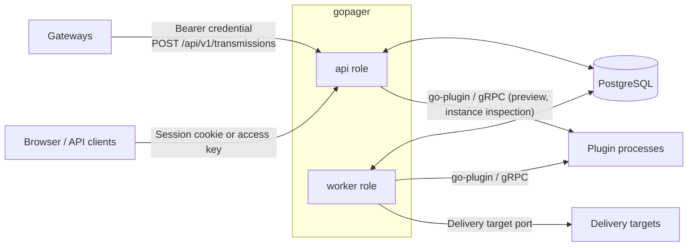
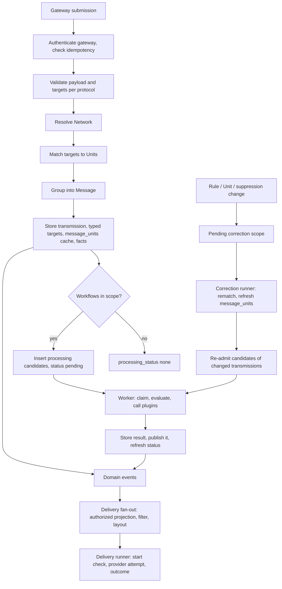
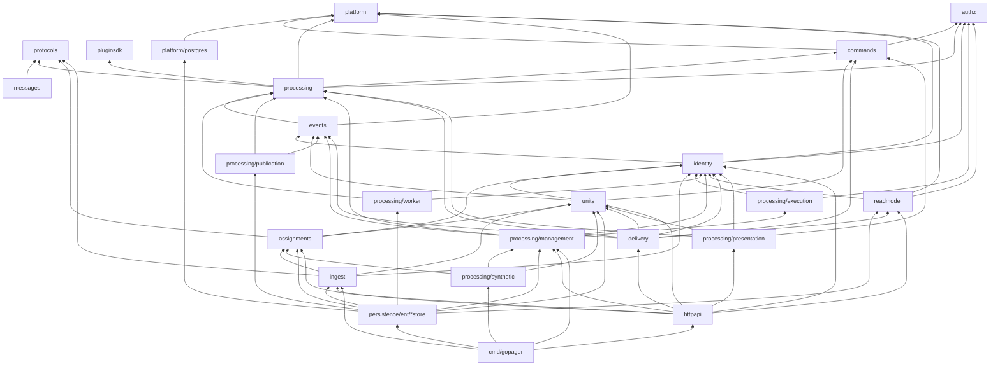
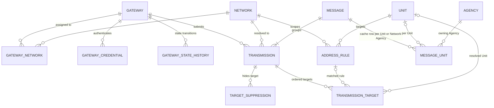
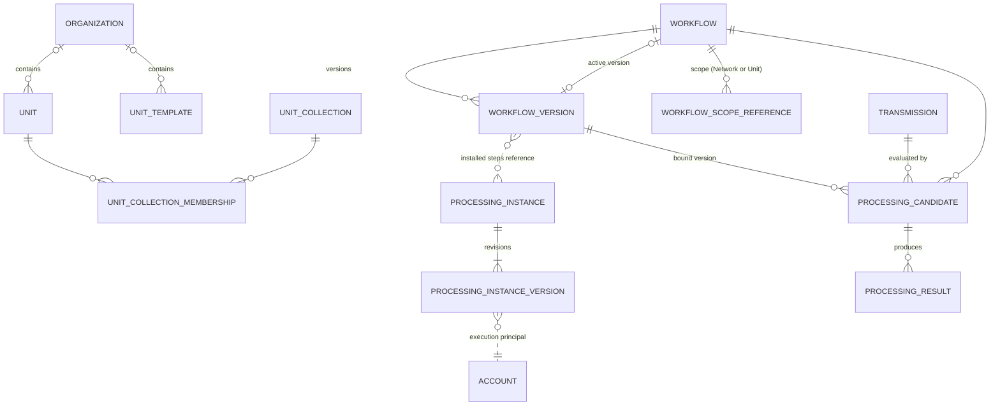
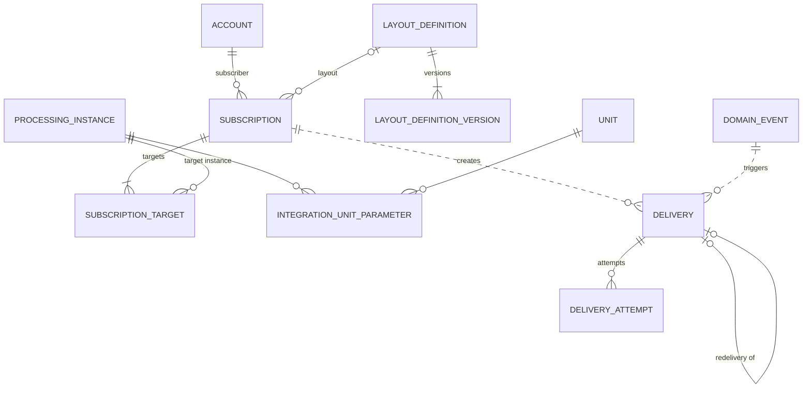
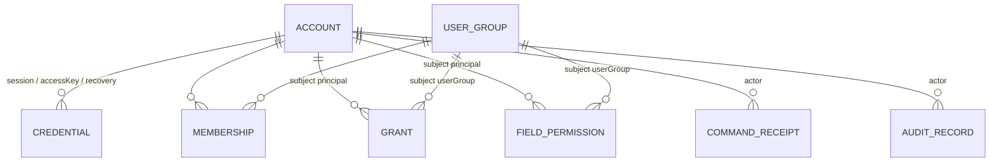

# Architecture

## System overview

GoPager receives decoded pager transmissions (POCSAG, FLEX, ZVEI, EAS) from authenticated gateways and stores each one as immutable evidence. Transmissions with the same payload identity that arrive within a grouping window are combined into one Message. Each transmission target (address/function) is resolved to a Unit through temporal address rules; rule, Unit and suppression changes are applied to stored history by a correction worker. Workflows evaluate transmissions in a worker process, can call operator-installed plugins, and attach their results to the Message when they complete; accepted evidence is visible from the moment intake commits.

GoPager is a single Go binary, `gopager` ([cmd/gopager](../cmd/gopager/)), backed by PostgreSQL. The `--roles` flag selects which roles a process runs:

| Role | Runs | Started from |
| --- | --- | --- |
| `api` | HTTP listener: gateway intake, login/session, management routes, health endpoints | `composeApplicationAPI` in [main.go](../cmd/gopager/main.go) |
| `worker` | Processing dispatcher (workflow candidates), correction runner (rematching, Processing readmission), Gateway contact-loss monitor, event consumers (Delivery fan-out) and the Delivery runner | `composeProcessingWorker`, `composeCorrectionRunner`, `composeEventsRuntime` |
| `bootstrap` subcommand | One-shot local creation of the first account; no listener | [bootstrap.go](../cmd/gopager/bootstrap.go) |

One process can run both roles (`--roles api,worker`), or the roles can run in separate processes against the same database. Role processes coordinate only through PostgreSQL (row locks, leases, fencing tokens). They do not talk to each other directly.

| External actor | Interaction |
| --- | --- |
| Gateway | Submits transmissions and state reports with a per-gateway bearer credential. See [http-api.md](http-api.md). |
| Browser / API client | Authenticates with a session cookie (human accounts) or an access key, or acts as the guest account when anonymous. Manages master data, rules, gateways, workflows and instances. |
| Plugin | Operator-provisioned executable, pinned by SHA-256 digest and verified again by go-plugin each time it is started. One long-lived child process per instance revision, pooled by the plugin host, called over gRPC one request at a time and stopped after an idle timeout, when its instance changes, or at shutdown. Previews call the same process with `mode: "preview"`. See [plugins.md](plugins.md). |
| Delivery target | An external system that receives authorized, rendered Delivery input through the Core target port (`delivery.Targets`). Without a configured provider every target is unavailable. See [Delivery](#delivery-worker-role). |
| PostgreSQL | The only store: domain state, domain events, outbox, work queues, migration ledger, and the clock used for domain time. See [operations.md](operations.md). |

## End-to-end data flow

### Intake (one transaction)

`POST /api/v1/transmissions` runs as a single primary transaction. If any step fails, nothing is stored. The only exception is a separate transaction that records a rejected submission (`operation.submission-rejected`).

| Step | What happens | Package |
| --- | --- | --- |
| HTTP decoding | Bearer extraction, `application/json`, size limit, JSON decoding | `internal/httpapi` ([ingest.go](../internal/httpapi/ingest.go)) |
| Gateway authentication | The bearer secret hash identifies exactly one enabled, undeleted gateway. A pending replacement credential takes over on first use. | `identity.GatewayAuthenticator`, `ingeststore` |
| Validation | Submission shape, observation time, payload form per protocol, target address/function ranges | `ingest` (`Submission.Validate`), `protocols` |
| Submission idempotency | `(gateway, submissionId)` plus an input fingerprint. A matching retry returns the original receipt; a different input is rejected. | `ingest`, `ingeststore` |
| Payload identity | Each payload form maps to a comparison-only identity (form, subtype, normalized value). The submitted payload is stored unchanged. | `protocols.TransmissionPayload.Identity` |
| Network resolution | Among the gateway's networks of the submission protocol, in order: declared gateway network identifier (`declared`; unknown is invalid), the only network (`inferred-single`), the only network with rules matching the targets at the observation time (`inferred-address`), the highest-priority network among several that match (`address-priority`, plus `operation.network-ambiguous`), and when none matches (also targetless input) the highest-priority network (`priority`). The winner is never a non-matching network while another matches. | `ingest.ResolveNetwork`, `assignments.Service.NetworksWithMatches` |
| Target matching | Each target position is resolved against the current address rules at its observation time: `assigned` (Unit plus rule) or `unassigned`. Overlapping rules resolve to the most specific selector. Ambiguity is a conflict. | `assignments.Resolve`, `assignments.Service.MatchTargets` |
| Grouping | Candidate Messages have equal payload identity and `last_observed_at >= observed - window AND first_observed_at <= observed + window` (index `messages_identity` on identity and `last_observed_at`); their members are those with `transmissions.observed_at` in the inclusive range `[observed - window, observed + window]` (`make_interval(secs => window)`, no arithmetic on the column). `messages.Decide` decides over these members: none, create a Message; one Message, join it; several, merge them into the lowest ID and move their transmissions and `message_units` rows. The store applies the decision (survivor, absorbed, late join, revision). Window `0` disables grouping. | `ingeststore.groupMessage` (decision from `messages.Decide`) |
| Persistence | Transmission, ordered targets with their resolution and typed address columns (`network_id`, `protocol`, `observed_at`, `address_number` or `address_text`, `function`), `message_units` cache rows (one per Message and Unit with the Unit's Agency, or one Unit-less row per Message and Network Agency for targetless input and for unassigned targets) | `ingeststore.AcceptTransmission` |
| Correction scope | None at intake: targets are stamped with the assignment revision read under the shared Assignment lock, so a correction recorded afterwards (always at a higher revision) selects them by selector if affected; no dirty capture exists | `assignmentstore.MarkPending` |
| Facts | `gateway.state-changed`, `message.created` / `message.transmission-joined` / `message.merged`, one `assignment.changed` (reason `created`) per Transmission with targets, carrying the ordered target resolutions, `operation.observation-time-implausible` | `events`, `eventstore` |
| Processing admission | Select enabled workflows with an active version and scope `all`, the matching Network, or one of the matched Units. Insert one `processing_candidates` row per selected workflow and set `processing_status` to `pending`, or to `none` when no workflow is selected. | `ingeststore.admitProcessing` |

The response is `202` when the processing status is `pending` and `200` otherwise. The accepted evidence is visible to readers either way.

### Grouping rules

- **Basis.** Grouping uses the normalized (whole-second) observation instant of each transmission, never the acceptance time, and is independent of Network, Gateway, address and Unit matching. Only exactly equal payload identities group (see [Protocols, targets and payload identity](http-api.md#protocols-targets-and-payload-identity)); a multi-target transmission always belongs to exactly one Message and is never split by target.
- **Window.** `grouping_control.window_seconds` is a whole number of seconds from `0` to 9007199254740991 (default 30). The comparison is inclusive: instants that differ by at most the window are linked. `0` makes every transmission its own Message. The window is not clamped, and no arithmetic is done on the stored instants.
- **Chain rule.** Membership does not depend on arrival order: payload-identical transmissions connected by consecutive gaps of at most the window form one Message (0 s, 50 s and then 25 s with a 30 s window end up as one Message, like 0, 25, 50). There is no maximum Message age and no lateness cut-off, so a continuously repeated payload forms one unbounded Message and a late transmission can join any retained Message. A transmission that bridges several Messages merges them into the lowest ID; originals and targets are untouched and no alias or old-to-new ID mapping is kept, so a merged-away Message ID is `NOT_FOUND`.
- **Configuration.** Changing the window affects only transmissions accepted afterwards; existing Messages are neither split nor merged by the change. Rematching, lifting a suppression and Workflow changes never change membership.
- **Message time.** `first_observed_at` is the earliest observation time of any member, corrected downward by an older late join or merge; `last_observed_at` is the latest.
- **Concurrency.** Exact grouping is serialized per payload identity with a transaction advisory lock, and the Message, its facts and the `message_units` rows commit with the transmission.

### Processing (worker role)

| Step | What happens | Package |
| --- | --- | --- |
| Due selection | Selects due candidates with `FOR UPDATE SKIP LOCKED` (no control-row lock, no paging) for bounded concurrency; wakes on a `gopager_processing_due` notification, with a poll interval as fallback | `processing/worker.Dispatcher`, `processingstore.SelectDueWork`, `postgres.Store.Listen` |
| Reconcile | Supersede candidates whose workflow, version, source or assignment context changed, including the dispatched one. Admit current bindings. Recover expired leases. | `ingeststore.ProcessingSourceOwner.ReconcileCandidate` |
| Capture and claim | In one transaction: capture a detached source projection (payload fields, targets, Units, Network) and claim the candidate (lease, fencing token, worker ID) | `worker.Service`, `ProcessingSourceOwner.CaptureCandidate`, `processingstore` |
| Evaluate | Outside any SQL transaction: compile the definition (CEL predicates, Core regex extraction, map, branch, installed plugin steps) and evaluate within a compute budget. Evaluation is two-valued and runs as the system; no value carries a per-value classification | `processing` (`WorkflowProgram.EvaluateScoped`, `PluginHost`) |
| Complete or fail | Recheck source and authority, then write a `processing_results` row or a classified failure with automatic retry scheduling (at most 5 attempts) | `worker.Service.finish`, `processingstore` |
| Publish | In the same transaction: attach completed, not yet published results to the Message (`published_at`, `message_id`), emit `processing.completed`, and derive the transmission's processing status from the candidates of the currently selected workflows | `processing/publication.Service`, `ProcessingSourceOwner.ApplyProcessingStatus` |

Workflow definitions, versions, activation and processing instances are described in [workflows.md](workflows.md). The plugin protocol is described in [plugins.md](plugins.md).

### Processing status

There is no publication barrier: accepted evidence is visible on commit, and processing adds results to it. Two fields describe that state.

| Record | Field | Meaning |
| --- | --- | --- |
| `transmissions` | `processing_status` (`none`/`pending`/`completed`/`failed`) | `none` when no workflow was selected at intake; otherwise derived from the candidates of the currently selected workflows: `pending` while any is pending or running, `failed` when none is pending and at least one failed, `completed` when all completed |
| `processing_results` | `published_at`, `message_id` | Set when the result was attached to the Message; `message_id` references `messages` and follows a merge |

Result-dependent reactions subscribe to `processing.completed`; nothing else waits for processing.

### Historical correction (worker role)

Creating, updating or deleting a rule, deleting a Unit, changing a suppression or replacing a Gateway's Network mapping does three things in the same transaction. It increments `assignment_control.revision`, stores an `assignment_pending_scopes` row (reason `rule-change`, `unit-deleted`, `suppression-change` or `gateway-mapping-change`, affected Networks/Unit/target or Gateway and Protocol), and returns that scope's status or ID to the caller. A mapping replacement (`ingest.GatewayAdministration.ConfigureNetworks`) queues one `gateway` scope per Protocol whose candidates (identifiers and Networks in priority order) changed and none otherwise. A rule change additionally queues, at the same revision and with reason `rule-change`, one `gateway` scope per Gateway and Protocol whose current mapping contains the rule's Network and at least one other Network of that Protocol, because rules decide Network inference between them ([D-143](../development/decisions/03-assignment-and-correction.md#d-143)); such a scope selects only the Gateway's inferred Transmissions with targets, since rules cannot change the Network of a declared or targetless one. A rule on any Network of a shared Gateway can thereby move inferred history between Agencies, just as intake inference uses it for new Transmissions.

`assignments.CorrectionRunner` then processes the queue:

1. It claims the oldest due scope with a lease and fencing token (`assignmentstore.ClaimCorrection`).
2. It reads the transmissions with a target inside the scope's selector (Network, protocol and address range or text with an optional validity window; one Unit; or one target) that still carry an older assignment revision, or for a `gateway` scope every transmission of the Gateway and Protocol whose `network_revision` is older, in batches of 100 ordered by `(accepted_at, id)` after a cursor. A `gateway` batch first locks the Gateway row, like intake and mapping replacement, and re-resolves each transmission's Network with `ingest.NetworkReResolver`: `ResolveNetwork` with the stored declaration (`gateway_network_identifier`), the current mapping and the current rules at the Observation time. Each batch runs `MatchTargets` again at the original observation time on the (re-resolved) Network; the fresh match may be at a newer assignment revision than the scope.
3. `ApplyCorrectionBatch` restamps every target of the batch at the fresh match revision, updates changed target resolutions and rebuilds the Message's `message_units` rows. Suppressed targets are excluded. The rebuilt rows are `current` unless another queued or running scope still holds an older-revision target of the Message, in which case they stay `correcting`. Correction is system work and pins no access revision: the fencing token and lease are the only guards, so unrelated configuration changes do not fail a batch. Each Transmission with changed targets emits one `assignment.changed` (reason `corrected`) listing the changed targets with before and after. For a `gateway` scope it also stamps `network_revision`; a different resolved Network moves the transmission (`network_id`, `network_resolution`, `source_revision` + 1) and its targets, increments the Message revision, and its fact carries `previousNetworkId` (its target list may then be empty). A transmission the current mapping and rules cannot resolve keeps its Network and is flagged `network_unresolved` (reported as the scope's `unresolved` count and logged); a later successful re-resolution clears the flag.
4. In the same batch transaction, the runner re-admits processing once for every transmission whose stamped revision moved or that moved to another Network (`ProcessingSourceOwner.ReadmitProcessing`), whether or not its resolution changed, because the processing context is the highest revision stamped on the transmission's targets: candidates bound to the old assignment context (including failed ones) are superseded, a candidate is admitted for every currently selected workflow and the transmission's processing status becomes `pending`. This is what makes a suppression, which never changes a resolution, reprocess its transmission. Transmissions outside the batch keep their candidates and status.
5. On failure, the scope is rescheduled with backoff and a failure code. After five attempts the scope is failed and the runner appends exactly one `correction.failed` fact: either from its own failure handling, or, for a scope whose fifth lease expired, in the claim transaction that marks it failed with `RETRY_LIMIT` (the store reports the exhausted scope, the runner owns the fact). A failed scope can be retried through `POST /api/v1/assignment-corrections/{id}/retry`.

Correction never creates or deletes transmissions or Messages, never changes grouping, originals or receipts.

### Gateway state and contact loss (worker role)

A Gateway's state (`never-seen`, `active`, `degraded`, `stopped`, `contact-lost`) changes in three places, each in its own transaction with the Gateway row locked: an authenticated Submission (`AcceptTransmission`) or state report (`ReportGatewayState`), whose next state comes from `ingest.NextGatewayState`, and the contact-loss monitor. Every effective change advances `gateways.revision` and, through `ingeststore.recordTransition`, inserts one `gateway_state_history` row (unique `(gateway_id, revision)`, cause `report`, `submission` or `timeout`) and appends one `gateway.state-changed` fact with that revision; a failure of either rolls back the state change.

`ingest.ContactMonitor` runs in the `worker` role only. Every `--gateway-contact-scan-interval` it runs one short transaction: it reads the database clock and `ingeststore.MarkContactLost` selects up to 100 enabled, undeleted `active` or `degraded` Gateways whose `last_contact_at` is at or before `now - --gateway-contact-timeout` (`FOR UPDATE SKIP LOCKED`, partial index `gateways_contact_scan`), sets them `contact-lost` and records each transition with the last contact as contact time. A full batch is followed immediately by the next scan. A report or Submission that commits first refreshes the contact so the row no longer qualifies; one that waits behind the scan sees `contact-lost` and recovers to `active`. Locked rows are skipped, so several workers never change the same Gateway twice. `stopped`, `never-seen`, disabled and deleted Gateways are never evaluated.

### Query (api role)

Message reads (`GET /api/v1/messages`, `/messages/{id}`, `/messages/filter-options`) run through `readmodel.Service` inside `identity.WithAuthority`, so the caller's grants, field permissions and key restrictions are resolved in the same transaction as the rows. `authz.NewMessageAccess` turns that authority into a store-neutral predicate (owner clauses per action, each with its own age cutoff, intersected with the key); `readstore` renders it as SQL over `message_units` rows, so eligibility is decided before filters, ordering and paging and hidden Messages never consume page slots. Exactly one row per Message is returned, ordered by `(messages.first_observed_at, messages.id)` descending; the page, its projection aggregates and the event-log cutoff `position` come from one statement and therefore one snapshot. Field groups only shape the projection and decide which filters are allowed. Page tokens are HMAC-signed keyset cursors bound to the filters and the caller, with the secret in the single-row table `query_token_keys`; a process creates it in its own committed transaction before its first read, so every process signs with the same secret. Each feed page is first admitted by `readmodel.Admission` in its own short transaction (before the read, so a rejected request holds no snapshot). Saved views are managed by `readmodel.SavedViews` through the `readstore` ports.

**Live updates** (`GET /api/v1/messages/stream`) are not a durable consumer: they keep no offset and run in the api role only. A stream subscribes to the process-wide `events.WakeHub` (one database listener for all streams and consumers) and holds its own position. On every wake-up and every 15 s heartbeat it runs one `readmodel.LiveSession.Batch`: one transaction resolves the caller's authority (a changed access revision or a failure ends the stream), reads up to 256 facts after the position with `events.Log.ReadAfter`, drops facts whose Message-time span misses the loaded range, evaluates the affected Messages with the feed query minus its time filter (`Service.evaluate`), reads the current Unit and Network contexts only for the before basis of possible removals, and turns the result into `upsert`, `remove` or `resync-required` frames. The transaction commits before the HTTP layer writes the frames, each write under its own deadline (`http.ResponseController`), so a slow client never holds a transaction or connection from the pool. A fact is positioned by `(tx_id, seq)`: the feed page returns the cutoff of its own snapshot, so no fact falls between a page and its stream. Processing results are shown, and matched by the `derived` filter, only when the caller reads every field group stored with the result (`processing_results.field_groups`, always including `derived`); reads compare stored groups in SQL and never load, compile or classify Workflow definitions.

### Delivery (worker role)

Subscriptions select deliverable Domain event types for one subscriber (the owning User or, for a global Subscription, a technical account) and send to configured target instances; routes, fields, states and rights are in [HTTP API: Subscriptions](http-api.md#subscriptions), [Deliveries](http-api.md#deliveries) and [Layouts](http-api.md#layouts).

- **Fan-out.** `delivery.FanOut` is the event consumer `delivery-fanout` on `events.Runner`. For each deliverable fact of `replayMode` `normal` recorded at most 24 h before the database clock, it loads the active Subscriptions selecting the type that existed when the fact was recorded (share-locked), resolves the subscriber's current authority (`identity.Resolver.ResolvePrincipalAuthority`), projects the fact's Message (after a merge, the surviving Message found through the fact's Transmission) through the read side under that authority (`readmodel.Service.ProjectForDelivery`; Gateway facts need `gateway.read` on one of the Gateway's Agencies), evaluates the Subscription filter on the projection, splits by Unit when configured, renders the resolved layout (`processing.LayoutResolver`, `processing.CompileLayout`), applies the target inputs and `integration_unit_parameters`, validates them against the target descriptor and inserts one `prepared` Delivery per Subscription, Domain event, target and split, with the bounded input, in the batch transaction. The unique Delivery identity makes a repeated fact a no-op. A subscriber without authority, an ineligible projection or a false filter create nothing; a parameter conflict or an invalid input create a visible `failed` Delivery.
- **Runner.** `delivery.Runner` (worker role, woken by the fact hub and polling every 5 s) first ends `started` Deliveries whose lease expired as `uncertain` (`lease-lost`), then claims up to 10 due `prepared` or `retry-pending` Deliveries with `FOR UPDATE SKIP LOCKED`, a new fencing token and a 60 s lease. Per Delivery, one transaction re-checks expiry, the Subscription (state and revision), the subscriber's authority, the projection and filter (re-rendering the input when the access or instance revision changed), the target instance and descriptor, and sending admission, then records the attempt `started`. The provider is called outside SQL with a 30 s deadline while the lease is renewed every 20 s; a lost lease, or a subscriber who may no longer see the Delivery's data after an access change, cancels the call. The outcome is written under the same claim: `accepted`, `retry-pending` (at most five attempts, 30 s/2 min/10 min/30 min ±20 %, a later provider retry time wins), `failed`, or `uncertain` for an uncertain answer or any error after the call started. Uncertain Deliveries are never retried automatically.
- **Sending admission.** One-minute windows in `delivery_admissions`, keyed by a hash of the subscriber and of the target instance; each admitted send also sweeps up to 100 expired windows of any bucket (`--delivery-sends-per-minute`, `--delivery-target-sends-per-minute`). A background start over the limit is deferred to the next window without consuming an attempt; Subscription create and redelivery answer `RATE_LIMITED`.
- **Targets.** `delivery.Targets` (`Describe`, `Attempt`) is the Core target port with the versioned `TargetDescriptor` and `AttemptInvocation`/`AttemptResult`. The process composes `delivery.UnavailableTargets` until a target provider is configured, so Subscription targets are rejected as unavailable and no Delivery starts.
- **Layouts.** `processing/presentation` stores layout definitions with immutable versions (`layout_definitions`, `layout_definition_versions`) and resolves the Subscription's layout or the built-in default per output kind (`delivery.DefaultLayouts`).

### Address rule semantics

- **Shape.** A rule belongs to exactly one Network (and so to one protocol) and names one Unit, a selector and a validity interval `[validFrom, validUntil)`; a missing bound is open. Validity is evaluated at the transmission's observation time, never at acceptance or Message time. Rule bounds use microsecond timestamps and unsupported precision is rejected, not truncated.
- **Selectors.** POCSAG: an exact RIC or inclusive range, an optional function filter (absent means all four function bits; empty, duplicate or out-of-range lists are invalid) and a mode `function-bit` or `subaddress`; the mode is never inferred from a Unit name. FLEX: an exact address or range that consists only of supported address classes. ZVEI and EAS: the exact string, with no geographic containment or expansion. Cross-protocol selectors are invalid.
- **Specificity.** A selector is a set of address/function pairs. When several simultaneously valid rules of one Network match a target, the rule whose set is a proper subset of all others wins. Two simultaneously valid rules with equal selectors, or with overlapping selectors where neither contains the other, are rejected (`409 REVISION_CONFLICT`), even for the same Unit; so are overlapping POCSAG selectors with different modes. Disjoint selectors or disjoint validity intervals never conflict. At the boundary between two adjacent intervals the rule whose `validFrom` equals the instant applies. There is no priority score.
- **Resolution.** Every target ends as `assigned` (Unit and rule) or proven `unassigned` (both null); there is no default Unit. A targetless transmission gets no synthetic target. Storage, unsupported input or violated invariants are errors, never `unassigned`. A hidden co-target is not relabelled as without-Unit.
- **Suppression.** A suppression hides exactly one original target `(transmissionId, targetPosition)` from the Message read model and from Delivery input; the original payload, targets and Message membership stay untouched, and a Message keeps its other usable targets. At most one active suppression exists per target. Lifting a suppression re-evaluates the target and never creates a transmission, membership, assignment or Delivery trigger. Targets are referenced by this composite key; no separate target ID exists, and the target list is never sorted, renumbered or deduplicated.
- **Unit and cache.** `message_units.first_observed_at` is the minimum observation time of the Message's usable targets of that Unit and `age_anchor` the minimum over those targets of the earlier of observation and acceptance time. Repeated receptions never advance either. A Unit deletion, rule change or suppression changes them only through a correction batch.
- **Concurrency.** A rule or Unit change serializes with intake on the assignment lock, so a decision is never published with an incompatible revision.

## Package map

### Dependency layering

Derived from `go list -f '{{.ImportPath}} {{.Imports}}' ./...` (internal imports only; test-only packages and transitively implied edges omitted):

The layering rules that the code follows:

- Domain and application packages (`authz`, `protocols`, `messages`, `commands`, `events`, `identity`, `units`, `assignments`, `ingest`, `readmodel`, `delivery`, `processing/...`) never import `platform/postgres`, Ent, or any store package. They declare small consumer interfaces (`Repository`, `Clock`, `Transactions`, owner ports) and receive `platform.TransactionContext`.
- `authz`, `protocols`, `platform` and `pluginsdk` are leaves with no internal imports.
- Store adapters under `internal/persistence/ent/` implement those interfaces and are the only importers of `platform/postgres` besides `cmd/gopager`.
- `cmd/gopager` is the composition root. `composeCore` ([compose.go](../cmd/gopager/compose.go)) constructs every store and the shared services once per process; the API, worker and correction-runner compositions take that set instead of building their own.
- HTTP adapters live in `internal/httpapi`, never in `cmd/gopager`: they map requests to domain service calls and domain errors to the shared error body, hold no business rules and import no store. `cmd/gopager` registers them on the mux with `httpapi.Register*Routes`.
- `events` imports `processing` to validate `processing.completed` result payloads, so `processing` cannot import `events`.
- The generated Ent package and its `schema` import domain types (`units`, `assignments`, `authz`, `commands`, `processing`) for typed JSON columns.

### Packages

| Package | Responsibility |
| --- | --- |
| `cmd/gopager` | Flag/env configuration, composition of stores and services (`composeCore`, API, worker, correction runner, Processing runtime), wiring of `httpapi` routes, `bootstrap` subcommand |
| `internal/httpapi` | HTTP adapters of the application routes: management (one file per resource), Gateway intake and credentials, Processing; shared route helper (proof selection, pre-authentication before the body, error mapping), JSON decoding and paging. Exported surface: `RegisterManagementRoutes`, `RegisterMessageRoutes`, `RegisterIngestRoutes`, `RegisterGatewayManagementRoutes`, `RegisterNetworkManagementRoutes`, `RegisterProcessingRoutes`, `GatewayIntake`, `ProcessingRoutes` |
| `internal/platform` | Store-neutral runtime: `Config`/roles, `Store` and `Runner` interfaces, `TransactionContext`, `Clock`, `Failure` error codes, readiness/health handlers, graceful shutdown (`StartWithAPI`, `RunningHandle`) |
| `internal/platform/postgres` | PostgreSQL `Store`: connection/TLS policy, primary-only transactions, failure classification, database clock, goose migration check/apply under an advisory lock |
| `internal/authz` | Grant/scope/action catalog, field permissions, access-key restrictions, `Authorize` point decisions, age cutoffs, `MessageAccess` row eligibility for queries |
| `internal/identity` | Accounts, password hashing (Argon2id), secrets, login with rate limits, sessions/CSRF/origin policy (`HTTPTransport`), `Resolver` (proof to current authority), gateway authentication, bootstrap |
| `internal/commands` | Actor-bound command receipts, input fingerprints, optimistic revision increments |
| `internal/events` | Domain event fact types, envelope construction and validation, appender interfaces |
| `internal/protocols` | Protocol enum, address/target model and ranges, payload forms, payload identity |
| `internal/messages` | Grouping decision type and the pure grouping function `Decide` |
| `internal/delivery` | Subscriptions (management, save-time checks), the field catalog of filters and layouts, the `delivery-fanout` consumer, materialization, the Delivery runner (claims, start check, attempts, retry, uncertainty), sending admission, Delivery management (list, read, retry, redelivery), the Core target port and built-in layouts |
| `internal/processing/presentation` | Layout definitions with immutable versions (`presentation.manage`) and the `LayoutResolver` used by Delivery |
| `internal/readmodel` | Message read side: feed/detail/filter-option service, filter parsing and canonical encoding, page tokens and positions, field-group projection; ports for the store, token key and Workflow classification |
| `internal/units` (package `units`) | Agencies, Units, Unit collections, Organizations with setting defaults, Unit templates, bulk Unit operations, setting inheritance |
| `internal/assignments` | Address rules (selectors, validity intervals, conflict validation), target matching, suppressions, correction status/retry, `CorrectionRunner` |
| `internal/ingest` | Submission validation, Network resolution, intake service, gateway state reports and transitions, Network and Gateway administration (lifecycle, network assignment, credentials, diagnostics, history), contact-loss monitor |
| `internal/processing` | Workflow definition model and compiler, CEL predicates, Core regex, value/schema codec, candidate state machine, retry schedule, source capture, plugin host (process pool, verified-artifact cache) and installed-step execution, processing instances |
| `internal/processing/management` | Authorized workflow/version/instance commands and reads, candidate status reads, manual retry, preview |
| `internal/processing/worker` | Candidate dispatcher and per-candidate execution (claim, evaluate, complete/fail, publish) |
| `internal/processing/publication` | Applies completed results and source readiness in the caller's transaction |
| `internal/processing/execution` | Binds a request proof to preview authority for installed steps |
| `internal/processing/synthetic` | In-memory synthetic transmissions used as the source for workflow previews |
| `internal/persistence/migrations` | Embedded goose SQL migrations (`migrations.Files`) |
| `internal/persistence/ent` | Generated Ent client (do not edit). `schema/` holds the entity definitions. |
| `internal/persistence/ent/borrowed` | Ent driver that runs on an existing platform transaction and cannot commit or close it |
| `internal/persistence/ent/guard` | Mandatory Ent privacy policy: deny unless an adapter-bound access decision is in context |
| `internal/persistence/ent/permissions` | Translates `authz` grants into EntQL row predicates (`ReadScope`) |
| `internal/persistence/ent/identitystore` | Accounts, credentials, grants, field permissions, login attempts, audit, access revision |
| `internal/persistence/ent/unitstore` | Units, collections, Organizations, templates |
| `internal/persistence/ent/assignmentstore` | Address rules, assignment revision, pending scopes, suppressions, correction worker queries |
| `internal/persistence/ent/ingeststore` | Gateways, Networks, credentials, transmission intake, grouping, the message_units cache, processing admission. `ProcessingSourceOwner` provides the source, reconciliation and publication readiness. Uses SQL directly through `postgres.Executor`. |
| `internal/persistence/ent/processingstore` | Workflows, versions, scope references, instances, candidates, results, publication items |
| `internal/persistence/ent/deliverystore` | SQL implementation of the Delivery store: Subscriptions and targets, Deliveries with fenced claims, attempts, admission windows, Unit parameters and the read helpers Delivery needs |
| `internal/persistence/ent/layoutstore` | Layout definitions and versions |
| `internal/persistence/ent/readstore` | SQL implementation of the `readmodel` store: eligibility, filters, text search, keyset paging, projection aggregates and the token key, one statement per request |
| `internal/persistence/ent/commandstore` | Command receipt persistence |
| `internal/persistence/ent/eventstore` | Appends domain events and their outbox references |
| `pluginsdk` | Public Go SDK for plugins (`Serve`, `Handler`, `RequestMode`) |
| `internal/testutil/postgres`, `internal/testutil/pluginfixture` | Test-only: disposable PostgreSQL, plugin fixture binary |

Repository layout, tests and code generation are covered in [development.md](development.md).

## Domain model

### Intake, grouping and assignment

### Master data and processing

Dotted relations are references stored inside JSON columns (workflow definition, instance configuration).

### Subscriptions and Delivery

Deliveries keep the Subscription, subscriber, Domain event and target IDs without foreign keys, so their history outlives a deleted Subscription. `delivery_admissions` holds the hashed sending-admission windows.

### Identity and cross-cutting records

`DOMAIN_EVENT`, `LOGIN_ATTEMPT` and the single-row control tables (`identity_control`, `assignment_control`, `grouping_control`, `processing_control`) have no foreign relations.

Most cross-aggregate references are UUID columns without Ent edges. The schema is in [internal/persistence/ent/schema](../internal/persistence/ent/schema/) and the authoritative DDL is in [internal/persistence/migrations](../internal/persistence/migrations/).

### Glossary

| Term | Code | Definition |
| --- | --- | --- |
| Subscription | `subscriptions`, `delivery.Subscription` | A subscriber's selection of deliverable Domain event types, with an optional filter, one to eight target instances, an optional layout, an optional split by Unit and an optional maximum age; `personal` (acts as its User) or `global` (acts as a technical account). |
| Delivery | `deliveries`, `delivery.Delivery` | One job per Subscription, Domain event, target instance and split, with its bounded materialized input, attempts and outcome. |
| Delivery target | `delivery.Targets`, `delivery.TargetDescriptor` | A configured processing instance offering the Delivery capability: output kinds, typed inputs, dependencies and an optional sending limit. |
| Layout | `layout_definitions`, `processing.Layout` | A versioned, declarative arrangement of permitted fields for one output kind (`text`, `markdown`, `json`), rendered without a template engine. |
| Unit parameter | `integration_unit_parameters` | A Unit-specific value of a target input for one instance; applied to Deliveries of that Unit. |
| Gateway | `gateways`, `ingest` | Registered receiver instance with a name that submits transmissions under its own bearer credential. It can be disabled (credentials authenticate nothing) and soft-deleted. It has a state (`never-seen`, `active`, `degraded`, `stopped`, `contact-lost`), contact timestamps and a history retention marker. |
| Gateway state history | `gateway_state_history` | One row per Gateway revision that changed the state: old and new state, cause (`report`, `submission`, `timeout`), times and the degraded reason. |
| Gateway credential | `gateway_credentials` | Hashed bearer secret bound to one gateway. At most one active and one pending replacement per gateway. |
| Network | `networks` | Logical radio network with exactly one protocol, owned by one Agency; soft-deleted. Context for network resolution and address rules. |
| Gateway network | `gateway_networks` | Assignment of a Network to a gateway under a gateway-local identifier with a unique `priority` per gateway (lower number first, set `0..n-1`) that orders resolution among its Networks |
| Protocol | `protocols.Protocol` | `pocsag`, `flex`, `zvei` or `eas`. Determines valid payload forms and address ranges. |
| Submission | `ingest.Submission` | One gateway request carrying one transmission, identified by `submissionId` for idempotent retries |
| Transmission | `transmissions` | Immutable record that one gateway observed one emission: payload, ordered targets, observation and acceptance time, resolved Network, quality metrics, incomplete flag |
| Payload / payload form | `protocols.TransmissionPayload` | Submitted content in a closed per-protocol form (`text`, `numeric`, `tone-only`, `binary`, `flex-short-signal`, `zvei-signal`, `eas-header`) |
| Payload identity | `protocols.PayloadIdentity` | Normalized form, subtype and value used only to compare transmissions for grouping |
| Transmission target | `transmission_targets` | One original address/function at a position, with typed address columns for indexed lookups and its current resolution status, Unit, matched rule and assignment revision |
| Message | `messages` | Group of transmissions with equal payload identity within the grouping window. Has first/last observation time. |
| Grouping window | `grouping_control.window_seconds` | Maximum observation-time distance for joining an existing Message. `0` disables grouping. |
| Message unit (cache) | `message_units` | Rebuildable per-Message, per-Unit row (or Unit-less per Network Agency for targetless input and for targets no rule matches, so that Agency sees them as unassigned) with the Unit's Agency, first observation, age anchor and correction status; feeds and authorization predicates read it directly. A target's support is derivable from `transmission_targets` and Message membership, so no support table exists. Moving a Unit to another Agency rewrites `agency_id` on that Unit's rows in the same transaction. |
| Unit | `units` | Logical recipient that addresses resolve to. Optional Organization, settings, collection membership. Deletion is soft (`deleted`). |
| Organization | `organizations` | Container of Units and templates that supplies inherited setting defaults |
| Unit collection | `unit_collections` | Named set of Units used as an authorization scope |
| Agency | `agencies` | The operating authority of one alerting domain (for example a county's fire dispatch centre; the police of the same county is another). Owns Units and Networks (`agency_id` on both, exactly one each) and is the normal grant scope above a Unit; deletable only when nothing belongs to it. |
| Unit template | `unit_templates` | Standalone settings preset for creating Units. Copied settings keep no link to the template. |
| Address rule | `address_rules`, `assignments.Rule` | Mutable rule mapping a selector (address value or range, function set/mode) on a Network and protocol to a Unit, with optional `valid_from`/`valid_until` |
| Assignment | `assignments.Resolution` | Result of resolving one target against current rules at its observation time: `assigned` or `unassigned` |
| Assignment revision | `assignment_control.revision` | Global counter incremented by every rule, Unit or suppression change. Stamped on targets when they are resolved; a candidate's processing context is the highest revision of its Transmission's own targets (1 without targets), so a change elsewhere does not invalidate it. |
| Suppression | `target_suppressions` | Active marker that excludes one transmission target from the `message_units` cache |
| Correction (pending scope) | `assignment_pending_scopes` | Durable rematch work recorded at one assignment revision for one selector (address range or text on a Network and protocol with a validity window, one Unit, or one target), with lease, cursor, attempts and failure code; scopes run independently and are never superseded by later ones |
| Principal / Account | `identity_accounts` | Internal identity of kind `human`, `technical` or `guest`. Grants and credentials attach to it. |
| User group | `identity_user_groups` | Set of accounts used as a grant subject |
| Credential | `identity_credentials` | Hashed `session`, `accessKey` or `recovery` secret of an account. Access keys carry restrictions. |
| Grant | `identity_grants`, `authz.Grant` | Actions on a scope (`all`, `agency`, `unit`, `unitCollection`, `account`) for a principal or group, with optional maximum data age and delegability |
| Field permission | `identity_field_permissions` | Global permission to read field groups (`payload`, `address`, `unit`, `gateway`, `quality`, `derived`, `extension.<ns>.<name>`), independent of scope |
| Access key restrictions | `authz.Restrictions` | Subset of actions, scopes, fields and age that limits an access key below its owner's grants |
| Authority | `authz.Authority` | Current grants, field permissions and key restrictions of a principal, loaded once per transaction |
| Saved view | `saved_views`, `readmodel.SavedViews` | Named feed filter set (`definition` jsonb: filter dimensions plus optional time range) with a revision. A personal view is personal data keyed by `owner_principal_id` and visible only to that Principal; a global view has no owner and is maintained with `saved-view.manage-global`. Writes no domain event and no audit record. |
| Search admission | `search_admissions`, `readmodel.Admission` | Fixed one-minute window counter per bucket (SHA-256 of the access-key credential, the Principal or, for the guest, the client source). Incremented atomically only while below `--search-attempts-per-minute`; an admitted request deletes its bucket's older windows and up to 100 expired windows of any bucket (index on `window_start`, `SKIP LOCKED`), so buckets that never return do not accumulate. It holds no addresses or IDs in clear. |
| Workflow | `processing_workflows` | Named, scoped (`all`, `network`, `unit`), enable-able processing configuration that points at an active version |
| Workflow version | `processing_workflow_versions` | Immutable definition: selector predicate, steps (`map`, `extract`, `branch`, `installed`), output schema, outputs. Saving checks every referenced source field's group against the author's field permissions; the version's outputs are classified once as `derived` plus the groups it reads, computed from the definition and the source declarations on load (see [Classification](workflows.md#classification)) |
| Processing instance | `processing_instances`, `processing_instance_versions` | Revisioned binding of a provisioned plugin artifact (manifest path and pin), its configuration, and the execution principal it runs as |
| Processing candidate | `processing_candidates` | Durable work item for one transmission and workflow version at given source/context revisions. States: `pending`, `running`, `completed`, `failed`, `superseded`. Has lease, fencing token and attempts. |
| Processing result | `processing_results` | Typed evaluation output of a completed candidate, attached to the Message in the completing transaction; `field_groups` stores its classification (`derived` plus the groups the definition version reads), written with the result |
| Domain event | `domain_events`, `events` | Validated JSON envelope recording a committed state change |
| Command receipt | `command_receipts` | Stored outcome of an idempotent administrative command per actor and command ID |

## Cross-cutting mechanisms

### Transactions and the store abstraction

- `platform.Store` (implemented by `postgres.Store`) offers `WithinTransaction(ctx, func(platform.TransactionContext) error)`. Services receive it as `identity.Transactions`.
- `TransactionContext` is an opaque capability. Only store adapters can turn it into SQL access, through `postgres.Store.Resolve`. Resolving fails after the callback returns or for a different store.
- Every transaction runs at `READ COMMITTED` on a writable primary (checked with `pg_is_in_recovery`). It has a 30-second timeout and cannot be nested. If the store has a registered migration set, the transaction's first statement also compares the applied schema version with the version the process started with and fails `INCOMPATIBLE_VERSION` on a difference; the locked migration check itself runs only at startup, on `apply` and in the 5-second readiness recheck.
- All participants in one operation share one transaction: authority resolution, domain writes, command receipt, audit and domain events. Plugin calls and workflow evaluation run outside SQL transactions. The worker rechecks state with fencing before writing results.
- Ent repositories run on the borrowed transaction (`borrowed.Driver`). Every Ent entity has the `guard.Policy`, which denies all queries and mutations unless the adapter has bound an `Access` with per-entity EntQL predicates (from `permissions.ReadScope`) for the live transaction. Hot paths (`ingeststore`, correction and candidate queries) use SQL directly through `postgres.Executor`.
- Concurrency control uses the single-row control tables `identity_control` (access revision), `assignment_control`, `grouping_control` and `processing_control`. Readers (authority resolution, matching, candidate work, intake admission) take shared locks: `FOR KEY SHARE` on `identity_control`, so that configuration changes can bump the access revision with a plain update without waiting for in-flight requests, and `FOR SHARE` on the other control rows. Only commands that change access, rules, Suppressions or Processing configuration take the exclusive lock (`FOR UPDATE`) and bump the revision; such a command takes it as the first lock of its transaction (before it resolves its own authority), because two transactions that hold a shared lock and then request the exclusive one deadlock. Exact grouping serializes per payload identity with a transaction advisory lock, not on `grouping_control`. Lock order is `identity_control`, `assignment_control`, `grouping_control`, `processing_control`, then transmission, Message and candidate rows; the worker locks the control rows before the transmission row. Transmission is always locked before its Message: the worker and the correction batch lock a Transmission and then its Message, and the intake merge locks all Transmissions of the candidate Messages (in id order, under the payload-identity advisory lock) before it locks the Messages, because it later reassigns every Transmission of an absorbed Message. A transaction that holds a Message therefore never waits for a Transmission lock held by a transaction that wants the Message. Remaining Transmission-to-Transmission waits (a correction batch against a merge) are resolved by the single deadlock/serialization retry of `WithinTransaction`. Login verifies the password outside any transaction and serializes only its attempt accounting with a dedicated advisory lock. Aggregates use `revision` columns with expected-revision checks (`commands.NextRevision`). Background work uses leases and fencing tokens (`platform.NextFencingToken`).

### Clock

`platform.Clock.Now(ctx, tx)` returns the database's `clock_timestamp()` through the caller's transaction, truncated to microseconds. Acceptance times, leases, due times, age checks and event timestamps all use this clock, never a process wall clock.

### Domain events and outbox

- Producers build typed facts (`events.IntakeFact`, `IdentityFact`, `MasterDataFact`, `ConfigurationFact`, `CorrectionFact`, `Processing*Fact`). `Envelope()` validates each fact into a versioned envelope with `domainEventId`, `type`, `producer`, `aggregateRef`, `aggregateRevision`, `occurredAt`, `recordedAt`, `data`, `classification` and `replayMode`. Envelopes contain no original payload and no secrets.
- `eventstore` inserts the envelope into `domain_events` and, in the same transaction, runs `SELECT pg_notify('gopager_domain_events', <seq>)`. The event, the notification and the state change commit or roll back together; PostgreSQL delivers the notification only on commit. There is no second table and no relay.
- `domain_events` is a sequenced log. `seq` (`bigint GENERATED ALWAYS AS IDENTITY`, unique) is the human-facing event number; `tx_id` (`xid8`, default `pg_current_xact_id()`) records the writing transaction; `type` and `occurred_at` are stored generated columns from the envelope (index `(type, seq)` serves per-type reads, index `(tx_id, seq)` serves consumption). Sequence values are assigned at insert time but become visible in commit order, and the transaction ID is assigned at the transaction's first write, which can be earlier than the insert. A transaction with a higher `tx_id` can therefore hold a lower `seq`, so neither a plain `seq > last` read nor a `seq`-ordered read behind the xmin cut is safe.
- `events.Log` (implemented by `eventstore.Store`) is the reader port. The read position is an `events.Position{TxID, Seq}`, ordered by `(tx_id, seq)`. `ReadAfter(tx, after, limit)` is gap-safe: it returns only rows with `(tx_id, seq) > (after.TxID, after.Seq)` and `tx_id < pg_snapshot_xmin(pg_current_snapshot())`, ordered by `(tx_id, seq)`, so no row at or below a returned position can still be uncommitted. A transaction does not read its own appends. `Offset` and `Advance` keep one durable position per named consumer in `consumer_offsets(consumer, last_tx_id, last_seq, updated_at)`; `Advance` never moves backwards in `(tx_id, seq)` order (a stale position is a no-op), and because both run in the caller's transaction a consumer commits its effect and its offset atomically.
- The `NOTIFY` payload is only a wake-up hint (it can be lost, for example while a listener reconnects). A consumer combines `ReadAfter` with a listener on the channel or a periodic poll and always reads from its `Offset`. The store itself has no `LISTEN` capability; the live-delivery listener is a separate component.
- `events.WakeHub` fans one `LISTEN` session on the channel out to any number of subscribers (size-1 coalescing signal per subscriber, an initial signal at subscription, non-blocking fan-out); the `api` and `worker` roles each run one. `events.Runner` drives one named `events.Consumer` (`Name`, `Supports(type, schemaVersion)`, `Handle`): on every wake-up or poll tick (`--event-poll-interval`, default 5 s) it repeats batches until one is empty, each batch in one primary transaction that reads `Offset`, reads up to 100 records, calls `Handle` for supported ones in order, advances the offset to the last processed record and commits, so the effect and the offset are atomic. A handler error rolls the whole batch back and is retried on the next tick. A record of an unsupported type is advanced over; a record of a supported type with an unknown `schemaVersion` blocks the consumer: records before it are committed, the blocker is never skipped, `Runner.Blocked()` reports it and `event consumer blocked` is logged at every tick. Delivery is at-least-once, so consumers deduplicate by domain event ID plus consumer name in their own effect. The worker role starts one runner per registered consumer (`delivery-fanout`); Processing and correction workers still find their work by querying their own tables.
- **Envelope rules.** `schemaVersion` is 1. Adding an optional field is compatible; new meaning or a new required field needs a new schema version, and a consumer blocks visibly on a version it does not know instead of skipping it as handled. `data` is internal recorded context, never an already-authorized outbound payload. `replayMode` is `normal` or `reprocess` (explicit historical reprocessing); automatic Delivery fan-out acts only on `normal`. Facts carry no username, profile snapshot, credential, proof, name, setting value or original payload. Ordering is per aggregate revision and causation, with no global provider order; the facts of one atomic change may share the final aggregate revision with no order among them. A merge transaction records one `message.merged` (survivor and sorted absorbed references) plus one `message.transmission-joined` for the new member and no `message.created`, so consumers deduplicate each fact and reconcile current authorized state instead of relying on merge-before-join delivery. A recorded type never grants a consumer an unprojected original payload.
- **Message time in facts.** Every fact that names a Message carries `data.messageTime`, the Message time (`messages.first_observed_at`) after the change: `message.*`, `assignment.changed` (intake and correction, including Network moves), `suppression.changed` (which also carries `messageId`) and `processing.completed`. `message.transmission-joined` and `message.merged` add `previousMessageTime`, the latest Message time among the Messages the change replaced, when it differs; the Message time never moves later, so `[messageTime, previousMessageTime]` covers the affected rows before and after. Live streams filter by it without reading the Message.
- `producer.domain` names the producing domain:

| `producer.domain` | Domain | Events |
| --- | --- | --- |
| `intake` | Gateways, Networks, Transmissions and their targets | Transmission and Gateway facts |
| `grouping` | Payload identity and Message grouping | `message.*` |
| `masterdata` | Organizations, Units, collections, templates | Unit and Organization configuration facts |
| `assignment` | Address rules, target resolution, suppression, historical correction | `assignment.*`, rule configuration and correction facts |
| `identity` | Principals, credentials, sessions, grants | Identity facts |
| `processing` | Workflows, processing instances, candidates, results | Processing facts |
| `delivery` | Subscriptions | Subscription configuration facts; Delivery attempts record no facts |

| Event type | Emitted when |
| --- | --- |
| `message.created`, `message.transmission-joined`, `message.merged` | Grouping outcome at intake |
| `assignment.changed` | One per Transmission: all target resolutions set at intake (`created`), or the changed targets with before and after from a correction (`corrected`); a Network move adds `previousNetworkId` and may have no targets |
| `suppression.changed` | Suppression created or lifted |
| `gateway.state-changed` | Effective gateway state change from a report, a Submission or the contact-loss monitor; one per Gateway revision, with a matching `gateway_state_history` row |
| `operation.submission-rejected`, `operation.observation-time-implausible`, `operation.network-ambiguous` | Operational problems at intake; the ambiguity fact carries the chosen Network and the resolution `address-priority` |
| `configuration.changed` | Account/group/grant, Unit/collection/Organization/template, rule, workflow, processing-instance or Subscription configuration changed (Subscriptions: `created`, `updated`, `paused`, `deleted`) |
| `principal.access-changed`, `principal.deleted` | Effective access of a principal changed or the account is being deleted |
| `processing.completed` | A processing result was published |

### Idempotency

| Mechanism | Scope | Behavior |
| --- | --- | --- |
| Command receipt (`commands`, `command_receipts`) | Create-style management commands carrying `commandId` | Unique per `(actor, commandId)`. Stores the operation, a SHA-256 fingerprint of the canonical input and the result. A retry with the same input returns the stored result. A different input returns `IDEMPOTENCY_CONFLICT` (not retryable). |
| Submission receipt | Gateway intake | Unique per `(gateway_id, submission_id)` on `transmissions` with `submission_fingerprint`. A retry returns the original receipt. A conflicting retry is rejected and recorded. |
| Expected revision | Updates and deletes | `expectedRevision` must equal the stored `revision` |

### Authorization

1. The transport selects a proof (`identity.HTTPTransport.SelectProof`): an `Authorization` header (access key) takes precedence over the session cookie. Without either, the request is anonymous.
2. Before an authenticated management, Gateway administration or Processing route reads its request body, the shared route helper (`internal/httpapi/route.go`) has `identity.Preauthenticator` check in one short transaction that a session or access key exists, is not revoked or expired and belongs to an active account (`Resolver.Authenticate`: hash lookup only, no grants, no `last_used_at` write). A failing check answers `LOGIN_REQUIRED` without reading a body byte. An anonymous proof skips the credential check but is read-only: on any method except GET, HEAD and OPTIONS the helper answers `LOGIN_REQUIRED` before the body is read, so the guest can only view and filter. The check is advisory and exists for early rejection and body protection; the authoritative decision is the next step.
3. `identity.Resolver.Resolve`, called by each service inside its own operation transaction (`identity.WithAuthority`, also for Gateway administration; it rejects an expired authentication with `ErrLoginRequired` for every service, before the caller's check), takes the shared access lock, validates the credential (expiry; sessions also have idle and absolute limits), loads the account (anonymous requests map to the `guest` account), and builds the `authz.Authority` from direct and group grants and field permissions. The scopes of all grants, and then those of the access key, are checked for current existence through the owning stores (`applicationScopeOwners`) with one batched call each (`ScopesExist`, one query per scope kind), so the cost does not grow with the number of grants; a grant whose scope is gone is dropped, a key whose scope is gone is rejected. The credential's `last_used_at` is written only when the stored value is at least 5 minutes old, so the 7-day session inactivity limit can be off by up to 5 minutes. Cookie-authenticated state changes additionally require CSRF and Origin checks.
4. Decisions:
   - Point decisions use `authz.Authorize(authority, action, fields, target, now)`. Grants must contain the action, match the target's Agency/Unit/Unit collection/account scope (a Radio network resolves to its Agency), and satisfy the maximum age against the target's age anchor. Access-key restrictions must also allow the request. `message.detail` additionally requires `message.read`.
   - List and read queries use `permissions.ReadScope`, which compiles the same grant semantics into EntQL predicates. The guard policy applies them before counting and paging, so hidden rows are never loaded.
   - Field reads are allowed only for fields in the union of field permissions (and key fields).
5. Actions form a closed catalog (`authz.Actions()`), and each action allows only certain scope kinds. There are no wildcards. The initial account receives explicit actions and fields through `gopager bootstrap`.
6. Background executions (workflow plugin steps) run as the processing instance's execution principal (`Resolver.ResolvePrincipalAuthority`), which is checked again at claim and at completion.

### Errors and failure codes

`platform.Failure` wraps a cause with one of these codes: `INVALID_INPUT`, `LOGIN_REQUIRED`, `FORBIDDEN`, `NOT_FOUND`, `REVISION_CONFLICT`, `IDEMPOTENCY_CONFLICT`, `INCOMPATIBLE_VERSION`, `RESOURCE_LIMIT`, `STORAGE_UNAVAILABLE`, `AUTHORITY_UNAVAILABLE`, `COMMIT_UNCERTAIN`, `INTERNAL_ERROR`. `Error()` returns only an English fallback text, so wrapped causes never reach clients or logs (`LogValue`). The domain sentinels (`authz.ErrInvalidInput`, `ErrForbidden`, `ErrNotFound`, `ErrRevisionConflict`, `identity.ErrInvalidInput`, `ErrLoginRequired`, `commands.ErrIdempotencyConflict`) are themselves `*platform.Failure` values, so `platform.FailureCode` reports their own code when one is returned from a transaction callback, and `errors.Is` still matches them. The store passes any `*platform.Failure` through unchanged and classifies every other callback error as `STORAGE_UNAVAILABLE`. PostgreSQL errors are classified as follows:

| SQLSTATE | Code |
| --- | --- |
| serialization failure, deadlock | `REVISION_CONFLICT` (retryable; the callback is rerun once first) |
| unique violation | `REVISION_CONFLICT`, not retryable |
| read-only transaction | `AUTHORITY_UNAVAILABLE` |
| out-of-range values and resource exhaustion | `RESOURCE_LIMIT` |
| lost connection during commit | `COMMIT_UNCERTAIN` (never retried automatically) |

`STORAGE_UNAVAILABLE`, `AUTHORITY_UNAVAILABLE` and `REVISION_CONFLICT` are retryable, except a `REVISION_CONFLICT` created by `platform.NewPermanentFailure` (unique violation). After a serialization failure or deadlock the server has rolled the transaction back, so `WithinTransaction` reruns the callback once in a new transaction; callbacks must be safe to run twice. A failed commit is never rerun. Sentinel and `Failure` codes are mapped to HTTP statuses by `platform.HTTPStatus` and to responses in `cmd/gopager` and `internal/identity`; every error response logs its code with its `requestId`. The response envelope (`code`, `textKey`, `fallback`, `requestId`, `retryable`) is documented in [http-api.md](http-api.md).

### Readiness and lifecycle

`platform.StartWithAPI` checks connectivity, write authority and the migration state before starting any role. It then serves `/health/live` and `/health/ready`, rechecks every 5 seconds, and rejects application requests and new transactions with `503 AUTHORITY_UNAVAILABLE` while not ready. The processing dispatcher and the correction runner do not exit on transient database failures (`STORAGE_UNAVAILABLE`, `AUTHORITY_UNAVAILABLE`, `COMMIT_UNCERTAIN`, `REVISION_CONFLICT`); they log the code and retry with a backoff that doubles up to 30 seconds, so readiness returns once the recheck succeeds. A runner that exits early for any other reason marks the process not ready until restart. On SIGINT or SIGTERM the process stops accepting work, drains in-flight operations and runners, and closes the plugin host and the store. Configuration flags are listed in [operations.md](operations.md).

### Migrations and Ent code generation

| Concern | Source | Applied by |
| --- | --- | --- |
| Database schema (DDL) | Hand-written goose SQL files in `internal/persistence/migrations/NNNNN_name.sql`, embedded through `//go:embed` | `postgres.Store.Migrate`: `--migration-mode=check` (default) refuses to start on missing or unknown versions; `apply` applies pending ones. Runs under an advisory lock, with ledger table `platform_schema_migrations`. `NO TRANSACTION` and `ENVSUB` directives are rejected. |
| Go data-access code | Ent schema in `internal/persistence/ent/schema`, generated with `go generate ./internal/persistence/ent` (features `privacy`, `entql`, `sql/modifier`, `sql/lock`) | Compile time only. The generated `migrate` package is never executed. |

A schema change needs both a new migration file and a matching Ent schema change followed by regeneration. Ent never creates or alters tables at runtime. See [development.md](development.md).
