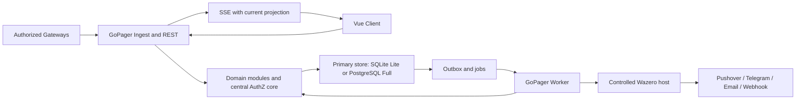
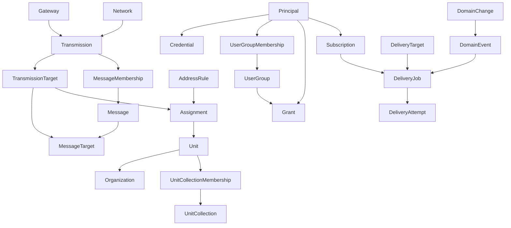

# GoPager Target Architecture and Responsibilities

Date: 2026-10-24. Architecture planning baseline, not an implementation description. Product decisions and approval status belong to the [plan](authoritative-plan.md); interfaces belong to the [contract catalog](domain-contracts.md).

## Technology Decisions

'Selected' means a reasoned planning decision inherited from the original plan, not a successful spike or a fixed package version. Go and the modular monolith were also directly confirmed by the user. Exact versions other than Vue 3, SQL drivers, Wasm ABI, UI component library, and build tools are not selected.

| ID | Selection | Rationale / boundary | Validation still required |
| --- | --- | --- | --- |
| TECH-01 | Go, modular monolith, single backend binary | Single-process Lite without installing a separate runtime; standard library first (`net/http`, `database/sql`, `context`), few justified dependencies, no heavy application framework. No claimed benchmark advantage. | Go version, target platforms, reproducible build in AP-03. |
| TECH-02 | Shared codebase and backend artifact for Lite/Full | Lite combines API, live views, ingest, plugin host, and jobs; Full may distribute the same capabilities across API/worker roles. No mandatory microservices or second Lite application. | Role startup, shutdown, resource profile. |
| TECH-03 | Vue 3 + TypeScript, statically built and embedded in the backend | Independent client/server development, deployment without a mandatory separate web server or frontend process. Build tools may be development dependencies. | Toolchain/versions, asset/API versioning, responsive and accessible UI. |
| TECH-04 | REST/JSON, versioned OpenAPI contract; SSE for live updates | Explicit query/command API; live communication is primarily server-to-browser. No WebSocket without a bidirectional product need. | API/error/cursor/SSE resume and revocation contract C-07. |
| TECH-05 | Local SQLite file for Lite; PostgreSQL for Full | Relational transactions, shared logical schema with explicit dialect/driver boundaries. No mandatory universal ORM or separate domain data models. | SQLite driver/build size/CGO trade-off, migrations, backend parity. |
| TECH-06 | PostgreSQL primary as Full write authority | Stateless API/worker roles; established external database HA with fencing instead of custom consensus. Replicas initially serve HA/recovery; only explicitly eventual reads. | Concrete HA operations, failover/lease/commit uncertainty. |
| TECH-07 | Transactional outbox/job tables in the primary database | Commit domain state and Domain event together; Full claims/leases work, Lite processes it in-process. Wake-up signals are optimization, not truth. No initial mandatory broker. | Claim/fencing, restart, receipt retention, finite retries. |
| TECH-08 | Language-neutral versioned Wasm SDK, embedded Wazero host | Separate operator-provided artifacts inside the Lite process, no native Go plugin ABI or mandatory plugin processes. No general filesystem or network access; controlled target-specific host functions. | ABI, runtime/toolchain versions, limits/cancellation, secrets/I/O, SDK lifecycle. No guarantee for arbitrary implementation languages. |
| TECH-09 | Database-integrated search baseline | No Lite search daemon. SQLite FTS5 trigram and PostgreSQL `pg_trgm` are candidates, not an already-correct search implementation. | Unicode/case folding/accents/short terms and authorized query parity before index selection. |
| TECH-10 | Central AuthZ core in Go | No baseline external policy service; one semantic owner for grants, field projection, and current Delivery authorization. | Safe SQL predicates/projections on both backends and revocation during SSE/jobs. |

A broker, cache, separate search index, or policy service may become a later Full optimization with demonstrated benefit, not a speculative baseline component. SQLite WAL permits only one concurrent writer; short transactions and local storage are prerequisites. No WAL on a shared network filesystem and no multi-host SQLite HA.

### Alternatives Considered

Node.js/TypeScript with JavaScript plugins was considered for its web/integration ecosystem and shared programming language, but not selected. single-executable delivery, dynamic/native modules, and resource use have their own trade-offs. JavaScript-only does not automatically provide polyglot support; separate plugin processes violate single-process Lite.

Rust with Wasm was considered for memory control and strong concurrency guarantees, but not selected. For the described load profiles, additional language/build complexity is not justified against maintainability and contributor accessibility. These are inherited selection reasons, not new measured performance comparisons. The Go decision is not reopened.

## Language and Internationalization

English is the authoritative language for planning, documentation, identifiers, comments, interface documentation, and default Localized text. Internationalization readiness is required from the first implementation; additional translations are not required yet. Extend REQ-097 rather than allocating a duplicate requirement.

- Frontend ownership: centralize user-facing labels, validation/error text, status text, accessibility labels, and built-in presentation text behind stable text keys and an English text catalog. Support parameter interpolation and pluralization; do not assemble sentences by concatenating translated fragments.
- Integration/API ownership: expose stable machine-readable error/status codes and structured parameters. Any human-readable fallback is English and is not a client parsing contract. Locale must not change field names, enum/Domain event values, IDs, authorization, or wire-format values. Do not translate Payload or operator-authored names/templates automatically.
- Keep interface language independent of user-selected formatting locale. Format dates, numbers, time zones, and relative times through centralized locale-aware facilities; preserve locale-independent storage/API representations and explicit time semantics.
- English is the only initially required catalog and fallback language. Choose a Vue-compatible i18n facility during AP-02/AP-13 planning; no library/version, additional language catalog, language-pack loading system, or language-selector UI is selected here.
- AP-13 owns frontend catalogs and formatting integration; AP-09 owns API code/parameter compatibility; AP-12 owns built-in processing/presentation Localized text. The integration owner coordinates shared keys/schema boundaries. Validate key completeness, interpolation/plurals, English fallback, independent formatting preferences, accessibility text, and layout resilience without requiring a second translated catalog.

This is preparation work for the future implementation, not a claim that an i18n runtime already exists. It neither approves unrelated product scope nor makes automatic translation a feature.

## Operating Profiles

Lite and Full share domain operations, contracts, and permissions. Lite combines roles in exactly one OS process; a SQLite file is not a separate database daemon. Frontend assets and Wazero are part of the application artifact/process. Containers are a delivery option, not an additional mandatory runtime for bare-metal use.

Full may replicate API/live and worker roles horizontally. PostgreSQL is authoritative; local caches or an open SSE connection do not confer write or authorization authority. One application container may include all roles; Full HA requires additional database/operational components. Replica reads must not make revocation or Delivery checks stale. Unclear authority visibly pauses acceptance and Delivery.

The diagram shows capabilities, not separate mandatory processes. The browser receives authorized projections only, never direct database/outbox or plugin Payloads.

## Domains and Data Ownership

This decomposition is a documented architecture draft implementing the confirmed boundaries. No Go package structure exists yet. 'Owner' means exclusive domain write responsibility, not ownership of an entire transaction or necessarily a single service.

| Domain / owner role | Owns and writes | Provides / consumes | Not responsible for |
| --- | --- | --- | --- |
| DOM-01 Transmission and Gateways | Gateways, authorized Network contexts, Network/Protocol mapping, heartbeats/state, submission receipts, immutable Transmissions and Transmission targets | C-01; uses C-02 Protocol description and C-06 AuthZ, provides evidence to C-03/C-05/C-08 | Unit master data, grant rules, Delivery heuristics; never silently replace unauthorized Network declarations |
| DOM-02 Protocol model and Grouping | Versioned Payload identity definitions, Grouping rules/configuration, Messages and Message membership as a derived projection | C-02/C-03; reads DOM-01 evidence, publishes Message Domain events through C-08 | Changing original Transmission, incident management, Gateway/Network-bound Payload identity |
| DOM-03 Units and domain structure | Units, organizations, Unit collections/memberships, templates, presentation defaults/overrides, Unit-specific Function meanings | C-04; uses C-06, triggers affected corrections through C-05 | Historical versioning of general colors/icons, User groups, assignment evidence |
| DOM-04 Assignment and correction | Temporal Address rules, conflict checks, versioned assignments, rematch jobs/progress, suppression rules and derived Transmission target state | C-05; reads DOM-01/DOM-03, uses C-02/C-06/C-08 | New Transmissions/Messages during rematching, global Payload masking, separate grant semantics |
| DOM-05 Identity and access | Internal Principals, credentials/identity bindings, sessions, API-key restrictions, User groups/memberships, grants, recovery/rescue proofs; central authorization/field projection semantics | C-06/C-13; used by every protected operation, coordinates account deletion with C-09 | Automatic email-based account linking, grants through new plugin fields, UI-based authorization |
| DOM-06 Search, feed, and details | Derived search/read projections and live/cursor state, not a second domain truth | C-07; consumes DOM-01..DOM-05 and their revisions, uses C-06 for counts/facets/SSE too | Separate permission rules, writing assignments/master data, sending unauthorized unprojected Domain events to browsers |
| DOM-07 Domain events and Delivery | Domain event records/outbox, subscriptions, Delivery targets, target/Unit Delivery settings, Delivery jobs and attempts | C-08/C-09; uses C-06/C-07 and C-10 plugin capabilities; Gateway/Message/correction Domain events as triggers | Defining another module's domain state, blanket once-per-Message Delivery, external exactly-once |
| DOM-08 Processing and presentation | Bounded rule definitions, active versions, previews/errors, derived structured results, presentation configuration | C-11; reads permitted original Payload/projections, may offer explicit reactions through C-08 | Overwriting original Payload identity, arbitrary scripts/loops, granting permissions |

### Supporting Responsibilities

| Role | Exclusive technical area | Boundary |
| --- | --- | --- |
| Integration | Composition root, use-case coordination, shared transaction/revision boundaries, contract versioning, OpenAPI/Domain event integration | No second domain/AuthZ truth; other modules change shared boundaries only by agreement. |
| Persistence and operations | Dialect adapters, migration execution/order, process roles, infrastructure claims/leases, backup/restore, status/shutdown | Schema object definitions belong to their domain owner; do not independently rewrite another owner's migrations. C-12. |
| Plugin host | Wazero adapter, artifact/compatibility checks, capability binding, limits/cancellation, secret transport | Executes only Delivery jobs authorized by DOM-07; does not configure another domain's permissions. C-10. |
| Frontend | Vue views, navigation/editors/accessibility, client state, English text catalog and locale-aware formatting | Uses C-07/C-11 and administrative APIs; hidden controls are not authorization; no direct SQL/host Functions. |

## Allowed Dependencies

1. Transports authenticate/validate, invoke use cases, and map results; they do not own Grouping, rematching, or retry decisions.
2. Domain modules communicate through documented operations and immutable references/results. No direct writes to another module's tables or runtime imports from PagerMon.
3. The AuthZ core may provide a centrally defined decision for SQL filters and field projection. Backend adapters must implement the same semantics; a second SQL-specific grant interpretation is prohibited.
4. DOM-06 may join owner-defined data/views for safe queries. 'No foreign writes' does not require individual module calls per search row or in-memory filtering after unauthorized pagination.
5. Domain state and Domain events use the same primary transaction. DOM-07 provides outbox/job mechanics, the producer owns Domain event meaning and causality, and integration owns the shared commit boundary.
6. Rule processing, plugin invocations, and provider I/O do not run inside long-lived SQL write transactions. Database rollback cannot recall external effects.
7. Apply dependency inversion at real infrastructure/module boundaries, not a generic repository/service hierarchy per entity without benefit. Derive concrete Go interfaces from frozen consumer needs.

## Shared Use Cases

| Use case | Leading coordination | Domain writes / consistency obligation |
| --- | --- | --- |
| Accept Transmission | Integration + DOM-01 | Authorize Gateway/Network, ensure idempotency, record Transmission; Message/assignment derivation and Domain event recording have their own owners. Whether derivation belongs to the first commit or is explicitly deferred remains open in C-01/C-03. Never falsely acknowledge 'fully processed'. |
| Change Address rule / delete Unit | DOM-04 or DOM-03 with integration | Reliably schedule affected rematching and protect unsafe old assignments; publish a consistent new revision. No dangling visible Unit references. The concrete revision mechanism is P-12, not already implemented. |
| Delete organization | DOM-03 | Determine effective inherited values, preserve them for Units, detach organization; filters/grants follow the new state. No Unit rematch. |
| Revoke rights / delete account | DOM-05 with DOM-06/DOM-07 | Sessions/keys/subscriptions and live/Delivery decisions use current state. Anonymize historical audit/Delivery fields under C-13; concrete deletion schema remains open. |
| Attempt Delivery | DOM-07 + plugin host | Check current Principal, subscription, data/field permissions, and age rules; record attempt/I/O/uncertain outcome separately. C-09 defines the exact authorization/execution boundary. |
| Apply retention | Operations + respective data owners + integration | Configured limits only, referential integrity, no resurrection through retries/replay. Transmission evidence is immutable, not necessarily retained forever. |

## Logical Relationship Model

Draft, not a physical SQL schema. IDs, Protocol-specific cardinalities, data types/constraints, and indexes are frozen with C-01..C-07. EAS target areas are not assumed to be pager Addresses or Units without validation.

`Network -> Transmission` denotes a resolved reference, not a requirement to store unknown Networks as an empty name. Database normalization remains open. An assignment connects a specific observed Transmission target to a Unit under a revision; Message-wide sets cannot replace this relationship.

## Non-Goals and Boundaries

No legacy adapter, automatic legacy-data migration, incident/personnel management, custom database consensus, or in-app plugin marketplace. No arbitrary polyglot runtime or sandbox guarantee. OIDC/SCIM/PWA and other delivery phases are defined only in the [delivery scope](authoritative-plan.md#delivery-scope), not brought forward by technical preparation. Internationalization readiness does not require additional translations.