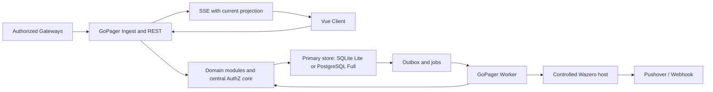
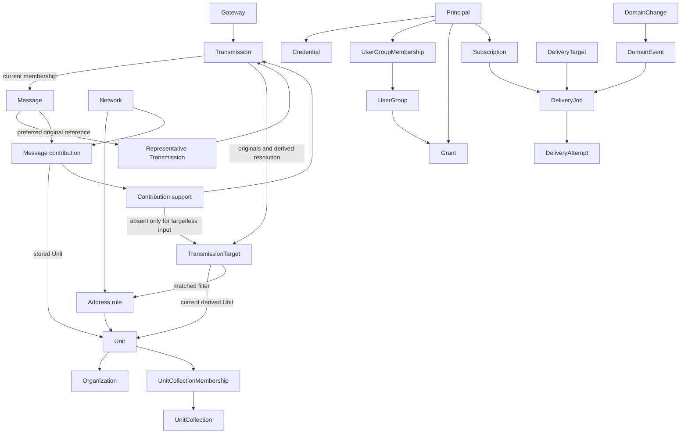

# GoPager Target Architecture and Responsibilities

Date: 2026-10-25. This file owns technology selections/rationale, topology, module/data ownership and dependency rules. Boundary behavior belongs to [owner contracts](domain-contracts.md); decision disposition/approval belongs to the [plan](authoritative-plan.md). Diagrams are relationship maps, never complete schemas.

## Technology Decisions

'Selected' means a reasoned planning decision inherited from the original plan, not a successful spike or a fixed package version. Go and the modular monolith were also directly confirmed by the user. Exact foundation versions are now approved in the [AP-05 selection](#ap-05-foundation-version-selection); SQLite drivers, Wasm ABI, UI component library and frontend build tools remain unselected.

| ID | Selection | Rationale / boundary | Evidence/gate owner |
| --- | --- | --- | --- |
| TECH-01 | Go, modular monolith, single backend binary | Single-process Lite without installing a separate runtime; standard library first (`net/http`, `database/sql`, `context`), few justified dependencies, no heavy application framework. No claimed benchmark advantage. | [AP-03 T010/T014](work-packages/ap-03-technical-validation.md) |
| TECH-02 | Shared codebase and backend artifact for Lite/Full | Lite composes roles; Full may distribute the same capabilities. Topology is shown below. | [P-20/P-21](authoritative-plan.md#open-issues-and-risks) |
| TECH-03 | Vue 3 + TypeScript, statically built and embedded in the backend | Independent client/server development, deployment without a mandatory separate web server or frontend process. Build tools may be development dependencies. | [AP-13](work-packages/ap-13-frontend.md), [C-07](contracts/c-07-query-live.md) |
| TECH-04 | REST/JSON, versioned OpenAPI contract; SSE for live updates | Explicit query/command API; live communication is primarily server-to-browser. No WebSocket without a bidirectional product need. | [P-10/P-15](authoritative-plan.md#open-issues-and-risks), [C-07](contracts/c-07-query-live.md) |
| TECH-05 | Local SQLite file for Lite; PostgreSQL for Full | Relational transactions, shared logical schema with explicit dialect/driver boundaries. No mandatory universal ORM or separate domain data models. | [AP-03 T010](work-packages/ap-03-technical-validation.md), [P-01/P-03](authoritative-plan.md#open-issues-and-risks) |
| TECH-06 | PostgreSQL primary as Full write authority | Stateless API/worker roles; established external database HA rather than custom consensus. Authority/replica behavior is specified in C-12. | [P-04/P-20](authoritative-plan.md#open-issues-and-risks), [C-12](contracts/c-12-persistence-operations.md) |
| TECH-07 | Transactional outbox/job tables in the primary database | Avoids a mandatory separate broker; integrates with the shared database transaction boundary. Job/event behavior belongs to [C-08](contracts/c-08-events-jobs.md). | [P-04/P-11](authoritative-plan.md#open-issues-and-risks) |
| TECH-08 | Language-neutral versioned Wasm SDK, embedded Wazero host | Embeddable extension runtime without native Go plugin ABI or mandatory plugin processes. Trust, capabilities and optional subprocess exception are defined only in [C-10](contracts/c-10-plugin-host.md). | [P-05..P-07](authoritative-plan.md#open-issues-and-risks) |
| TECH-09 | Database-integrated search baseline | No Lite search daemon. SQLite FTS5 trigram and PostgreSQL `pg_trgm` are candidates, not an already-correct search implementation. | [P-15](authoritative-plan.md#open-issues-and-risks), [C-07 search representation](contracts/c-07-query-live.md) |
| TECH-10 | Central AuthZ core in Go | No baseline external policy service; one semantic owner for grants, field projection, and current Delivery authorization. | [P-10](authoritative-plan.md#open-issues-and-risks), [C-06](contracts/c-06-identity-authorization.md) |

A broker, cache, separate search index, or policy service may become a later Full optimization with demonstrated benefit, not a speculative baseline component. SQLite WAL permits only one concurrent writer; short transactions and local storage are prerequisites. No WAL on a shared network filesystem and no multi-host SQLite HA.

### AP-05 Foundation Version Selection

**TECH-01/05/06; D-35; status: approved 2026-10-26 for AP-05 only.** Exact initial implementation tuple: Go `1.26.2`, `github.com/jackc/pgx/v5 v5.11.0` through its `stdlib` adapter and Go `database/sql`, PostgreSQL `18.0`. The reproducible local test image is `postgres:18.0-alpine` at OCI index digest `sha256:48c8ad3a7284b82be4482a52076d47d879fd6fb084a1cbfccbd551f9331b0e40`; this pins the test fixture, not a requirement that Operators deploy Alpine containers. AP-03 characterized these exact candidates; the user separately approved their production selection under [D-35](authoritative-plan.md#ap-04-foundation-freeze-decision). No claim of latest versions, vulnerability certification or product runtime validation follows.

Use the standard library for startup/configuration, HTTP status handlers, structured logging and test harnesses; no application framework, ORM or migration dependency is selected. `go.mod`/`go.sum` become executable dependency authorities in AP-05 and this section then links them rather than maintaining competing pins. New dependencies/version changes require their own rationale and affected compatibility checks; no silent switch to another tuple. SQLite driver, Wazero/SDK tuple, Unicode/search implementation and frontend tools remain unselected by this foundation approval.

The application consumes store-neutral transaction/repository interfaces under [C-12](contracts/c-12-persistence-operations.md#ap-05-foundation-boundary); pgx/SQL handles, dialects and migration SQL stay in infrastructure. AP-05 owns only platform schema objects. Domain owners later register their own migrations through integration, without copying AP-03 probe tables into production.

### Alternatives Considered

Node.js/TypeScript with JavaScript plugins was considered for its web/integration ecosystem and shared programming language, but not selected. single-executable delivery, dynamic/native modules, and resource use have their own trade-offs. JavaScript-only does not automatically provide polyglot support; separate plugin processes violate single-process Lite.

Rust with Wasm was considered for memory control and strong concurrency guarantees, but not selected. For the described load profiles, additional language/build complexity is not justified against maintainability and contributor accessibility. These are inherited selection reasons, not new measured performance comparisons. The Go decision is not reopened.

## Language and Internationalization

This section allocates responsibilities, not another copy of [REQ-097](requirements-catalog.md#j-processing-presentation-and-usability) or the language/text contracts.

| Responsibility | Owner | Authoritative boundary |
| --- | --- | --- |
| Frontend text catalog, formatting integration and Vue-compatible i18n selection | Frontend / AP-13 | [C-11 text mappings/preferences](contracts/c-11-processing-presentation.md#text-key-mapping-and-remaining-technical-evidence) |
| API error/code/parameter compatibility | DOM-06 / AP-09 | [C-07](contracts/c-07-query-live.md) |
| Built-in processing/presentation text | DOM-08 / AP-12 | [C-11](contracts/c-11-processing-presentation.md) |
| Shared key/schema compatibility | Integration | [Shared conventions](contracts/shared-conventions.md) |

## Operating Profiles

**AP-04 delivery amendment:** Under [D-32](authoritative-plan.md#ap-04-scope-decision), implement Full/PostgreSQL first. Lite below describes the retained target topology, not a first-release runtime obligation. Domain/application services must not depend on PostgreSQL-specific driver types, dialect SQL or multi-process-only communication. Infrastructure adapters own dialects, transaction execution, migrations and store-specific queries behind consumer-driven interfaces; application composition must permit in-process roles. Later Lite adds alternative adapters/composition without changing domain ownership or the logical Message model. Do not implement a speculative SQLite adapter now or promise parity before testing it. Review these boundaries with PostgreSQL-backed integration tests now; run the same domain conformance cases against SQLite when that adapter is introduced.

TECH-02 defines the shared artifact: Lite composes API/live/ingest/plugin/jobs in one process; Full may distribute API/live and worker roles. Frontend assets and Wazero are embedded. SQLite is a local file; PostgreSQL is an external Full component. Containers are a deployment option, not a mandatory bare-metal runtime. Optional plugin subprocesses follow [C-10](contracts/c-10-plugin-host.md).

This topology does not establish database HA. Operational authority/replica/failure behavior is defined in [C-12](contracts/c-12-persistence-operations.md), not repeated here.

The diagram shows capabilities, not separate mandatory processes. The browser receives authorized projections only, never direct database/outbox or plugin Payloads.

## Domains and Data Ownership

This decomposition is a documented architecture draft implementing the confirmed boundaries. No Go package structure exists yet. 'Owner' means exclusive domain write responsibility, not ownership of an entire transaction or necessarily a single service.

| Domain / owner role | Owns and writes | Provides / consumes | Not responsible for |
| --- | --- | --- | --- |
| DOM-01 Transmission and Gateways | Gateways, authorized Network contexts, Network/Protocol mapping, heartbeats/state, submission receipts, immutable Transmissions and Transmission targets | C-01; uses C-02 Protocol description and C-06 AuthZ, provides evidence to C-03/C-05/C-08 | Unit master data, grant rules, Delivery heuristics; never silently replace unauthorized Network declarations |
| DOM-02 Protocol model and Grouping | Payload identity definitions, Grouping policy, Messages/internal Message time, exact membership with future comparison extension boundary (D-30), representative preference and aliases | C-02/C-03; coordinates contribution coalescing on merge with DOM-04 and publishes facts through C-08 | Changing original Transmission, Unit-based Grouping, incident management, Gateway/Network-bound Payload identity |
| DOM-03 Units and domain structure | Units, organizations, Unit collections/memberships, templates, presentation defaults/overrides, Unit-specific Function meanings | C-04; uses C-06, triggers affected corrections through C-05 | Historical versioning of general colors/icons, User groups, assignment evidence |
| DOM-04 Assignment and correction | Temporal Address rules, current target Network/Unit/matched-rule resolution, Message contributions with direct Unit/first times/age anchors, Contribution supports, rematch work and suppression | C-05; derives from DOM-01 evidence/current rules, uses C-02/C-06/C-08; sole writer of target resolution and contribution read model | New Transmissions/Messages during rule Rematching, editing original Payload, global Payload masking, mandatory immutable rule histories, separate grant semantics |
| DOM-05 Identity and access | Internal Principals, credentials/identity bindings, sessions, API-key restrictions, User groups/memberships, grants, recovery/rescue proofs; central authorization/field projection semantics | C-06/C-13; used by every protected operation, coordinates account deletion with C-09 | Automatic email-based account linking, grants through new plugin fields, UI-based authorization |
| DOM-06 Search, feed, and details | Query-derived Unit appearances/View time, authorized representative selection, search/read projections and live/cursor state | C-07; normal reads use Message contributions/direct Unit, not rule-version joins or reception-history scans; diagnostics can read supports/evidence | Separate permissions, independently editing contribution truth, writing target resolutions/master data, private raw Domain event feeds |
| DOM-07 Domain events and Delivery | Domain event records/outbox, subscriptions, Delivery targets, target/Unit Delivery settings, Delivery jobs and attempts | C-08/C-09; uses C-06/C-07 and C-10 plugin capabilities; Gateway/Message/correction Domain events as triggers | Defining another module's domain state, blanket once-per-Message Delivery, external exactly-once |
| DOM-08 Processing and presentation | Bounded Workflows/active versions, previews/errors, source-bound Processing results, presentation configuration and ingest publication barrier | C-11; trusted installed steps follow C-10; level/other fields feed explicit Subscription predicates through C-08/C-09 | Overwriting original Payload identity, arbitrary inline scripts/unbounded loops, granting permissions |

### Supporting Responsibilities

| Role | Exclusive technical area | Boundary |
| --- | --- | --- |
| Integration | Composition root, use-case coordination, shared transaction/revision boundaries, contract versioning, OpenAPI/Domain event integration | No second domain/AuthZ truth; other modules change shared boundaries only by agreement. |
| Persistence and operations | Dialect adapters, migration execution/order, process roles, infrastructure claims/leases, status/shutdown and profile transition | Schema objects belong to their domain owner; do not independently rewrite another owner's migrations. Manual Operator Backup/Restore is outside application responsibilities (C-12/D-31). |
| Plugin host | Wazero adapter, artifact/compatibility checks, capability binding, limits/cancellation, secret transport | Executes only Delivery jobs authorized by DOM-07; does not configure another domain's permissions. C-10. |
| Frontend | Vue views, navigation/editors/accessibility, client state, English text catalog and locale-aware formatting | Uses C-07/C-11 and administrative APIs; hidden controls are not authorization; no direct SQL/host Functions. |

## Allowed Dependencies

1. Transports authenticate/validate, invoke use cases, and map results; they do not own Grouping, rematching, or retry decisions.
2. Domain modules communicate through documented operations and immutable references/results. No direct writes to another module's tables or runtime imports from PagerMon.
3. The AuthZ core may provide a centrally defined decision for SQL filters and field projection. Backend adapters must implement the same semantics; a second SQL-specific grant interpretation is prohibited.
4. DOM-06 may join owner-defined data/views for safe queries. 'No foreign writes' does not require individual module calls per search row or in-memory filtering after unauthorized pagination.
5. Domain state and Domain events use the same primary transaction. DOM-07 provides outbox/job mechanics, the producer owns Domain event meaning and causality, and integration owns the shared commit boundary.
6. Rule processing, plugin invocations, and provider I/O do not run inside long-lived SQL write transactions. Database rollback cannot recall external effects.
7. Apply dependency inversion at real infrastructure/module boundaries, not a generic repository/service hierarchy per entity without benefit. Derive concrete Go interfaces from frozen consumer needs.

## Shared Use Cases

| Use case | Leading coordination | Authoritative behavior |
| --- | --- | --- |
| Accept Transmission | Integration + DOM-01/DOM-02/DOM-04/DOM-08 | [C-01 intake](contracts/c-01-transmission-acceptance.md), [C-03 membership](contracts/c-03-message-grouping.md), [C-05 derivation](contracts/c-05-matching-correction.md), [C-11 publication](contracts/c-11-processing-presentation.md) |
| Change Address rule / delete Unit | DOM-04 or DOM-03 with integration | [C-05 correction](contracts/c-05-matching-correction.md), [C-04 deletion](contracts/c-04-master-data.md) |
| Delete organization | DOM-03 | [C-04](contracts/c-04-master-data.md) |
| Revoke rights / delete account | DOM-05 with DOM-06/DOM-07 | [C-06 revocation](contracts/c-06-identity-authorization.md), [C-13 cleanup](contracts/c-13-account-lifecycle.md) |
| Attempt Delivery | DOM-07 + plugin host | [C-09 attempt boundary](contracts/c-09-delivery.md), [C-10 invocation](contracts/c-10-plugin-host.md) |
| Apply retention | Operations + data owners + integration | [C-12 retention](contracts/c-12-persistence-operations.md), [C-09 dependencies](contracts/c-09-delivery.md) |

## Logical Relationship Model

Confirmed relationship direction under [D-29](authoritative-plan.md#d-29), not a SQL schema or field inventory. The diagram is the relationship map; the table routes records to exclusive writers and their owning contract. Required stored/reconstructable information, concrete fields/types/keys, revisions, constraints and indexes are specified only in those contracts. Normalization/deduplication may not lose required information. Vocabulary is owned by the [glossary](glossary.md).

The representative box denotes a role/reference to an existing Transmission, not another stored entity.

| Logical record / portion | Exclusive writer | Authoritative record detail |
| --- | --- | --- |
| Transmission originals / original targets / Gateway / Network | DOM-01 | [C-01](contracts/c-01-transmission-acceptance.md), [C-02 Protocol forms](contracts/c-02-protocol-payload.md) |
| Membership / Message / representative / aliases | DOM-02 | [C-03](contracts/c-03-message-grouping.md) |
| Unit / organization / collection / defaults | DOM-03 | [C-04](contracts/c-04-master-data.md) |
| Derived target resolution / contributions / supports / Address rules / suppression | DOM-04 | [C-05](contracts/c-05-matching-correction.md#target-resolution-message-contributions-and-ingest-storage) |
| Principal / credential / grant / User group / cleanup | DOM-05 | [C-06](contracts/c-06-identity-authorization.md), [C-13](contracts/c-13-account-lifecycle.md) |
| Query result / Unit appearance / View time | DOM-06 projection, not domain truth writes | [C-07](contracts/c-07-query-live.md) |
| Domain event / job / Subscription / Delivery input / attempt | DOM-07 mechanics; producing domain owns fact meaning | [C-08](contracts/c-08-events-jobs.md), [C-09](contracts/c-09-delivery.md) |
| Workflow / result / presentation configuration | DOM-08 | [C-11](contracts/c-11-processing-presentation.md) |
| Plugin / Secret / Extension definitions | Plugin host | [C-10](contracts/c-10-plugin-host.md) |

Derivation direction is originals -> current resolution -> contribution read model. Gateway/Network/Unit diagram nodes are stubs: their complete capabilities remain in the linked master-data contracts; omission from the diagram removes nothing.

**Displayed Payload ownership:** [C-03](contracts/c-03-message-grouping.md) owns representative preference/selection; [C-07](contracts/c-07-query-live.md) owns its authorized query projection and variant details; [C-11](contracts/c-11-processing-presentation.md) owns source-bound Processing/publication. This model does not define a second selection algorithm.

### Time and Read Paths

- Write path: original evidence -> current target resolution -> shared contributions/supports. [C-05](contracts/c-05-matching-correction.md) owns contribution minima, age anchors and correction; [C-03](contracts/c-03-message-grouping.md) owns internal Message time.
- User read path: direct contribution Unit/Network/Protocol -> permitted contributions -> query-derived Unit appearances -> time/age predicates -> readable Payload/representative -> one row per Message. No routine rule-version join or full reception-history scan. The precise algorithm, intervals, sort/cursor and diagnostic exceptions belong to [C-07](contracts/c-07-query-live.md#time-selection-and-one-row-message-results); concrete time cases belong to [F-11a..F-11i](contracts/reference-cases.md).
- Restricted evidence/age permissions may require scoped support evaluation rather than the stored aggregate alone; [C-06](contracts/c-06-identity-authorization.md) owns authorization semantics.
- Direct Unit columns on targets/contributions are approved denormalization, not an optional unmeasured schema experiment. Concrete indexes, SQL layout, revision fields and backend query plans remain owner-package work validated in AP-03. Additional aggregate layers require a demonstrated need.

## Non-Goals and Boundaries

Product exclusions/delivery phase are owned by the [plan](authoritative-plan.md#delivery-scope) and its D-ID owner links. This architecture does not bring deferred scope forward. Runtime trust/support boundaries belong to [C-10](contracts/c-10-plugin-host.md) and [C-12](contracts/c-12-persistence-operations.md).