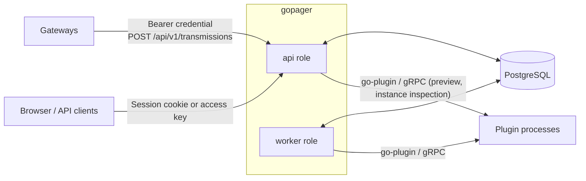
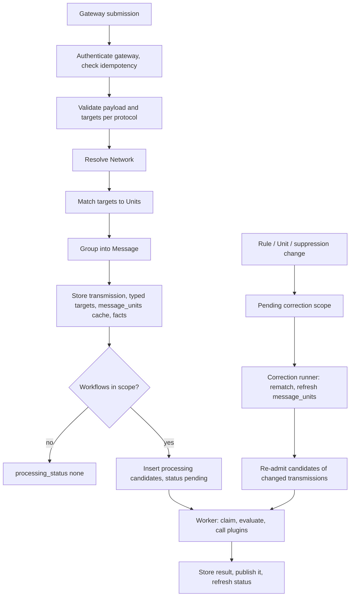
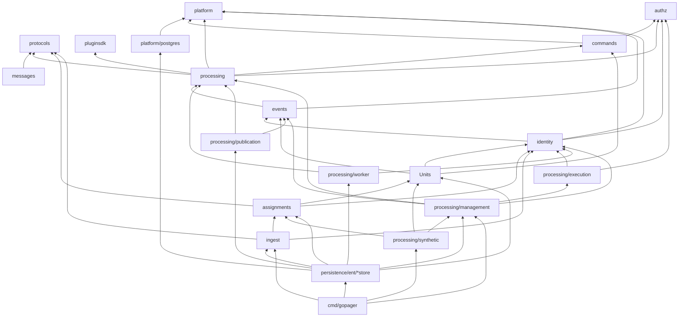
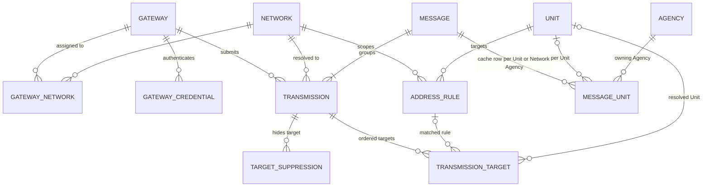
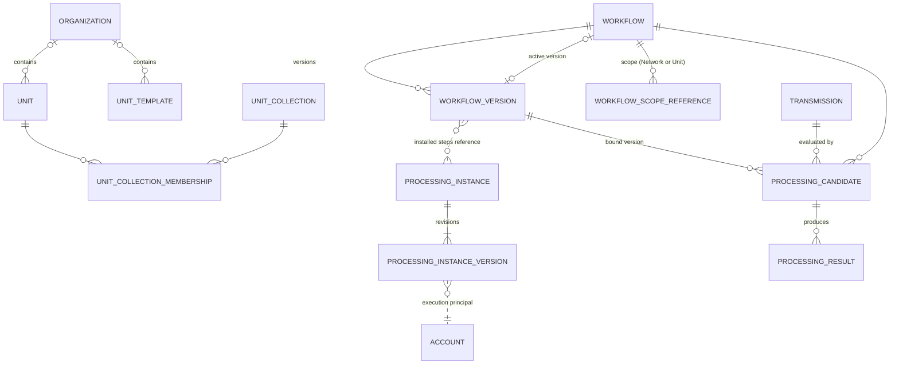
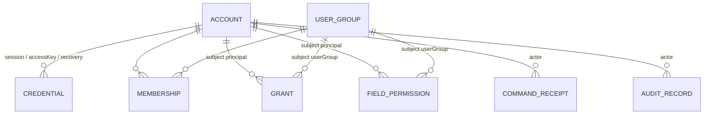

# Architecture

## System overview

GoPager receives decoded pager transmissions (POCSAG, FLEX, ZVEI, EAS) from authenticated gateways and stores each one as immutable evidence. Transmissions with the same payload identity that arrive within a grouping window are combined into one Message. Each transmission target (address/function) is resolved to a Unit through temporal address rules; rule, Unit and suppression changes are applied to stored history by a correction worker. Workflows evaluate transmissions in a worker process, can call operator-installed plugins, and attach their results to the Message when they complete; accepted evidence is visible from the moment intake commits.

GoPager is a single Go binary, `gopager` ([cmd/gopager](../cmd/gopager/)), backed by PostgreSQL. The `--roles` flag selects which roles a process runs:

| Role | Runs | Started from |
| --- | --- | --- |
| `api` | HTTP listener: gateway intake, login/session, management routes, health endpoints | `composeApplicationAPI` in [main.go](../cmd/gopager/main.go) |
| `worker` | Processing dispatcher (workflow candidates) and correction runner (rematching, Processing readmission) | `composeProcessingWorker`, `composeCorrectionRunner` |
| `bootstrap` subcommand | One-shot local creation of the first account; no listener | [bootstrap.go](../cmd/gopager/bootstrap.go) |

One process can run both roles (`--roles api,worker`), or the roles can run in separate processes against the same database. Role processes coordinate only through PostgreSQL (row locks, leases, fencing tokens). They do not talk to each other directly.

| External actor | Interaction |
| --- | --- |
| Gateway | Submits transmissions and state reports with a per-gateway bearer credential. See [http-api.md](http-api.md). |
| Browser / API client | Authenticates with a session cookie (human accounts) or an access key, or acts as the guest account when anonymous. Manages master data, rules, gateways, workflows and instances. |
| Plugin | Operator-provisioned executable, pinned by SHA-256 digest and verified again by go-plugin each time it is started. One long-lived child process per instance revision, pooled by the plugin host, called over gRPC one request at a time and stopped after an idle timeout, when its instance changes, or at shutdown. Previews call the same process with `mode: "preview"`. See [plugins.md](plugins.md). |
| PostgreSQL | The only store: domain state, domain events, outbox, work queues, migration ledger, and the clock used for domain time. See [operations.md](operations.md). |

## End-to-end data flow

### Intake (one transaction)

`POST /api/v1/transmissions` runs as a single primary transaction. If any step fails, nothing is stored. The only exception is a separate transaction that records a rejected submission (`operation.submission-rejected`).

| Step | What happens | Package |
| --- | --- | --- |
| HTTP decoding | Bearer extraction, `application/json`, size limit, JSON decoding | `cmd/gopager` ([ingest.go](../cmd/gopager/ingest.go)) |
| Gateway authentication | The bearer secret hash identifies exactly one gateway. A pending replacement credential takes over on first use. | `identity.GatewayAuthenticator`, `ingeststore` |
| Validation | Submission shape, observation time, payload form per protocol, target address/function ranges | `ingest` (`Submission.Validate`), `protocols` |
| Submission idempotency | `(gateway, submissionId)` plus an input fingerprint. A matching retry returns the original receipt; a different input is rejected. | `ingest`, `ingeststore` |
| Payload identity | Each payload form maps to a comparison-only identity (form, subtype, normalized value). The submitted payload is stored unchanged. | `protocols.TransmissionPayload.Identity` |
| Network resolution | In order: declared gateway network identifier (`declared`), the gateway's only network for the protocol (`inferred-single`), the gateway default (`default`). Address rules never select a Network, so no ambiguity fact exists. | `ingest.ResolveNetwork` |
| Target matching | Each target position is resolved against the current address rules at its observation time: `assigned` (Unit plus rule) or `unassigned`. Overlapping rules resolve to the most specific selector. Ambiguity is a conflict. | `assignments.Resolve`, `assignments.Service.MatchTargets` |
| Grouping | Candidate Messages have equal payload identity and `last_observed_at >= observed - window AND first_observed_at <= observed + window` (index `messages_identity` on identity and `last_observed_at`); their members are those with `transmissions.observed_at` in the inclusive range `[observed - window, observed + window]` (`make_interval(secs => window)`, no arithmetic on the column). `messages.Decide` decides over these members: none, create a Message; one Message, join it; several, merge them into the lowest ID and move their transmissions and `message_units` rows. The store applies the decision (survivor, absorbed, late join, revision). Window `0` disables grouping. | `ingeststore.groupMessage` (decision from `messages.Decide`) |
| Persistence | Transmission, ordered targets with their resolution and typed address columns (`network_id`, `protocol`, `observed_at`, `address_number` or `address_text`, `function`), `message_units` cache rows (one per Message and Unit with the Unit's Agency, or one Unit-less row per Message and Network Agency for targetless input) | `ingeststore.AcceptTransmission` |
| Correction scope | None at intake: targets are stamped with the assignment revision read under the shared Assignment lock, so a correction recorded afterwards (always at a higher revision) selects them by selector if affected; no dirty capture exists | `assignmentstore.MarkPending` |
| Facts | `gateway.state-changed`, `message.created` / `message.transmission-joined` / `message.merged`, one `assignment.changed` (reason `created`) per Transmission with targets, carrying the ordered target resolutions, `operation.observation-time-implausible` | `events`, `eventstore` |
| Processing admission | Select enabled workflows with an active version and scope `all`, the matching Network, or one of the matched Units. Insert one `processing_candidates` row per selected workflow and set `processing_status` to `pending`, or to `none` when no workflow is selected. | `ingeststore.admitProcessing` |

The response is `202` when the processing status is `pending` and `200` otherwise. The accepted evidence is visible to readers either way.

### Processing (worker role)

| Step | What happens | Package |
| --- | --- | --- |
| Due selection | Selects due candidates with `FOR UPDATE SKIP LOCKED` (no control-row lock, no paging) for bounded concurrency; wakes on a `gopager_processing_due` notification, with a poll interval as fallback | `processing/worker.Dispatcher`, `processingstore.SelectDueWork`, `postgres.Store.Listen` |
| Reconcile | Supersede candidates whose workflow, version, source or assignment context changed, including the dispatched one. Admit current bindings. Recover expired leases. | `ingeststore.ProcessingSourceOwner.ReconcileCandidate` |
| Capture and claim | In one transaction: capture a detached source projection (payload fields, targets, Units, Network) and claim the candidate (lease, fencing token, worker ID) | `worker.Service`, `ProcessingSourceOwner.CaptureCandidate`, `processingstore` |
| Evaluate | Outside any SQL transaction: compile the definition (CEL predicates, Core regex extraction, map, branch, installed plugin steps) and evaluate within a compute budget. Evaluation is two-valued and runs as the system; no value carries a per-value classification | `processing` (`WorkflowProgram.EvaluateScoped`, `PluginHost`) |
| Complete or fail | Recheck source and authority, then write a `processing_results` row or a classified failure with automatic retry scheduling (at most 5 attempts) | `worker.Service.finish`, `processingstore` |
| Publish | In the same transaction: attach completed, not yet published results to the Message (`published_at`, `message_id`), emit `processing.completed`, and derive the transmission's processing status from the candidates of the currently selected workflows | `processing/publication.Service`, `ProcessingSourceOwner.ApplyProcessingStatus` |

Workflow definitions, versions, activation and processing instances are described in [workflows.md](workflows.md). The plugin protocol is described in [plugins.md](plugins.md).

### Processing status

There is no publication barrier (D-135): accepted evidence is visible on commit, and processing adds results to it. Two fields describe that state.

| Record | Field | Meaning |
| --- | --- | --- |
| `transmissions` | `processing_status` (`none`/`pending`/`completed`/`failed`) | `none` when no workflow was selected at intake; otherwise derived from the candidates of the currently selected workflows: `pending` while any is pending or running, `failed` when none is pending and at least one failed, `completed` when all completed |
| `processing_results` | `published_at`, `message_id` | Set when the result was attached to the Message; `message_id` references `messages` and follows a merge |

Result-dependent reactions subscribe to `processing.completed`; nothing else waits for processing.

### Historical correction (worker role)

Creating, updating or deleting a rule, deleting a Unit, or changing a suppression does three things in the same transaction. It increments `assignment_control.revision`, stores an `assignment_pending_scopes` row (reason `rule-change`, `unit-deleted` or `suppression-change`, affected Networks/Unit), and returns that scope's status to the caller.

`assignments.CorrectionRunner` then processes the queue:

1. It claims the oldest due scope with a lease and fencing token (`assignmentstore.ClaimCorrection`).
2. It reads the transmissions with a target inside the scope's selector (Network, protocol and address range or text with an optional validity window; one Unit; or one target) that still carry an older assignment revision, in batches of 100 ordered by `(accepted_at, id)` after a cursor. Each batch runs `MatchTargets` again at the original observation time; the fresh match may be at a newer assignment revision than the scope.
3. `ApplyCorrectionBatch` updates changed target resolutions and rebuilds the Message's `message_units` rows. Suppressed targets are excluded. Each Transmission with changed targets emits one `assignment.changed` (reason `corrected`) listing the changed targets with before and after.
4. In the same batch transaction, the runner re-admits processing for every transmission whose resolution changed (`ProcessingSourceOwner.ReadmitProcessing`): candidates bound to the old assignment context are superseded, a candidate is admitted for every currently selected workflow and the transmission's processing status becomes `pending`. Unchanged transmissions keep their candidates and status.
5. On failure, the scope is rescheduled with backoff and a failure code. It can be retried through `POST /api/v1/assignment-corrections/{id}/retry`.

Correction never creates or deletes transmissions or Messages and never changes grouping.

## Package map

### Dependency layering

Derived from `go list -f '{{.ImportPath}} {{.Imports}}' ./...` (internal imports only; test-only packages and transitively implied edges omitted):

The layering rules that the code follows:

- Domain and application packages (`authz`, `protocols`, `messages`, `commands`, `events`, `identity`, `Units`, `assignments`, `ingest`, `processing/...`) never import `platform/postgres`, Ent, or any store package. They declare small consumer interfaces (`Repository`, `Clock`, `Transactions`, owner ports) and receive `platform.TransactionContext`.
- `authz`, `protocols`, `platform` and `pluginsdk` are leaves with no internal imports.
- Store adapters under `internal/persistence/ent/` implement those interfaces and are the only importers of `platform/postgres` besides `cmd/gopager`.
- `cmd/gopager` is the composition root. It constructs stores, wires them into services, and registers HTTP routes.
- `events` imports `processing` to validate `processing.completed` result payloads, so `processing` cannot import `events`.
- The generated Ent package and its `schema` import domain types (`Units`, `assignments`, `authz`, `commands`, `processing`) for typed JSON columns.

### Packages

| Package | Responsibility |
| --- | --- |
| `cmd/gopager` | Flag/env configuration, role composition, HTTP route registration and JSON mapping for management, intake, gateway and processing routes, `bootstrap` subcommand |
| `internal/platform` | Store-neutral runtime: `Config`/roles, `Store` and `Runner` interfaces, `TransactionContext`, `Clock`, `Failure` error codes, readiness/health handlers, graceful shutdown (`StartWithAPI`, `RunningHandle`) |
| `internal/platform/postgres` | PostgreSQL `Store`: connection/TLS policy, primary-only transactions, failure classification, database clock, goose migration check/apply under an advisory lock |
| `internal/authz` | Grant/scope/action catalog, field permissions, access-key restrictions, `Authorize` point decisions, age cutoffs |
| `internal/identity` | Accounts, password hashing (Argon2id), secrets, login with rate limits, sessions/CSRF/origin policy (`HTTPTransport`), `Resolver` (proof to current authority), gateway authentication, bootstrap |
| `internal/commands` | Actor-bound command receipts, input fingerprints, optimistic revision increments |
| `internal/events` | Domain event fact types, envelope construction and validation, appender interfaces |
| `internal/protocols` | Protocol enum, address/target model and ranges, payload forms, payload identity |
| `internal/messages` | Grouping decision type and the pure grouping function `Decide` |
| `internal/Units` (package `units`) | Agencies, Units, Unit collections, Organizations with setting defaults, Unit templates, bulk Unit operations, setting inheritance |
| `internal/assignments` | Address rules (selectors, validity intervals, conflict validation), target matching, suppressions, correction status/retry, `CorrectionRunner` |
| `internal/ingest` | Submission validation, Network resolution, intake service, gateway state reports, gateway administration (network assignment, credentials) |
| `internal/processing` | Workflow definition model and compiler, CEL predicates, Core regex, value/schema codec, candidate state machine, retry schedule, source capture, plugin host (process pool, verified-artifact cache) and installed-step execution, processing instances |
| `internal/processing/management` | Authorized workflow/version/instance commands and reads, candidate status reads, manual retry, preview |
| `internal/processing/worker` | Candidate dispatcher and per-candidate execution (claim, evaluate, complete/fail, publish) |
| `internal/processing/publication` | Applies completed results and source readiness in the caller's transaction |
| `internal/processing/execution` | Binds a request proof to preview authority for installed steps |
| `internal/processing/synthetic` | In-memory synthetic transmissions used as the source for workflow previews |
| `internal/persistence/migrations` | Embedded goose SQL migrations (`migrations.Files`) |
| `internal/persistence/ent` | Generated Ent client (do not edit). `schema/` holds the entity definitions. |
| `internal/persistence/ent/borrowed` | Ent driver that runs on an existing platform transaction and cannot commit or close it |
| `internal/persistence/ent/guard` | Mandatory Ent privacy policy: deny unless an adapter-bound access decision is in context |
| `internal/persistence/ent/permissions` | Translates `authz` grants into EntQL row predicates (`ReadScope`) |
| `internal/persistence/ent/identitystore` | Accounts, credentials, grants, field permissions, login attempts, audit, access revision |
| `internal/persistence/ent/unitstore` | Units, collections, Organizations, templates |
| `internal/persistence/ent/assignmentstore` | Address rules, assignment revision, pending scopes, suppressions, correction worker queries |
| `internal/persistence/ent/ingeststore` | Gateways, Networks, credentials, transmission intake, grouping, the message_units cache, processing admission. `ProcessingSourceOwner` provides the source, reconciliation and publication readiness. Uses SQL directly through `postgres.Executor`. |
| `internal/persistence/ent/processingstore` | Workflows, versions, scope references, instances, candidates, results, publication items |
| `internal/persistence/ent/commandstore` | Command receipt persistence |
| `internal/persistence/ent/eventstore` | Appends domain events and their outbox references |
| `pluginsdk` | Public Go SDK for plugins (`Serve`, `Handler`, `RequestMode`) |
| `internal/testutil/postgres`, `internal/testutil/pluginfixture` | Test-only: disposable PostgreSQL, plugin fixture binary |

Repository layout, tests and code generation are covered in [development.md](development.md).

## Domain model

### Intake, grouping and assignment

### Master data and processing

Dotted relations are references stored inside JSON columns (workflow definition, instance configuration).

### Identity and cross-cutting records

`DOMAIN_EVENT`, `LOGIN_ATTEMPT` and the single-row control tables (`identity_control`, `assignment_control`, `grouping_control`, `processing_control`) have no foreign relations.

Most cross-aggregate references are UUID columns without Ent edges. The schema is in [internal/persistence/ent/schema](../internal/persistence/ent/schema/) and the authoritative DDL is in [internal/persistence/migrations](../internal/persistence/migrations/).

### Glossary

| Term | Code | Definition |
| --- | --- | --- |
| Gateway | `gateways`, `ingest` | Registered receiver instance that submits transmissions under its own bearer credential. It has a state (`active`, `degraded`, `stopped`, `contact-lost`) and contact timestamps. |
| Gateway credential | `gateway_credentials` | Hashed bearer secret bound to one gateway. At most one active and one pending replacement per gateway. |
| Network | `networks` | Logical radio network with exactly one protocol. Context for network resolution and address rules. |
| Gateway network | `gateway_networks` | Assignment of a Network to a gateway under a gateway-local identifier, optionally the default for its protocol |
| Protocol | `protocols.Protocol` | `pocsag`, `flex`, `zvei` or `eas`. Determines valid payload forms and address ranges. |
| Submission | `ingest.Submission` | One gateway request carrying one transmission, identified by `submissionId` for idempotent retries |
| Transmission | `transmissions` | Immutable record that one gateway observed one emission: payload, ordered targets, observation and acceptance time, resolved Network, quality metrics, incomplete flag |
| Payload / payload form | `protocols.TransmissionPayload` | Submitted content in a closed per-protocol form (`text`, `numeric`, `tone-only`, `binary`, `flex-short-signal`, `zvei-signal`, `eas-header`) |
| Payload identity | `protocols.PayloadIdentity` | Normalized form, subtype and value used only to compare transmissions for grouping |
| Transmission target | `transmission_targets` | One original address/function at a position, with typed address columns for indexed lookups and its current resolution status, Unit, matched rule and assignment revision |
| Message | `messages` | Group of transmissions with equal payload identity within the grouping window. Has first/last observation time. |
| Grouping window | `grouping_control.window_seconds` | Maximum observation-time distance for joining an existing Message. `0` disables grouping. |
| Message unit (cache) | `message_units` | Rebuildable per-Message, per-Unit row (or Unit-less per Network Agency for targetless input) with the Unit's Agency, first observation, age anchor and correction status; feeds and authorization predicates read it directly. A target's support is derivable from `transmission_targets` and Message membership, so no support table exists. |
| Unit | `units` | Logical recipient that addresses resolve to. Optional Organization, settings, collection membership. Deletion is soft (`deleted`). |
| Organization | `organizations` | Container of Units and templates that supplies inherited setting defaults |
| Unit collection | `unit_collections` | Named set of Units used as an authorization scope |
| Agency | `agencies` | The operating authority of one alerting domain (for example a county's fire dispatch centre; the police of the same county is another). Owns Units and Networks (`agency_id` on both, exactly one each) and is the normal grant scope above a Unit; deletable only when nothing belongs to it. |
| Unit template | `unit_templates` | Standalone settings preset for creating Units. Copied settings keep no link to the template. |
| Address rule | `address_rules`, `assignments.Rule` | Mutable rule mapping a selector (address value or range, function set/mode) on a Network and protocol to a Unit, with optional `valid_from`/`valid_until` |
| Assignment | `assignments.Resolution` | Result of resolving one target against current rules at its observation time: `assigned` or `unassigned` |
| Assignment revision | `assignment_control.revision` | Global counter incremented by every rule, Unit or suppression change. Stamped on targets when they are resolved; a candidate's processing context is the highest revision of its Transmission's own targets (1 without targets), so a change elsewhere does not invalidate it. |
| Suppression | `target_suppressions` | Active marker that excludes one transmission target from the `message_units` cache |
| Correction (pending scope) | `assignment_pending_scopes` | Durable rematch work recorded at one assignment revision for one selector (address range or text on a Network and protocol with a validity window, one Unit, or one target), with lease, cursor, attempts and failure code; scopes run independently and are never superseded by later ones |
| Principal / Account | `identity_accounts` | Internal identity of kind `human`, `technical` or `guest`. Grants and credentials attach to it. |
| User group | `identity_user_groups` | Set of accounts used as a grant subject |
| Credential | `identity_credentials` | Hashed `session`, `accessKey` or `recovery` secret of an account. Access keys carry restrictions. |
| Grant | `identity_grants`, `authz.Grant` | Actions on a scope (`all`, `agency`, `unit`, `unitCollection`, `account`) for a principal or group, with optional maximum data age and delegability |
| Field permission | `identity_field_permissions` | Global permission to read field groups (`payload`, `address`, `unit`, `gateway`, `quality`, `derived`, `extension.<ns>.<name>`), independent of scope |
| Access key restrictions | `authz.Restrictions` | Subset of actions, scopes, fields and age that limits an access key below its owner's grants |
| Authority | `authz.Authority` | Current grants, field permissions and key restrictions of a principal, loaded once per transaction |
| Workflow | `processing_workflows` | Named, scoped (`all`, `network`, `unit`), enable-able processing configuration that points at an active version |
| Workflow version | `processing_workflow_versions` | Immutable definition: selector predicate, steps (`map`, `extract`, `branch`, `installed`), output schema, outputs. Saving checks every referenced source field's group against the author's field permissions; the version's outputs are classified once as `derived` plus the groups it reads, computed from the definition and the source declarations on load (see [Classification](workflows.md#classification)) |
| Processing instance | `processing_instances`, `processing_instance_versions` | Revisioned binding of a provisioned plugin artifact (manifest path and pin), its configuration, and the execution principal it runs as |
| Processing candidate | `processing_candidates` | Durable work item for one transmission and workflow version at given source/context revisions. States: `pending`, `running`, `completed`, `failed`, `superseded`. Has lease, fencing token and attempts. |
| Processing result | `processing_results` | Typed evaluation output of a completed candidate, attached to the Message in the completing transaction |
| Domain event | `domain_events`, `events` | Validated JSON envelope recording a committed state change |
| Command receipt | `command_receipts` | Stored outcome of an idempotent administrative command per actor and command ID |

## Cross-cutting mechanisms

### Transactions and the store abstraction

- `platform.Store` (implemented by `postgres.Store`) offers `WithinTransaction(ctx, func(platform.TransactionContext) error)`. Services receive it as `identity.Transactions`.
- `TransactionContext` is an opaque capability. Only store adapters can turn it into SQL access, through `postgres.Store.Resolve`. Resolving fails after the callback returns or for a different store.
- Every transaction runs at `READ COMMITTED` on a writable primary (checked with `pg_is_in_recovery`). It has a 30-second timeout and cannot be nested. If the store has a registered migration set, the transaction's first statement also compares the applied schema version with the version the process started with and fails `INCOMPATIBLE_VERSION` on a difference; the locked migration check itself runs only at startup, on `apply` and in the 5-second readiness recheck.
- All participants in one operation share one transaction: authority resolution, domain writes, command receipt, audit and domain events. Plugin calls and workflow evaluation run outside SQL transactions. The worker rechecks state with fencing before writing results.
- Ent repositories run on the borrowed transaction (`borrowed.Driver`). Every Ent entity has the `guard.Policy`, which denies all queries and mutations unless the adapter has bound an `Access` with per-entity EntQL predicates (from `permissions.ReadScope`) for the live transaction. Hot paths (`ingeststore`, correction and candidate queries) use SQL directly through `postgres.Executor`.
- Concurrency control uses the single-row control tables `identity_control` (access revision), `assignment_control`, `grouping_control` and `processing_control`. Readers (authority resolution, matching, candidate work, intake admission) take shared locks: `FOR KEY SHARE` on `identity_control`, so that configuration changes can bump the access revision with a plain update without waiting for in-flight requests, and `FOR SHARE` on the other control rows. Only commands that change access, rules, Suppressions or Processing configuration take the exclusive lock (`FOR UPDATE`) and bump the revision; such a command takes it as the first lock of its transaction (before it resolves its own authority), because two transactions that hold a shared lock and then request the exclusive one deadlock. Exact grouping serializes per payload identity with a transaction advisory lock, not on `grouping_control`. Lock order is `identity_control`, `assignment_control`, `grouping_control`, `processing_control`, then transmission, Message and candidate rows; the worker locks the control rows before the transmission row. Login verifies the password outside any transaction and serializes only its attempt accounting with a dedicated advisory lock. Aggregates use `revision` columns with expected-revision checks (`commands.NextRevision`). Background work uses leases and fencing tokens (`platform.NextFencingToken`).

### Clock

`platform.Clock.Now(ctx, tx)` returns the database's `clock_timestamp()` through the caller's transaction, truncated to microseconds. Acceptance times, leases, due times, age checks and event timestamps all use this clock, never a process wall clock.

### Domain events and outbox

- Producers build typed facts (`events.IntakeFact`, `IdentityFact`, `MasterDataFact`, `ConfigurationFact`, `CorrectionFact`, `Processing*Fact`). `Envelope()` validates each fact into a versioned envelope with `domainEventId`, `type`, `producer`, `aggregateRef`, `aggregateRevision`, `occurredAt`, `recordedAt`, `data`, `classification` and `replayMode`. Envelopes contain no original payload and no secrets.
- `eventstore` inserts the envelope into `domain_events` and, in the same transaction, runs `SELECT pg_notify('gopager_domain_events', <seq>)`. The event, the notification and the state change commit or roll back together; PostgreSQL delivers the notification only on commit. There is no second table and no relay.
- `domain_events` is a sequenced log. `seq` (`bigint GENERATED ALWAYS AS IDENTITY`, unique) orders consumption; `tx_id` (`xid8`, default `pg_current_xact_id()`) records the writing transaction; `type` and `occurred_at` are stored generated columns from the envelope (index `(type, seq)` serves per-type reads). Sequence values are assigned at insert time but become visible in commit order, so a plain `seq > last` read can skip a fact that commits late.
- `events.Log` (implemented by `eventstore.Store`) is the reader port. `ReadAfter(tx, lastSeq, limit)` is gap-safe: it returns only rows with `seq > lastSeq` and `tx_id < pg_snapshot_xmin(pg_current_snapshot())`, ordered by `seq`, so no row below a returned `seq` can still be uncommitted. A transaction does not read its own appends. `Offset` and `Advance` keep one durable position per named consumer in `consumer_offsets`; `Advance` never moves backwards (a stale seq is a no-op), and because both run in the caller's transaction a consumer commits its effect and its offset atomically.
- The `NOTIFY` payload is only a wake-up hint (it can be lost, for example while a listener reconnects). A consumer combines `ReadAfter` with a listener on the channel or a periodic poll and always reads from its `Offset`. The store itself has no `LISTEN` capability; the live-delivery listener is a separate component.
- No application consumer exists yet; workers still find their work by querying their own tables.
- `producer.domain` names the producing domain:

| `producer.domain` | Domain | Events |
| --- | --- | --- |
| `intake` | Gateways, Networks, Transmissions and their targets | Transmission and Gateway facts |
| `grouping` | Payload identity and Message grouping | `message.*` |
| `masterdata` | Organizations, Units, collections, templates | Unit and Organization configuration facts |
| `assignment` | Address rules, target resolution, suppression, historical correction | `assignment.*`, rule configuration and correction facts |
| `identity` | Principals, credentials, sessions, grants | Identity facts |
| `processing` | Workflows, processing instances, candidates, results | Processing facts |

| Event type | Emitted when |
| --- | --- |
| `message.created`, `message.transmission-joined`, `message.merged` | Grouping outcome at intake |
| `assignment.changed` | One per Transmission: all target resolutions set at intake (`created`), or the changed targets with before and after from a correction (`corrected`) |
| `suppression.changed` | Suppression created or lifted |
| `gateway.state-changed` | Effective gateway state change |
| `operation.submission-rejected`, `operation.observation-time-implausible` | Operational problems at intake |
| `configuration.changed` | Account/group/grant, Unit/collection/Organization/template, rule, workflow or processing-instance configuration changed |
| `principal.access-changed`, `principal.deleted` | Effective access of a principal changed or the account is being deleted |
| `processing.completed` | A processing result was published |

### Idempotency

| Mechanism | Scope | Behavior |
| --- | --- | --- |
| Command receipt (`commands`, `command_receipts`) | Create-style management commands carrying `commandId` | Unique per `(actor, commandId)`. Stores the operation, a SHA-256 fingerprint of the canonical input and the result. A retry with the same input returns the stored result. A different input returns `REVISION_CONFLICT`. |
| Submission receipt | Gateway intake | Unique per `(gateway_id, submission_id)` on `transmissions` with `submission_fingerprint`. A retry returns the original receipt. A conflicting retry is rejected and recorded. |
| Expected revision | Updates and deletes | `expectedRevision` must equal the stored `revision` |

### Authorization

1. The transport selects a proof (`identity.HTTPTransport.SelectProof`): an `Authorization` header (access key) takes precedence over the session cookie. Without either, the request is anonymous.
2. `identity.Resolver.Resolve` takes the shared access lock, validates the credential (expiry; sessions also have idle and absolute limits), loads the account (anonymous requests map to the `guest` account), and builds the `authz.Authority` from direct and group grants and field permissions. Access-key scopes are checked for current existence through the owning store (`applicationScopeOwners`). Cookie-authenticated state changes additionally require CSRF and Origin checks.
3. Decisions:
   - Point decisions use `authz.Authorize(authority, action, fields, target, now)`. Grants must contain the action, match the target's Agency/Unit/Unit collection/account scope (a Radio network resolves to its Agency), and satisfy the maximum age against the target's age anchor. Access-key restrictions must also allow the request. `message.detail` additionally requires `message.read`.
   - List and read queries use `permissions.ReadScope`, which compiles the same grant semantics into EntQL predicates. The guard policy applies them before counting and paging, so hidden rows are never loaded.
   - Field reads are allowed only for fields in the union of field permissions (and key fields).
4. Actions form a closed catalog (`authz.Actions()`), and each action allows only certain scope kinds. There are no wildcards. The initial account receives explicit actions and fields through `gopager bootstrap`.
5. Background executions (workflow plugin steps) run as the processing instance's execution principal (`Resolver.ResolvePrincipalAuthority`), which is checked again at claim and at completion.

### Errors and failure codes

`platform.Failure` wraps a cause with one of these codes: `INVALID_INPUT`, `LOGIN_REQUIRED`, `FORBIDDEN`, `NOT_FOUND`, `REVISION_CONFLICT`, `IDEMPOTENCY_CONFLICT`, `INCOMPATIBLE_VERSION`, `RESOURCE_LIMIT`, `STORAGE_UNAVAILABLE`, `AUTHORITY_UNAVAILABLE`, `COMMIT_UNCERTAIN`, `INTERNAL_ERROR`. `Error()` returns only an English fallback text, so wrapped causes never reach clients or logs (`LogValue`). The domain sentinels (`authz.ErrInvalidInput`, `ErrForbidden`, `ErrNotFound`, `ErrRevisionConflict`, `identity.ErrInvalidInput`, `ErrLoginRequired`, `commands.ErrIdempotencyConflict`) are themselves `*platform.Failure` values, so `platform.FailureCode` reports their own code when one is returned from a transaction callback, and `errors.Is` still matches them. The store passes any `*platform.Failure` through unchanged and classifies every other callback error as `STORAGE_UNAVAILABLE`. PostgreSQL errors are classified as follows:

| SQLSTATE | Code |
| --- | --- |
| serialization failure, deadlock | `REVISION_CONFLICT` (retryable; the callback is rerun once first) |
| unique violation | `REVISION_CONFLICT`, not retryable |
| read-only transaction | `AUTHORITY_UNAVAILABLE` |
| out-of-range values and resource exhaustion | `RESOURCE_LIMIT` |
| lost connection during commit | `COMMIT_UNCERTAIN` (never retried automatically) |

`STORAGE_UNAVAILABLE`, `AUTHORITY_UNAVAILABLE` and `REVISION_CONFLICT` are retryable, except a `REVISION_CONFLICT` created by `platform.NewPermanentFailure` (unique violation). After a serialization failure or deadlock the server has rolled the transaction back, so `WithinTransaction` reruns the callback once in a new transaction; callbacks must be safe to run twice. A failed commit is never rerun. Sentinel and `Failure` codes are mapped to HTTP statuses by `platform.HTTPStatus` and to responses in `cmd/gopager` and `internal/identity`; every error response logs its code with its `requestId`. The response envelope (`code`, `textKey`, `fallback`, `requestId`, `retryable`) is documented in [http-api.md](http-api.md).

### Readiness and lifecycle

`platform.StartWithAPI` checks connectivity, write authority and the migration state before starting any role. It then serves `/health/live` and `/health/ready`, rechecks every 5 seconds, and rejects application requests and new transactions with `503 AUTHORITY_UNAVAILABLE` while not ready. The processing dispatcher and the correction runner do not exit on transient database failures (`STORAGE_UNAVAILABLE`, `AUTHORITY_UNAVAILABLE`, `COMMIT_UNCERTAIN`, `REVISION_CONFLICT`); they log the code and retry with a backoff that doubles up to 30 seconds, so readiness returns once the recheck succeeds. A runner that exits early for any other reason marks the process not ready until restart. On SIGINT or SIGTERM the process stops accepting work, drains in-flight operations and runners, and closes the plugin host and the store. Configuration flags are listed in [operations.md](operations.md).

### Migrations and Ent code generation

| Concern | Source | Applied by |
| --- | --- | --- |
| Database schema (DDL) | Hand-written goose SQL files in `internal/persistence/migrations/NNNNN_name.sql`, embedded through `//go:embed` | `postgres.Store.Migrate`: `--migration-mode=check` (default) refuses to start on missing or unknown versions; `apply` applies pending ones. Runs under an advisory lock, with ledger table `platform_schema_migrations`. `NO TRANSACTION` and `ENVSUB` directives are rejected. |
| Go data-access code | Ent schema in `internal/persistence/ent/schema`, generated with `go generate ./internal/persistence/ent` (features `privacy`, `entql`, `sql/modifier`, `sql/lock`) | Compile time only. The generated `migrate` package is never executed. |

A schema change needs both a new migration file and a matching Ent schema change followed by regeneration. Ent never creates or alters tables at runtime. See [development.md](development.md).
