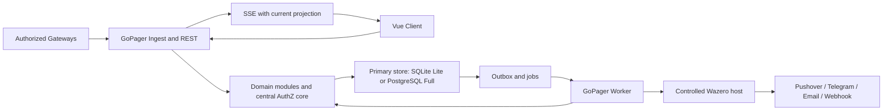
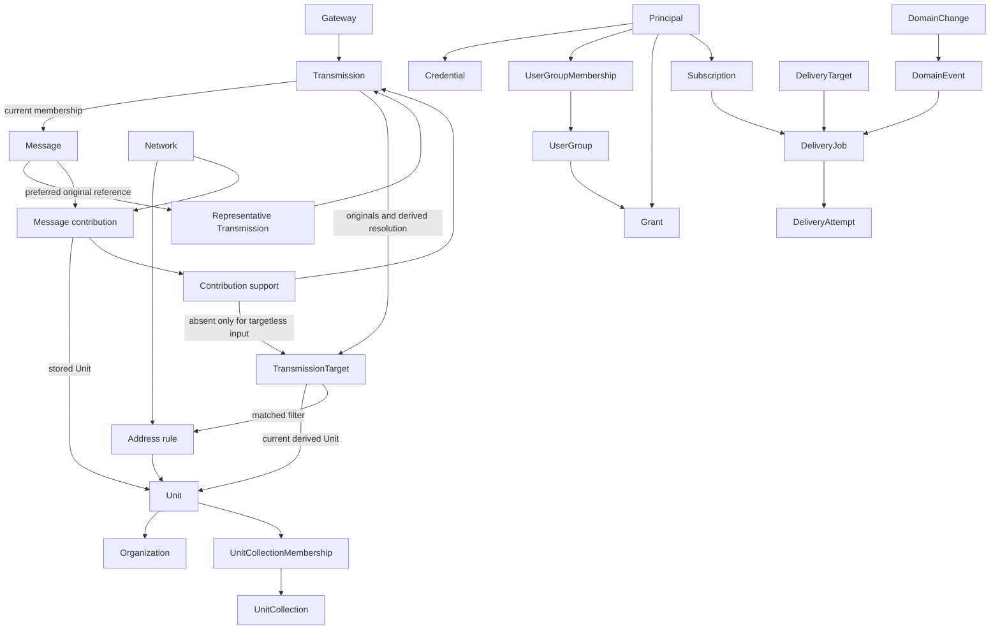

# GoPager Target Architecture and Responsibilities

Date: 2026-10-25. Architecture planning baseline, including the user-approved AP-02 evidence/target-resolution/contribution model (D-29), not an implementation description. Product decisions and approval status belong to the [plan](authoritative-plan.md); interfaces belong to the [contract catalog](domain-contracts.md).

## Technology Decisions

'Selected' means a reasoned planning decision inherited from the original plan, not a successful spike or a fixed package version. Go and the modular monolith were also directly confirmed by the user. Exact versions other than Vue 3, SQL drivers, Wasm ABI, UI component library, and build tools are not selected.

| ID | Selection | Rationale / boundary | Validation still required |
| --- | --- | --- | --- |
| TECH-01 | Go, modular monolith, single backend binary | Single-process Lite without installing a separate runtime; standard library first (`net/http`, `database/sql`, `context`), few justified dependencies, no heavy application framework. No claimed benchmark advantage. | Go version, target platforms, reproducible build in AP-03. |
| TECH-02 | Shared codebase and backend artifact for Lite/Full | Lite combines API, live views, ingest, plugin host, and jobs; Full may distribute the same capabilities across API/worker roles. No mandatory microservices or second Lite application. | Role startup, shutdown, resource profile. |
| TECH-03 | Vue 3 + TypeScript, statically built and embedded in the backend | Independent client/server development, deployment without a mandatory separate web server or frontend process. Build tools may be development dependencies. | Toolchain/versions, asset/API versioning, responsive and accessible UI. |
| TECH-04 | REST/JSON, versioned OpenAPI contract; SSE for live updates | Explicit query/command API; live communication is primarily server-to-browser. No WebSocket without a bidirectional product need. | API/error/cursor/SSE resume and revocation contract C-07. |
| TECH-05 | Local SQLite file for Lite; PostgreSQL for Full | Relational transactions, shared logical schema with explicit dialect/driver boundaries. No mandatory universal ORM or separate domain data models. | SQLite driver/build size/CGO trade-off, migrations, backend parity. |
| TECH-06 | PostgreSQL primary as Full write authority | Stateless API/worker roles; established external database HA with fencing instead of custom consensus. Replicas initially serve HA/recovery; only explicitly eventual reads. | Concrete HA operations, failover/lease/commit uncertainty. |
| TECH-07 | Transactional outbox/job tables in the primary database | Commit domain state and Domain event together; Full claims/leases work, Lite processes it in-process. Wake-up signals are optimization, not truth. No initial mandatory broker. | Claim/fencing, restart, receipt retention, finite retries. |
| TECH-08 | Language-neutral versioned Wasm SDK, embedded Wazero host | Prebuilt operator-provided artifacts inside Lite; trusted plugins may receive explicitly approved network/filesystem/command capabilities (D-24), not implicit unrestricted Core-data access. No native Go plugin ABI or mandatory plugin processes; optional approved subprocesses are a documented exception. Not a hostile-code sandbox. | ABI, runtime/toolchain versions, limits/cancellation, secrets/I/O and lifecycle under C-10. No arbitrary-language/library guarantee. |
| TECH-09 | Database-integrated search baseline | No Lite search daemon. SQLite FTS5 trigram and PostgreSQL `pg_trgm` are candidates, not an already-correct search implementation. | Unicode/case folding/accents/short terms and authorized query parity before index selection. |
| TECH-10 | Central AuthZ core in Go | No baseline external policy service; one semantic owner for grants, field projection, and current Delivery authorization. | Safe SQL predicates/projections on both backends and revocation during SSE/jobs. |

A broker, cache, separate search index, or policy service may become a later Full optimization with demonstrated benefit, not a speculative baseline component. SQLite WAL permits only one concurrent writer; short transactions and local storage are prerequisites. No WAL on a shared network filesystem and no multi-host SQLite HA.

### Alternatives Considered

Node.js/TypeScript with JavaScript plugins was considered for its web/integration ecosystem and shared programming language, but not selected. single-executable delivery, dynamic/native modules, and resource use have their own trade-offs. JavaScript-only does not automatically provide polyglot support; separate plugin processes violate single-process Lite.

Rust with Wasm was considered for memory control and strong concurrency guarantees, but not selected. For the described load profiles, additional language/build complexity is not justified against maintainability and contributor accessibility. These are inherited selection reasons, not new measured performance comparisons. The Go decision is not reopened.

## Language and Internationalization

English is the authoritative language for planning, documentation, identifiers, comments, interface documentation, and default Localized text. Internationalization readiness is required from the first implementation; additional translations are not required yet. Extend REQ-097 rather than allocating a duplicate requirement.

- Frontend ownership: centralize user-facing labels, validation/error text, status text, accessibility labels, and built-in presentation text behind stable text keys and an English text catalog. Support parameter interpolation and pluralization; do not assemble sentences by concatenating translated fragments.
- Integration/API ownership: expose stable machine-readable error/status codes and structured parameters. Any human-readable fallback is English and is not a client parsing contract. Locale must not change field names, enum/Domain event values, IDs, authorization, or wire-format values. Do not translate Payload or operator-authored names/templates automatically.
- Keep interface language independent of user-selected formatting locale. Format dates, numbers, time zones, and relative times through centralized locale-aware facilities; preserve locale-independent storage/API representations and explicit time semantics.
- English is the only initially required catalog and fallback language. Choose a Vue-compatible i18n facility during AP-02/AP-13 planning; no library/version, additional language catalog, language-pack loading system, or language-selector UI is selected here.
- AP-13 owns frontend catalogs and formatting integration; AP-09 owns API code/parameter compatibility; AP-12 owns built-in processing/presentation Localized text. The integration owner coordinates shared keys/schema boundaries. Validate key completeness, interpolation/plurals, English fallback, independent formatting preferences, accessibility text, and layout resilience without requiring a second translated catalog.

This is preparation work for the future implementation, not a claim that an i18n runtime already exists. It neither approves unrelated product scope nor makes automatic translation a feature.

## Operating Profiles

Lite and Full share domain operations, contracts, and permissions. Lite combines roles in exactly one OS process; a SQLite file is not a separate database daemon. Frontend assets and Wazero are part of the application artifact/process. Containers are a delivery option, not an additional mandatory runtime for bare-metal use.

Full may replicate API/live and worker roles horizontally. PostgreSQL is authoritative; local caches or an open SSE connection do not confer write or authorization authority. One application container may include all roles; Full HA requires additional database/operational components. Replica reads must not make revocation or Delivery checks stale. Unclear authority visibly pauses acceptance and Delivery.

The diagram shows capabilities, not separate mandatory processes. The browser receives authorized projections only, never direct database/outbox or plugin Payloads.

## Domains and Data Ownership

This decomposition is a documented architecture draft implementing the confirmed boundaries. No Go package structure exists yet. 'Owner' means exclusive domain write responsibility, not ownership of an entire transaction or necessarily a single service.

| Domain / owner role | Owns and writes | Provides / consumes | Not responsible for |
| --- | --- | --- | --- |
| DOM-01 Transmission and Gateways | Gateways, authorized Network contexts, Network/Protocol mapping, heartbeats/state, submission receipts, immutable Transmissions and Transmission targets | C-01; uses C-02 Protocol description and C-06 AuthZ, provides evidence to C-03/C-05/C-08 | Unit master data, grant rules, Delivery heuristics; never silently replace unauthorized Network declarations |
| DOM-02 Protocol model and Grouping | Payload identity definitions, Grouping policy, Messages/internal Message time, exact membership with future comparison extension boundary (D-30), representative preference and aliases | C-02/C-03; coordinates contribution coalescing on merge with DOM-04 and publishes facts through C-08 | Changing original Transmission, Unit-based Grouping, incident management, Gateway/Network-bound Payload identity |
| DOM-03 Units and domain structure | Units, organizations, Unit collections/memberships, templates, presentation defaults/overrides, Unit-specific Function meanings | C-04; uses C-06, triggers affected corrections through C-05 | Historical versioning of general colors/icons, User groups, assignment evidence |
| DOM-04 Assignment and correction | Temporal Address rules, current target Network/Unit/matched-rule resolution, Message contributions with direct Unit/first times/age anchors, Contribution supports, rematch work and suppression | C-05; derives from DOM-01 evidence/current rules, uses C-02/C-06/C-08; sole writer of target resolution and contribution read model | New Transmissions/Messages during rule Rematching, editing original Payload, global Payload masking, mandatory immutable rule histories, separate grant semantics |
| DOM-05 Identity and access | Internal Principals, credentials/identity bindings, sessions, API-key restrictions, User groups/memberships, grants, recovery/rescue proofs; central authorization/field projection semantics | C-06/C-13; used by every protected operation, coordinates account deletion with C-09 | Automatic email-based account linking, grants through new plugin fields, UI-based authorization |
| DOM-06 Search, feed, and details | Query-derived Unit appearances/View time, authorized representative selection, search/read projections and live/cursor state | C-07; normal reads use Message contributions/direct Unit, not rule-version joins or reception-history scans; diagnostics can read supports/evidence | Separate permissions, independently editing contribution truth, writing target resolutions/master data, private raw Domain event feeds |
| DOM-07 Domain events and Delivery | Domain event records/outbox, subscriptions, Delivery targets, target/Unit Delivery settings, Delivery jobs and attempts | C-08/C-09; uses C-06/C-07 and C-10 plugin capabilities; Gateway/Message/correction Domain events as triggers | Defining another module's domain state, blanket once-per-Message Delivery, external exactly-once |
| DOM-08 Processing and presentation | Bounded Workflows/active versions, previews/errors, source-bound Processing results, presentation configuration and ingest publication barrier | C-11; trusted installed steps follow C-10; level/other fields feed explicit Subscription predicates through C-08/C-09 | Overwriting original Payload identity, arbitrary inline scripts/unbounded loops, granting permissions |

### Supporting Responsibilities

| Role | Exclusive technical area | Boundary |
| --- | --- | --- |
| Integration | Composition root, use-case coordination, shared transaction/revision boundaries, contract versioning, OpenAPI/Domain event integration | No second domain/AuthZ truth; other modules change shared boundaries only by agreement. |
| Persistence and operations | Dialect adapters, migration execution/order, process roles, infrastructure claims/leases, status/shutdown and profile transition | Schema objects belong to their domain owner; do not independently rewrite another owner's migrations. Manual Operator Backup/Restore is outside application responsibilities (C-12/D-31). |
| Plugin host | Wazero adapter, artifact/compatibility checks, capability binding, limits/cancellation, secret transport | Executes only Delivery jobs authorized by DOM-07; does not configure another domain's permissions. C-10. |
| Frontend | Vue views, navigation/editors/accessibility, client state, English text catalog and locale-aware formatting | Uses C-07/C-11 and administrative APIs; hidden controls are not authorization; no direct SQL/host Functions. |

## Allowed Dependencies

1. Transports authenticate/validate, invoke use cases, and map results; they do not own Grouping, rematching, or retry decisions.
2. Domain modules communicate through documented operations and immutable references/results. No direct writes to another module's tables or runtime imports from PagerMon.
3. The AuthZ core may provide a centrally defined decision for SQL filters and field projection. Backend adapters must implement the same semantics; a second SQL-specific grant interpretation is prohibited.
4. DOM-06 may join owner-defined data/views for safe queries. 'No foreign writes' does not require individual module calls per search row or in-memory filtering after unauthorized pagination.
5. Domain state and Domain events use the same primary transaction. DOM-07 provides outbox/job mechanics, the producer owns Domain event meaning and causality, and integration owns the shared commit boundary.
6. Rule processing, plugin invocations, and provider I/O do not run inside long-lived SQL write transactions. Database rollback cannot recall external effects.
7. Apply dependency inversion at real infrastructure/module boundaries, not a generic repository/service hierarchy per entity without benefit. Derive concrete Go interfaces from frozen consumer needs.

## Shared Use Cases

| Use case | Leading coordination | Domain writes / consistency obligation |
| --- | --- | --- |
| Accept Transmission | Integration + DOM-01 | Store original Payload/targets/receipt, determine single Message, store target resolutions, upsert shared Message contributions and Contribution supports, maintain first times/representative preference and facts. Ten technical target Unit values do not mean ten user assignments. Intake may be acknowledged pending; GUI/Delivery waits for current resolution/required Parsing. |
| Change Address rule / delete Unit | DOM-04 or DOM-03 with integration | Invalidate affected scope, rematch original Addresses at Observation times, update target resolutions and redistribute supports/rebuild contributions under checked publication. Recompute first times/age anchors without changing membership or original evidence. Rule edit history is not domain validity. |
| Delete organization | DOM-03 | Determine effective inherited values, preserve them for Units, detach organization; filters/grants follow the new state. No Unit rematch. |
| Revoke rights / delete account | DOM-05 with DOM-06/DOM-07 | Immediately block access/starts; durable domain cleanup follows C-13's field matrix. Pseudonymize historical actor references with distinct non-authenticating Deleted Principal IDs, not an anonymity claim. Failed cleanup never restores access. |
| Attempt Delivery | DOM-07 + plugin host | Check current Principal, subscription, data/field permissions, and age rules; record attempt/I/O/uncertain outcome separately. C-09 defines the exact authorization/execution boundary. |
| Apply retention | Operations + respective data owners + integration | Delete whole Messages by internal Message time/count, with contributions/supports/target resolutions/evidence, not View time. Preserve bounded independent Delivery work where dependencies permit; C-01 retains its accepted post-retention retry exception. |

## Logical Relationship Model

Confirmed logical structure (D-29), not a frozen SQL schema or complete field inventory. Vocabulary is owned by the [glossary](glossary.md). Owner contracts elaborate concrete fields, revision placement, constraints and indexes before AP-04 freeze; no migration or product code is created here. Exact EAS location-code Address rules are in C-05.

The representative box denotes a role/reference to an existing Transmission, not another stored entity.

| Logical record | Stored information / source of truth | Mutability and owner |
| --- | --- | --- |
| Transmission | Gateway/Submission, Protocol/declaration, original Payload including partial/deviating variants, original Observation time/offset, Acceptance time, quality/incomplete context; current Message membership and comparison/decision context | DOM-01 originals immutable; DOM-02 owns derived membership/comparison. Original Payload may repeat per reception; lossless physical deduplication is optional. |
| Transmission target | Exact original Address/Function; stored current Network, direct Unit, matched Address-rule reference and explicit resolution/suppression state | DOM-01 owns original target; DOM-04 alone replaces derived resolution. Unit repetition across Gateways is deliberate technical denormalization, not repeated user assignment. |
| Message | Logical summary, representative preference, publication/change state and existing origin/alias information | DOM-02; no second original Payload copy or MessageGroup parent required. Units do not determine Grouping. |
| Message contribution | Message/Network/Protocol/Address/Function/direct Unit or explicit status, first usable time and capped age anchor | DOM-04 rebuildable read model; identity excludes Gateway, rule version and validity segment. Original targets retain each temporal evaluation. |
| Contribution support | References to contribution, Transmission and original target; no target only for targetless input | DOM-04; at most one current support per usable target, matching Transmission ownership and common Message. No copied technical evidence. |
| Address rule | Existing temporal selector/mode/Network/Unit definition and edit concurrency state | DOM-04; current rules plus original times enable Rematching. Configuration audit explains edits; immutable version entities/exact old-evaluation replay are not required. |

No contribution is independently edited. Supplied originals -> current target resolution -> shared contribution is the derivation direction. Suppression invalidates/rebuilds affected supports and minima without deleting originals. A multi-target Transmission remains one member of one Message, supports several contributions, and is never split by Unit. Multiple rules/validity segments may yield one contribution if their visible context is identical; different Addresses/Units/Networks do not collapse.

**Master-data preservation:** Gateway, Network and Unit nodes, including the earlier illustrative field diagram, are stubs only. Preserve all C-01/C-04/C-06 requirements: names/configuration, Gateway adapter identity and allowed/default Networks, Network/Protocol context, contact/state/heartbeat/termination, authorization, organizations, multiple Unit collections, colors/icons, templates, fieldwise inherited defaults/overrides, Function meanings and Extension fields. Neither this diagram nor its short table replaces those master-data contracts.

**Displayed Payload:** Message stores a preferred original reference, not a synthesized text. Prefer readable, non-suppressed, exact members not marked incomplete; tie-break by earliest Acceptance time then ascending stable ID. Otherwise show a deterministically selected, visibly qualified fallback. Apply the same rule within each authorized view; hidden fuller evidence cannot supply its text or Processing results. Publish a better representative only after required Processing; this changes content, not first Unit times. A readable variant match must be identified in details if the representative differs.

### Time and Read Paths

- Maintain Contribution time/age anchor; later repeats do not move the first time. Store Message time separately as internal origin/retention key, not a universally readable timestamp.
- User path: direct contribution Unit/Network/Protocol -> permitted contributions -> query-derived Unit appearances -> time/age predicates -> readable Payload/representative -> one row per Message. View time is the minimum surviving appearance time; sort/cursor use it. Without Unit filter use the same algorithm. No routine rule-version join or full reception-history scan.
- With Unit A first at 12:00 and Unit B first at 12:05, the unfiltered 12:04..12:06 view shows that Message at 12:05; the Unit-A view for that interval excludes it. An unrestricted view of both shows it once at 12:00. New Gateway copies do not change any of those first times.
- Administrative reception diagnostics alone use Gateway filters/individual receipt times. Suppression rebuilds affected supports/minima; restricted evidence/age permissions may still require scoped support evaluation. Never expose a hidden stored minimum. Targetless contributions use Network/Protocol context without invented Address/Unit.
- Direct Unit columns on targets/contributions are approved denormalization, not an optional unmeasured schema experiment. Concrete indexes, SQL layout, revision fields and backend query plans remain owner-package work validated in AP-03. Additional aggregate layers require a demonstrated need.

## Non-Goals and Boundaries

No legacy adapter, automatic legacy-data migration, incident/personnel management, custom database consensus, or in-app plugin marketplace. No arbitrary polyglot runtime or sandbox guarantee. OIDC/SCIM/PWA and other delivery phases are defined only in the [delivery scope](authoritative-plan.md#delivery-scope), not brought forward by technical preparation. Internationalization readiness does not require additional translations.