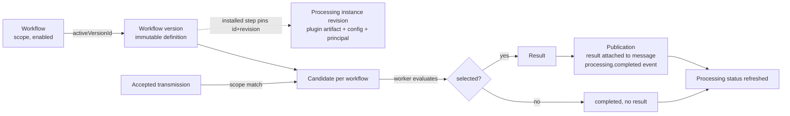
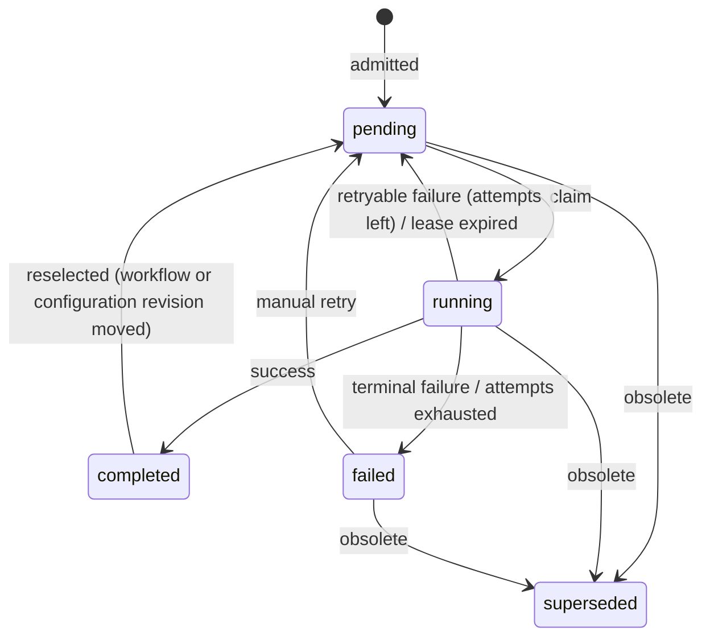

# Workflows

A workflow selects transmissions with a typed predicate and derives typed output fields from them with a bounded sequence of steps. The steps can be built-in (map, extract, branch) or calls into an installed plugin.

Related: [HTTP API](http-api.md) (routes, authentication, errors) · [Plugins](plugins.md) (manifest, invocation protocol).

## Contents

1. [Concepts](#concepts)
2. [Definition format](#definition-format)
3. [Validation](#validation)
4. [Lifecycle](#lifecycle)
5. [Limits and defaults](#limits-and-defaults)

## Concepts

| Term | Meaning |
| --- | --- |
| **Workflow** | Revisioned metadata: `name`, `scope`, `enabled`, `activeVersionId`. Every change increments `revision`. Deleting a workflow is logical: it sets `enabled=false` and clears the active version. |
| **Workflow version** | An immutable saved **definition** (selector, steps, output schema). Saving a version does not activate it. Any retained version can be activated. |
| **Processing instance** | An administratively configured, revisioned binding of one plugin capability: the `main` plugin artifact, an execution principal and a configuration value. Each save creates a new immutable revision. Installed steps pin an instance ID and revision. |
| **Candidate** | Durable work item for one (transmission, workflow, definition version, source revision, context revision). It is admitted when a transmission is accepted and an enabled workflow's scope covers it. Admission does not mean the selector matched. |
| **Result** | Private evaluation evidence stored when a candidate completes with `selected=true`. Not-selected completions store no result. |
| **Publication** | Step that attaches a completed candidate's result to the transmission's message, appends its `processing.completed` event and refreshes the transmission's processing status. It runs in the same transaction as the completion; it never hides evidence. |
| **Processing status** | Per-transmission marker `none` (no workflow selected), `pending`, `completed` or `failed`, derived from the candidates of the currently selected workflows. Accepted evidence is visible regardless of it. |



Multiple workflows can match the same transmission. Each one runs independently and produces its own result namespace.

## Definition format

All processing JSON is decoded strictly:

- Unknown properties, duplicate keys, trailing documents and non-UTF-8 input are rejected with `INVALID_INPUT`.
- A document larger than 1 MiB is rejected with `RESOURCE_LIMIT`.
- JSON nesting deeper than 32 levels is rejected with `RESOURCE_LIMIT`.

### Definition

| Field | Type | Required | Notes |
| --- | --- | --- | --- |
| `schemaVersion` | integer | yes | Must be `1`. |
| `selector` | [Predicate](#predicates) | yes | Decides whether the workflow produces a result for a source or target context. |
| `steps` | [Step](#steps)[] | no | Executed in order. At most 128 steps in total, counting nested branch steps. |
| `outputSchema` | map name → [FieldSchema](#field-schema) | yes (may be `{}`) | Declares the result fields. At most 1000 entries. |
| `outputs` | map name → [Assignment](#assignments) | yes (may be `{}`) | Assigns each output from a field or a literal. Every non-optional output must be assigned. |

Minimal definition (from tests). It selects transmissions of any of the four protocols and produces an empty field set:

```json
{
  "schemaVersion": 1,
  "selector": {"op": "or", "args": [
    {"op": "eq", "field": {"namespace": "source", "path": ["protocol"]}, "value": {"kind": "string", "value": "pocsag"}},
    {"op": "eq", "field": {"namespace": "source", "path": ["protocol"]}, "value": {"kind": "string", "value": "flex"}},
    {"op": "eq", "field": {"namespace": "source", "path": ["protocol"]}, "value": {"kind": "string", "value": "zvei"}},
    {"op": "eq", "field": {"namespace": "source", "path": ["protocol"]}, "value": {"kind": "string", "value": "eas"}}
  ]},
  "outputSchema": {},
  "outputs": {}
}
```

Extract-and-branch definition (from tests; the test source has a `source.text` field). It extracts `level` from text such as `LEVEL=7`:

```json
{
  "schemaVersion": 1,
  "selector": {"op": "present", "field": {"namespace": "source", "path": ["payload", "text", "value"]}, "value": {"kind": "boolean", "value": true}},
  "steps": [
    {"id": "extract", "kind": "extract",
     "outputSchema": {"level": {"kind": "integer"}},
     "extract": {"input": {"namespace": "source", "path": ["payload", "text", "value"]},
                 "pattern": "LEVEL=(?P<level>[0-9]+)",
                 "captures": {"level": {"name": "level", "conversion": "integer"}}}},
    {"id": "choose", "kind": "branch",
     "outputSchema": {"level": {"kind": "integer"}},
     "branch": {"condition": {"op": "eq", "field": {"namespace": "step", "path": ["extract", "level"]}, "value": {"kind": "integer", "value": "7"}},
                "thenOutputs": {"level": {"field": {"namespace": "step", "path": ["extract", "level"]}}},
                "elseOutputs": {"level": {"literal": {"kind": "integer", "value": "7"}}}}}
  ],
  "outputSchema": {"level": {"kind": "integer"}},
  "outputs": {"level": {"field": {"namespace": "step", "path": ["choose", "level"]}}}
}
```

Here `extract.level` is required, so a text that does not match fails the run (see [Extract](#extract)). Declare the output `"optional": true` if a non-match should be allowed.

### Field references

A field reference has the form `{"namespace": "source" | "target" | "step", "path": [segment, ...]}`. The path has 1–32 segments. Each segment is a non-empty UTF-8 string without NUL.

| Namespace | Resolves to |
| --- | --- |
| `source` | A field of the transmission (see [Source fields](#source-fields)). |
| `target` | A field of one original target of the transmission. Referencing any `target` field anywhere in the definition makes the workflow **target-dependent** (see [Result shape](#result-shape)). |
| `step` | `["<stepId>", "<outputName>"]`: an output of a step that ran earlier in the same lexical scope. Forward references, references to sibling-branch steps, and references from the definition's `outputs` into steps nested inside a branch are rejected. |

#### Source fields

The server defines a fixed catalog. Only these references are accepted:

| Reference | Kind | Optional | Field group | Present when |
| --- | --- | --- | --- | --- |
| `source.protocol` | string | no | `payload` | always (`pocsag`, `flex`, `zvei`, `eas`) |
| `source.form` | string | no | `payload` | always (`text`, `numeric`, `tone-only`, `binary`, `flex-short-signal`, `zvei-signal`, `eas-header`) |
| `source.subtype` | string | yes | `payload` | FLEX binary (`transparent`, `secure`) |
| `source.observedAt` | timestamp | no | `gateway` | always |
| `source.network.id` | string (UUID) | no | `gateway` | always |
| `source.network.name` | string | no | `gateway` | always |
| `source.payload.text.value` | string | yes | `payload` | form `text` |
| `source.payload.numeric.value` | string | yes | `payload` | form `numeric` |
| `source.payload.binary` | bytes | yes | `payload` | form `binary` |
| `source.payload.flex.shortSignal.sourceCode` | integer | yes | `payload` | form `flex-short-signal` |
| `source.payload.zvei.double_tone` | string, nullable | yes | `payload` | form `zvei-signal` (`null` if no double tone) |
| `source.payload.eas.originator` / `eventCode` / `purgeTime` / `issueTime` | string | yes | `payload` | form `eas-header` |
| `target.address.number` | integer | yes | `address` | numeric address |
| `target.address.text` | string | yes | `address` | text address |
| `target.function` | integer | yes | `address` | target has a function |
| `target.unit.id` | string (UUID) | yes | `unit` | target is assigned to a unit |
| `target.unit.collections` | list of string (UUID) | yes | `unit` | target is assigned to a unit |

Every captured source field carries the owner's **dependency**: the transmission, network, source/context revision, optional target position, and the field group declared for it. Derived values (step outputs and final outputs) carry none. A definition is classified **once per definition version**, not per value: its outputs are `derived` plus the union of the field groups of every source field the definition reads (see [Classification](#classification)).

### Field schema

| Field | Type | Notes |
| --- | --- | --- |
| `kind` | `string` \| `boolean` \| `integer` \| `number` \| `timestamp` \| `bytes` \| `object` \| `list` | Required. |
| `optional` | boolean | The field may be absent. Absence is distinct from `null`. |
| `nullable` | boolean | The value may be explicit `null`. |
| `properties` | map name → FieldSchema | Only for `object`; at most 1000 entries. |
| `element` | FieldSchema | Required for `list` and forbidden otherwise. |

Schemas nest at most 32 levels. Scalar kinds must not have `properties` or `element`.

### Typed values

Every literal and every result value is a typed envelope `{"kind": K, "value": V}`.

| Kind | `value` encoding | Example |
| --- | --- | --- |
| `string` | JSON string | `{"kind":"string","value":"a"}` |
| `boolean` | JSON boolean | `{"kind":"boolean","value":true}` |
| `integer` | Decimal **string**, int64 range | `{"kind":"integer","value":"9223372036854775807"}` |
| `number` | JSON number, finite (not a string) | `{"kind":"number","value":1.25}` |
| `timestamp` | RFC 3339 string with offset | `{"kind":"timestamp","value":"2026-11-01T12:00:00+01:00"}` |
| `bytes` | Canonical standard Base64 with padding | `{"kind":"bytes","value":"AAEC/w=="}` |
| `object` | Map of name → typed value; every non-optional property must be present | `{"kind":"object","value":{"ids":{"kind":"list","value":[{"kind":"integer","value":"7"}]}}}` |
| `list` | Array of typed values (≤ 1000) | `{"kind":"list","value":[{"kind":"integer","value":"7"}]}` |
| `null` | `null`, only where the schema is `nullable` | `{"kind":"null","value":null}` |

The following are rejected (from tests):

- `{"kind":"integer","value":9223372036854775807}`: the value must be a string.
- `"9223372036854775808"`: out of the int64 range.
- `{"kind":"number","value":"1.25"}`: the value must be a JSON number, not a string.
- `1e1000`: not finite.
- A timestamp without an offset.
- Non-canonical Base64 (`"AAEC/w"`, `"__8="`, trailing space).
- `{"kind":"string","value":null}`: use the `null` kind instead.
- Extra properties in the envelope.
- Unknown object properties.

A value's `kind` must equal the declared schema kind, or be `null` where the schema is nullable. Values are never coerced implicitly.

### Assignments

Used by `outputs`, `map` steps, branch `thenOutputs`/`elseOutputs` and installed step `input`.

| Field | Notes |
| --- | --- |
| `field` | A field reference. Exactly one of `field` and `literal` is required. |
| `literal` | A typed value. |
| `conversion` | Optional. Must equal the target schema's `kind`. |

Rules:

- Without `conversion`, the source schema must equal the target schema. Top-level `optional` is ignored in this comparison; `nullable` and nested declarations must match.
- With `conversion`, the source must be a `string`, and the target kind must be `integer`, `number`, `boolean` or `timestamp`. The only other accepted conversion is an identity conversion to an equal schema.
- Every name in the mapping must be declared in the target schema. Every non-optional target name must be mapped.
- An absent source value produces an absent output. If that output is required, the run fails with `INVALID_INPUT`.

String conversions applied at run time. A value that cannot be converted fails the run with `INVALID_INPUT`:

| Target | Accepted string |
| --- | --- |
| `integer` | Decimal int64 (as parsed by Go `strconv.ParseInt`, base 10). |
| `number` | A finite JSON number literal with no surrounding whitespace. |
| `boolean` | Exactly `true` or `false`. |
| `timestamp` | RFC 3339 (fractional seconds allowed). |

### Steps

Common fields:

| Field | Type | Notes |
| --- | --- | --- |
| `id` | string | Required. Non-empty UTF-8 without NUL, and unique across the whole definition, nested steps included. |
| `kind` | `map` \| `extract` \| `branch` \| `installed` | Required. Only the configuration object that matches `kind` may be set. |
| `outputSchema` | map name → FieldSchema | Required. At most 1000 entries. Outputs are addressable as `step.<id>.<name>` by later steps. |

#### Map

`"map": {name: Assignment}` assigns outputs from fields or literals. The `map` object must be present, even when it is empty (`{}`).

#### Extract

```json
"extract": {"input": FieldRef, "pattern": "...", "captures": {"<outputName>": {"name": "<groupName>", "conversion": "<kind>"}}}
```

- `input` must resolve to a declared `string` field.
- `pattern` uses Go RE2 syntax, Perl flags. It has no backreferences or lookaround, and matching runs in linear time.
- The match is the leftmost match anywhere in the input; it is not anchored unless the pattern anchors it.
- Each capture maps one output to a **named** group: `(?P<name>…)`. The group name must occur exactly once in the pattern. Unnamed groups are ignored.
- Without `conversion`, the output must be `string`. With `conversion`, the conversion must equal the output kind, which must be `string`, `integer`, `number`, `boolean` or `timestamp`.
- Every non-optional output must have a capture.

Behavior at run time:

| Situation | Result |
| --- | --- |
| Input absent | All outputs are absent. |
| No match, or the group did not participate | That output is absent. If the output is required, the run fails with `INVALID_INPUT`. |
| Conversion fails | The run fails with `INVALID_INPUT`. |

Regex engine bounds:

| Bound | Value | Failure |
| --- | --- | --- |
| Pattern length | 4096 bytes | `RESOURCE_LIMIT` |
| Input text length | 1 MiB | `RESOURCE_LIMIT` |
| Compiled program size | 20 000 instructions | `RESOURCE_LIMIT` |
| Estimated NFA memory (instructions × capture slots × 16 B) | 32 MiB | `RESOURCE_LIMIT` |
| Wall time per match | 1 s | `RESOURCE_LIMIT` (shared 1 s compute budget) |
| Unparseable pattern, or non-UTF-8 pattern or text | — | `INVALID_INPUT` |

Patterns are checked when the definition is compiled, so an inadmissible pattern is rejected when the version is saved.

#### Branch

```json
"branch": {"condition": Predicate, "then": [Step...], "else": [Step...], "thenOutputs": {...}, "elseOutputs": {...}}
```

- `then` runs if `condition` is true. `else` runs if it is false. There is no third outcome.
- `then` and `else` are nested step lists, at most 32 levels deep. Each sees the steps before the branch plus its own earlier steps.
- `thenOutputs` and `elseOutputs` both assign the branch step's `outputSchema`. Each is validated against its own branch scope.
- Steps in the branch that does not run still count toward target dependence. For example, a `target` reference in an unused `else` still makes the workflow per-target.

#### Installed (plugin step)

```json
"installed": {"instanceId": "<uuid>", "configurationRevision": "3", "input": {"<name>": Assignment}}
```

- `instanceId` names a [processing instance](#processing-instances). `configurationRevision` is a positive revision, encoded as a decimal string.
- `input` assigns the plugin manifest's `inputSchema`.
- The step's `outputSchema` must equal the manifest's `resultSchema` exactly.
- At save, activation and run time the pinned revision must be the instance's **current** revision, and the instance must be enabled. An instance update therefore requires saving and activating a workflow version that pins the new revision.
- Each call is authorized again at run time. The instance's execution principal must hold field permission for every group of the definition's [classification](#classification) and read access to the source. The input sent to the plugin must equal the evaluated input.
- Each invocation is bounded to 30 s. Exceeding it fails the run with `RESOURCE_LIMIT` and kills the plugin process. The time spent waiting for the plugin, and for the authorization transaction that precedes each call, is not charged to the 1 s built-in budget.
- Plugin failure reasons map to codes:
  - `resource-limit` → `RESOURCE_LIMIT`
  - `capability-unavailable` → `AUTHORITY_UNAVAILABLE`
  - `conversion-failed` and `evaluation-failed` → `INVALID_INPUT`
  - Any other reason, or a malformed response → `INVALID_INPUT`
  - A plugin error, crash or broken connection during the call → `INVALID_INPUT`
  - A plugin process that cannot be started or does not complete its handshake → `AUTHORITY_UNAVAILABLE`
- During preview the instance's plugin is called with `mode: "preview"` and must answer without effects outside its process. If its manifest does not declare `supportsPreview`, the plugin is not called and the step fails with `AUTHORITY_UNAVAILABLE`.
- The plugin process of an instance revision is long-lived and shared by all runs and previews that use it, one call at a time; see [Plugins](plugins.md#1-runtime-model).
- Plugins whose configuration policy declares a secret, or user-scoped configuration, cannot be used: `AUTHORITY_UNAVAILABLE`.

The manifest, artifact pinning and gRPC invocation are described in [Plugins](plugins.md).

### Predicates

A predicate is a structured JSON tree, not expression text. The server compiles it into a checked [CEL](https://cel.dev) program. Each referenced field becomes a typed CEL variable, and each literal becomes a typed constant. The CEL environment exposes no macros, functions or variables beyond these. Users cannot write CEL directly.

| `op` | Operands | Semantics |
| --- | --- | --- |
| `and`, `or` | `args`: 1–1024 predicates | Logical conjunction / disjunction. |
| `not` | `args`: exactly 1 predicate | Negation. |
| `present` | `field`, `value`: boolean | `true`: the field is present (a `null` value counts as present). `false`: the field is absent. |
| `eq` | `field`, `value` | Typed equality. Applies to any kind, including `bytes`, `object` and `list`. `value` may be `null` if the field is nullable. |
| `in` | `field`, `values`: 1–1024 values | Membership in a list of typed values of the field's schema. |
| `lt`, `lte`, `gt`, `gte` | `field`, `value` | Ordered comparison. The field must be `integer`, `number` or `timestamp`, and the value must not be `null`. |
| `contains` | `field`, `value` | Substring test. The field must be `string`. |

Semantics:

- **Absent fields.** Every comparison is guarded by presence, so a comparison on an absent field is `false`, and `not` of it is `true`.
- **Literals.** A literal must validate against the field's schema. For example, comparing an `integer` field with a `string` literal is rejected at compile time.
- **Two-valued logic.** Evaluation runs as the system, so a field is only ever `present` or `absent`. `and`, `or` and `not` are ordinary boolean operators, a selector is `true` or `false`, and a branch runs `then` or `else`. Whether a human may read a field never changes the result; it is checked when the version is saved (see [Validation](#validation)).
- **Target contexts.** In a per-target evaluation, `target` fields refer to the current target context. A single predicate cannot mix target contexts.
- **Evaluation limits.**

  | Bound | Value |
  | --- | --- |
  | CEL cost | 2 000 000, including byte-by-byte comparisons of `bytes` operands |
  | CEL tracked memory | 2 MiB |
  | Wall time | 1 s |
  | Encoded operand input | 1 MiB |
  | Predicate nesting | 32 |
  | Parser recursion | 128 |
  | Expression nodes | 20 000 |

  Exceeding a cost or memory limit is `RESOURCE_LIMIT`.

### Result shape

Evaluation runs once for the whole source unless the workflow is target-dependent and the transmission has targets. In that case:

- The selector and steps run once for each eligible original target position.
- Positions are never renumbered.
- Each selected position yields its own field set in `targetResults`.

```json
{"selected": true, "fields": {"level": {"state": "present", "value": {"kind": "integer", "value": "7"}}}}
```

```json
{"selected": true, "targetResults": [{"targetPosition": 1, "fields": {"address": {"state": "present", "value": {"kind": "string", "value": "222"}}}}]}
```

- Not selected: `{"selected": false}`.
- Selected with no outputs: `{"selected": true, "fields": {}}`.
- Field `state` is `present` or `absent`. There is no `hidden` state.
- Output fields carry no per-value `dependencies`; the result is classified once per definition (see [Classification](#classification)).
- If any selected context fails, the whole evaluation fails. Partial results are never returned.
- The encoded result must not exceed 256 KiB, and decoded bytes inside it must not exceed 256 KiB. Otherwise the run fails with `RESOURCE_LIMIT`.

### Classification

A definition version's outputs are classified once, as `derived` plus the union of the field groups the definition reads. The groups come from the source declarations (the catalog above) for every source and target field the definition references in its selector, steps (installed-step inputs included, and both branch arms whether or not they run) and outputs. They depend only on the definition, never on source values, on which branch runs or on a reader's rights, and they are computed from the definition and the declarations whenever it is loaded rather than stored.

At run time `Evaluation.Dependencies()` returns the owner dependency (transmission, network, revisions, optional target position, groups) of each referenced source field. Publication and preview rechecks authorize exactly that set, and an installed plugin's execution principal must be able to read the whole set before a call.

## Validation

A definition is compiled when a version is **saved**, when it is **activated**, when it is **previewed**, and again at the start of every **run**. Compilation is checked against the server's field catalog and the current processing instances. If saving the version would change the definition in any way, the request is rejected.

**Field validation.** Saving a version, and previewing an unsaved draft, additionally check every source or target field the selector, steps (installed-step inputs included) and outputs reference against the author's current field permissions and the field group declared for it. If the author may not read one of those groups the request fails with `INVALID_INPUT`; the offending reference is recorded in the private cause. Nothing at evaluation time depends on a human reader's rights, so this check is the only place an author's readable groups constrain a definition. Previewing a saved version is not re-validated here: its result is instead authorized against the previewer's field permissions when it is rechecked after evaluation.

All failures use the platform error codes. Messages are internal and never part of the API response.

| Code | Raised for |
| --- | --- |
| `INVALID_INPUT` | `schemaVersion` ≠ 1; unknown or duplicate JSON properties; unknown step `kind` or mismatched step configuration; duplicate or empty step `id`; invalid output name; unknown field reference or field outside lexical scope; malformed predicate operands (for example `not` with ≠ 1 arg, `in` without `values`, `contains` on a non-string, ordered comparison on a non-numeric field); literal not matching the schema; incompatible assignment or undeclared conversion; required output unmapped; mapping to an undeclared output; extraction input not a string; capture group missing or ambiguous; invalid capture conversion; unparseable regex; installed step without `instanceId` or with revision ≤ 0; installed `outputSchema` differing from the manifest's `resultSchema`; a selector, step or output referencing a source field whose field group the author may not read (save and draft preview); runtime: required value absent, conversion failure, plugin failure. |
| `RESOURCE_LIMIT` | More than 128 steps; branch depth > 32; JSON/schema/value/predicate nesting > 32; collection > 1000; predicate args/values > 1024; encoded input > 1 MiB; regex bounds; CEL cost or memory; aggregate run input/intermediate > 1 MiB; result > 256 KiB; accumulated built-in compute > 1 s; installed call > 30 s; plugin reports `resource-limit`. |
| `AUTHORITY_UNAVAILABLE` | Instance disabled, missing artifact root, or preview requested for a plugin that does not support preview; plugin uses secret or user-scoped configuration; plugin reports `capability-unavailable`; execution principal no longer resolvable or authorized. |
| `INCOMPATIBLE_VERSION` | Plugin manifest schema or SDK version not supported (see [Plugins](plugins.md)). |
| `REVISION_CONFLICT` | `expectedRevision` does not match; pinned instance revision is no longer current; authority or workflow changed between preparation and commit. |

## Lifecycle

### Workflow configuration

Management operations (see [HTTP API](http-api.md) for the routes and envelopes):

| Operation | Permission | Effect | Event `changeKind` |
| --- | --- | --- | --- |
| List / read workflow, list / read versions | `workflow.read` | Results are filtered by scope. | — |
| Create workflow | `workflow.create` | New workflow with `revision` 1 and no active version. `commandId` makes the request idempotent. | `created` |
| Update workflow | `workflow.update` | Changes `name`, `scope` and `enabled`. The active version is unchanged. | `updated` |
| Save version | `workflow.update` | Compiles the definition, stores an immutable version, and increments the workflow revision. Idempotent by `commandId`. | `version-saved` |
| Activate version | `workflow.activate` | Recompiles the version and sets `activeVersionId`. Any retained version can be activated, including an earlier one. | `activated` |
| Delete workflow | `workflow.delete` | Sets `enabled=false` and clears the active version. Versions are retained. | `deleted` |
| Preview | `workflow.preview` | See [Preview](#preview). | — |
| List / read candidate status, read result metadata | `workflow.read` | See [Status reads](#status-reads). | — |
| Retry failed candidate | `workflow.reprocess` | See [Retries](#retries). | — |

Common rules:

- Every mutation needs `expectedRevision`, encoded as a decimal string. A mismatch returns `REVISION_CONFLICT`.
- Create and update need `enabled`.
- `name` must be non-blank UTF-8.
- `scope` is `{"kind": "all"}` or `{"kind": "network" | "unit", "references": [uuid, ...]}`, with 1–1024 references. References are de-duplicated and sorted, and each must exist.
- The caller must hold the action for every network or unit the scope covers.

Typical sequence (from tests):

1. Create: `{"schemaVersion":1,"commandId":"…","name":"Synthetic Preview","scope":{"kind":"all"},"enabled":true}` returns revision `1`.
2. Save version: `{"schemaVersion":1,"commandId":"…","expectedRevision":"1","definition":{…}}` returns the version ID and revision `2`.
3. Activate: `{"schemaVersion":1,"expectedRevision":"2"}`.

A workflow processes new transmissions only when it is `enabled`, not deleted, has an active version, and its scope covers the transmission:

| Scope kind | Covers |
| --- | --- |
| `all` | Every transmission. |
| `network` | Transmissions received on a referenced network. |
| `unit` | Transmissions with at least one target assigned to a referenced unit. Only those target positions are evaluated. |

Suppressed targets are never evaluated.

### Processing instances

| Operation | Permission | Notes |
| --- | --- | --- |
| List / read instances | `plugin.configure` | The view omits manifest paths and digests. Configuration values are shown according to the manifest policy; secret and user-scoped values are redacted. Page `limit` is 1–200 (default 50). |
| Create instance | `plugin.configure` | `expectedRevision` `"0"` creates revision 1. Idempotent by `commandId`. |
| Update instance | `plugin.configure` | `expectedRevision` = the current revision. Every save appends a new immutable revision and becomes current. |

Input fields:

| Field | Notes |
| --- | --- |
| `enabled` | Required. |
| `executionPrincipalId` | Required. The principal must currently resolve. |
| `main` | `{"manifestPath", "pin": {"pluginId", "version", "capabilityId", "digest"}}`. `digest` is lowercase SHA-256 hex. |
| `configuration` | A typed value valid against the manifest's `configurationSchema`. |

Before the instance is stored:

- The manifests are loaded from the operator's artifact root and the artifact digests are verified. The plugin is not started.
- The configuration is validated.
- A secret or user-scoped configuration policy is rejected with `AUTHORITY_UNAVAILABLE`.

A successful save:

- emits `configuration.changed` with aggregate type `processing-instance` and `changeKind` `created` or `updated`;
- cancels runs in progress that use an older revision of the instance.

Disabling an instance makes installed steps that use it fail with `AUTHORITY_UNAVAILABLE`.

### Preview

Preview evaluates one definition against one source without persisting anything. It creates no candidates, results or events, and makes no deliveries. Request fields:

| Field | Notes |
| --- | --- |
| `versionId` or `definition` | Exactly one. `definition` is an unsaved draft and is compiled like a save. |
| `syntheticJson` | A synthetic transmission (see below). |
| `storedTransmissionId` | Accepted by the schema, but stored-transmission preview is not available and returns `AUTHORITY_UNAVAILABLE`. |

Synthetic transmission:

```json
{"schemaVersion":1,"protocol":"pocsag","form":"text","networkId":"…","observedAt":"2026-11-03T14:00:00Z",
 "payload":{"value":"sample text"},"targets":[{"address":123,"function":1}]}
```

| Protocol | Forms | Payload |
| --- | --- | --- |
| `pocsag` | `text`, `numeric`, `tone-only` | `{"value": "..."}`. Numeric allows the characters `0-9 . U - ) (` and space. `tone-only` has no payload. |
| `flex` | additionally `binary` (subtype `transparent` or `secure`) and `flex-short-signal` | Binary: `{"encoding":"base64","data":"AQID"}`. Short signal: `{"sourceCode": 0..7}`. |
| `zvei` | `zvei-signal` | `{"double_tone": null | "<name>"}`. At least one target is required. |
| `eas` | `eas-header` | `{"originator","eventCode","purgeTime","issueTime"}`. 1–31 targets. |

Rules:

- `observedAt` is optional and defaults to the current time.
- The network must exist and use the same protocol.
- Targets are matched against current assignments.
- The workflow scope is applied for the given network or unit.
- An unsaved draft that references a field the editor may not read is rejected with `INVALID_INPUT`, exactly as on save. A saved version is evaluated in full, and its result is released only if the editor may read every group of its [classification](#classification).
- Installed steps call the instance's plugin in preview mode, and only if its manifest declares `supportsPreview`. Each call checks both the execution principal and the editor.
- After evaluation, the workflow revision and source authority are checked again. If the workflow changed, the request fails with `REVISION_CONFLICT`.
- The response is the [result shape](#result-shape).

### From transmission to candidate

When a transmission is accepted, the same transaction:

1. Locks the processing configuration revision.
2. Selects every enabled, non-deleted workflow with an active version whose scope covers the transmission (network, or a unit of any target).
3. Inserts one `pending` candidate per workflow, due immediately. Each candidate pins the transmission, the workflow and its revision, the active version, the configuration revision, the source revision (1) and the assignment context revision.

The transmission's `processing_status` is `pending` when at least one candidate was admitted and `none` otherwise. The receipt reports the same value; the HTTP status is `202` for `pending` and `200` for every other value. Evidence is visible to readers in both cases.

When an assignment correction changes a target's resolution, the correction batch re-admits processing for that transmission in the same transaction: candidates bound to the old assignment context are superseded, a candidate is admitted for every currently selected workflow, and the processing status becomes `pending` again. Transmissions whose resolution did not change keep their candidates and status.

### Worker dispatch

Each worker process runs one dispatcher:

| Setting | Default |
| --- | --- |
| Concurrent evaluations (`--processing-concurrency`) | 2 |
| Fallback poll interval (`--processing-poll-interval`) | 5 s |

Work is selected by primary-database time. A candidate is due if it is `pending` with `due_at ≤ now`, or `running` with `lease_until ≤ now`. Due work is ordered by `due_at` and ID. One selection asks for at most the configured concurrency plus the number of failed candidates this process still tracks, locks the rows with `FOR UPDATE SKIP LOCKED` and takes no lock on the Processing control row. Dispatchers never wait for each other or for a configuration change, and a selection skips rows another open selection holds. The selection transaction ends before execution, so its locks end at commit and two dispatchers can still select the same row one after the other; the revision-checked claim below is the guard against double execution.

A dispatcher selects when it starts, when a wake-up arrives and on every poll. Intake, and the Processing readmission that follows a correction, send a PostgreSQL notification on channel `gopager_processing_due` in the transaction that admits candidates; every worker process listens on a dedicated connection, so new work starts without waiting for the poll. The listener reconnects with backoff and signals once after each reconnect, because notifications sent while it was disconnected are lost. The poll is the fallback for such losses and for work that becomes due by time (retry delays, expired leases).

A candidate whose dispatch failed cools down until the next wake-up or poll and is then retried behind fresh due work, so a persistently rejected early candidate cannot starve later ones.

For each selected candidate the worker:

1. **Reconciles.** It re-reads the source and the current workflow selection:
   - A changed source or context revision, or a workflow that is no longer selected or now has a different active version, marks the candidate `superseded`.
   - A changed workflow or configuration revision with the same definition **reselects** it: new revision and fence, state `pending`, attempt history kept.
   - A `running` candidate whose lease expired is recovered as a retryable `INTERNAL_ERROR` failure.
2. **Claims.** In a short transaction it captures the source and definition and claims the candidate: state `running`, new fencing token, lease 60 s. Each claim increments `attempts`; automatic claims also increment `automaticAttempts`.
3. **Evaluates.** Compilation and evaluation run outside any database transaction.
   - All built-in work shares one accumulated 1 s compute budget. Exhausting it fails the run with `RESOURCE_LIMIT`.
   - Installed calls add their own 30 s bound each. Exceeding it fails the run with `RESOURCE_LIMIT`.
   - Worker shutdown or a lost lease cancels the evaluation. Nothing is stored for that attempt; the candidate is recovered after its lease expires.
   - The aggregate encoded input and intermediate data is bounded to 1 MiB.
   - The lease is renewed every 20 s, after the source is checked again. A transient renewal failure (`STORAGE_UNAVAILABLE`, `AUTHORITY_UNAVAILABLE`, `COMMIT_UNCERTAIN`) does not abort the evaluation while the lease would still outlive the next renewal attempt; the renewal is retried at the next tick. A `REVISION_CONFLICT`, any other failure, or a lease that would expire without a renewal aborts the evaluation.
4. **Finishes.** It rechecks the source and configuration, then writes under the lease fence:
   - **Success:** the candidate becomes `completed` with `selected` set. A result row is stored if selected and published in the same transaction (see [Publication](#publication)).
   - **Failure:** the failure is classified, then retried or marked terminal. The transmission's processing status is refreshed in the same transaction.

### Retries

| Failure code | Handling |
| --- | --- |
| `STORAGE_UNAVAILABLE`, `AUTHORITY_UNAVAILABLE` | Automatic retry. |
| `INVALID_INPUT`, `INCOMPATIBLE_VERSION`, `RESOURCE_LIMIT` (including an exhausted compute budget or an exceeded 30 s installed-call deadline) | Terminal `failed`. |
| Anything else, including a revision conflict | Stored as `INTERNAL_ERROR`, terminal `failed`. |
| Lease expired (worker lost) | `INTERNAL_ERROR`, automatic retry. |

There are at most **5** automatic attempts. After automatic attempt *n* fails retryably, the next attempt is due after:

| Attempt *n* | Nominal delay |
| --- | --- |
| 1 | 30 s |
| 2 | 2 min |
| 3 | 10 min |
| 4 | 30 min |

Each delay has uniform ±20 % jitter. After the fifth automatic attempt the candidate is terminal `failed`. Reselecting a candidate keeps its automatic-attempt count. If the count is exhausted, the reselected candidate is immediately `failed` with `RESOURCE_LIMIT`.

**Manual retry** of a `failed`, unpublished candidate:

- Requires `workflow.reprocess` and the candidate's `expectedRevision`.
- Checks, in the same transaction, that the candidate is still current: its transmission is unpublished with unchanged targets, source and assignment context revisions; its workflow is still selected at the same active version and workflow revision; the processing configuration revision is unchanged; and every processing instance the definition uses is still valid. Anything stale fails with `409 REVISION_CONFLICT` and leaves the candidate `failed`.
- On success, queues one attempt immediately: the candidate becomes `pending`, due now.
- The manual attempt does not count against or reset the automatic budget.
- The response is `{"schemaVersion":1,"data":{"candidateId":"…","revision":"…"}}`.

A transmission with a `failed` candidate for a current workflow stays unpublished until the candidate is retried successfully, or until it becomes obsolete. A candidate becomes obsolete when the workflow is disabled, deleted, re-scoped, or another version is activated. The candidate is then superseded the next time the transmission is reconciled.

### Candidate states



| State | Terminal | Meaning |
| --- | --- | --- |
| `pending` | no | Waiting until `due_at`. |
| `running` | no | Claimed under a lease and fencing token. |
| `completed` | yes | `selected` is set. A result is stored only if `selected=true`; a stored result is published in the same transaction. |
| `failed` | until retried | `failureCode` holds one of `INVALID_INPUT`, `INCOMPATIBLE_VERSION`, `RESOURCE_LIMIT`, `STORAGE_UNAVAILABLE`, `AUTHORITY_UNAVAILABLE`, `INTERNAL_ERROR`. |
| `superseded` | yes | The binding is no longer current. Evidence is retained. |

### Publication

Publication runs in the same transaction as every candidate transition: a completion, a classified failure, the processing of a superseded candidate, a manual retry and a correction's readmission. It never waits for sibling candidates and never hides evidence.

For each current candidate that is `completed` with `selected=true` and a result not yet published, publication:

1. Verifies that the source revision, context revision and message revision are unchanged, and that the candidate still matches the active workflow version and configuration revision.
2. Verifies that the instances used by the definition are enabled and current.
3. Verifies that every target position of the result is inside the current workflow scope. If the definition has installed steps, it also verifies that each instance's execution principal may read every dependency (`message.read` on its field groups).
4. Sets the result's `published_at` and `message_id` and appends a `processing.completed` event.

It then derives the transmission's processing status from the candidates of the currently selected workflows:

| Candidates of current bindings | `processing_status` |
| --- | --- |
| any `pending` or `running` | `pending` |
| none pending, at least one `failed` | `failed` |
| all `completed` | `completed` |
| none (for example after a workflow was enabled later) | unchanged |

Any failed check rolls the whole transaction back with `REVISION_CONFLICT`; the candidate transition is retried by a later reconciliation. Published results stay attached to their message when their candidate is later superseded, and a message merge moves them to the surviving message (`processing_results.message_id` references `messages`).

### Events

All processing events use schema version 1 and producer version `processing-kernel1.0`.

| Type | Aggregate | Classification | `data` |
| --- | --- | --- | --- |
| `configuration.changed` | `workflow` (ID, revision) | `configuration` | `{"changeKind": "created" \| "updated" \| "version-saved" \| "activated" \| "deleted"}` |
| `configuration.changed` | `processing-instance` (ID, revision) | `configuration` | `{"changeKind": "created" \| "updated"}`. Paths, configuration values and the principal are not included. |
| `processing.completed` | `processingResult` (result ID, result revision) | `source-classified` | `transmissionId`, `messageId`, `workflowId`, `definitionVersionId`, `resultId`, `resultRevision`, `sourceRevision`, `contextRevision`, `status: "completed"`, `result` (the [result shape](#result-shape)). |

`processing.completed` is emitted only for selected results, when the result is published. Not-selected outcomes and failures emit no event; a failure is visible as the transmission's `failed` processing status. Replay mode is `normal`, or `historical-reprocessing` for historical replays.

### Status reads

Candidate status reads require `workflow.read` on the workflow and are permission-filtered. Their response contains only:

```json
{"id": "…", "revision": "4", "state": "failed", "selected": true, "failureCode": "RESOURCE_LIMIT", "updatedAt": "…"}
```

`selected` and `failureCode` appear only when set.

Result metadata returns `{"id", "revision", "completedAt"}`. Source identity, execution pins, lease data and result fields are not exposed through these routes.

## Limits and defaults

| Limit | Value | Failure |
| --- | --- | --- |
| Encoded request / definition / value / predicate | 1 MiB | `RESOURCE_LIMIT` |
| JSON, schema, value, predicate, field path nesting | 32 | `RESOURCE_LIMIT` / `INVALID_INPUT` |
| Steps per definition (total, nested included) | 128 | `RESOURCE_LIMIT` |
| Branch nesting depth | 32 | `RESOURCE_LIMIT` |
| Schema properties, step/final outputs, object and list elements | 1000 | `RESOURCE_LIMIT` |
| Predicate `args` / `values`; targets per transmission | 1024 | `RESOURCE_LIMIT` |
| Scope references | 1–1024 | `INVALID_INPUT` |
| CEL cost / tracked memory / wall time per predicate | 2 000 000 / 2 MiB / 1 s | `RESOURCE_LIMIT` |
| Regex pattern / text / instructions / NFA memory / match time | 4096 B / 1 MiB / 20 000 / 32 MiB / 1 s | `RESOURCE_LIMIT` |
| Built-in compute per run (accumulated) | 1 s | `RESOURCE_LIMIT` |
| Aggregate run input + intermediates (encoded and decoded bytes) | 1 MiB | `RESOURCE_LIMIT` |
| Complete result (encoded and decoded bytes) | 256 KiB | `RESOURCE_LIMIT` |
| Installed invocation | 30 s each | `RESOURCE_LIMIT` |
| Candidate lease / renewal interval | 60 s / 20 s | — |
| Automatic attempts | 5 | terminal `failed` |
| Retry delays | 30 s, 2 min, 10 min, 30 min, ±20 % jitter | — |
| Dispatcher concurrency / poll interval | 2 / 5 s (`--processing-concurrency`, `--processing-poll-interval`) | `INVALID_INPUT` at startup if not positive |
| Page `limit` (workflow, candidate and instance lists) | 1–200, default 50 | `INVALID_INPUT` |
